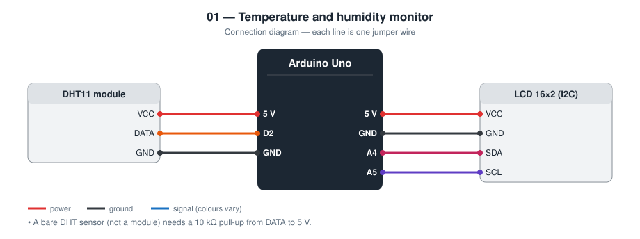
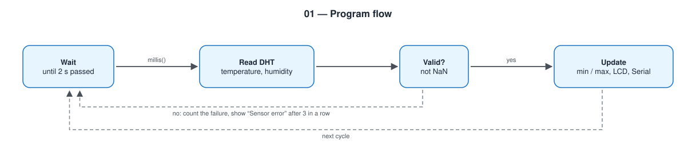

# 01 — Temperature and Humidity Monitor

An Arduino Uno reads a DHT sensor every two seconds and shows temperature,
humidity, and the lowest / highest temperature since power-on on a 16×2 LCD.

**Level 1 — basic electronics.** No network.

TODO: Add prototype photo (`images/prototype.jpg`)

## Contents

1. [At a glance](#at-a-glance)
2. [Why I built it](#why-i-built-it)
3. [Problem and context](#problem-and-context)
4. [Objectives and success criteria](#objectives-and-success-criteria)
5. [What it does](#what-it-does)
6. [Background: how it works physically](#background-how-it-works-physically)
7. [Parts](#parts)
8. [Wiring](#wiring)
9. [Build steps](#build-steps)
10. [How it works](#how-it-works)
11. [Build and upload](#build-and-upload)
12. [Code walkthrough](#code-walkthrough)
13. [Engineering notes](#engineering-notes)
14. [Test checklist](#test-checklist)
15. [Results and discussion](#results-and-discussion)
16. [Troubleshooting](#troubleshooting)
17. [Challenges log](#challenges-log)
18. [Demo script (about one minute)](#demo-script-about-one-minute)
19. [What I learned](#what-i-learned)
20. [Limitations](#limitations)
21. [Future improvements](#future-improvements)
22. [Connection to further study](#connection-to-further-study)
23. [References](#references)

## At a glance

|  |  |
| --- | --- |
| **Board** | Arduino Uno |
| **Input** | DHT11 temperature and humidity sensor (digital, one wire) |
| **Output** | 16×2 character LCD over I2C; CSV on Serial |
| **Network** | None |
| **Key ideas** | Non-blocking timing, I2C bus, handling invalid sensor data |
| **Firmware** | 103 lines of C++ in [`firmware/src/main.cpp`](firmware/src/main.cpp) |
| **Tests defined** | 5 (see [Test checklist](#test-checklist)) |
| **Hardware status** | TODO: built on (date) / tested on (date) |

## Why I built it

This is the first project in the portfolio. I wanted the smallest complete
measurement system: one sensor, one display, and code I can explain line by
line.

## Problem and context

Temperature and humidity decide whether a room is comfortable, whether food
or medicine is stored safely, and whether mould will grow. A household
thermometer shows one number at one moment. It does not show the range over
a day, and it cannot pass its reading to another device.

This project is the smallest instrument that fixes the first problem: it
keeps the lowest and highest temperature since it was switched on. It is
also the base that later projects extend to solve the second problem
(project 06 puts the reading on a web page, project 13 stores it in the
cloud).

## Objectives and success criteria

Each objective has a test I can pass or fail, so “it works” is not an opinion.

| # | Objective | How I will know it is met |
| --- | --- | --- |
| 1 | Show temperature and humidity on the LCD | Values appear within 4 s of power-on and refresh every 2 s |
| 2 | Track minimum and maximum temperature | Warming the sensor by hand raises only the *Hi* value; *Lo* stays |
| 3 | Never show invalid data as valid | With the data wire removed the LCD shows `Sensor error` within about 6 s |
| 4 | Recover without a reset | Reconnecting the wire brings the values back |
| 5 | Provide data for graphing | The Serial Plotter draws two lines from the CSV output |

## What it does

- Reads temperature and humidity from a DHT11 (or DHT22)
- Shows the current values and the min / max temperature on the LCD
- Prints CSV on Serial so the Arduino Serial Plotter draws a live graph
- Shows `Sensor error` after three failed reads in a row instead of freezing
  or displaying an old number as if it were current

## Background: how it works physically

**The sensor.** A DHT11 contains two sensing elements and a small chip.
Humidity is measured with a polymer film between two electrodes: the film
absorbs water vapour, which changes the capacitance (or, in some versions,
the resistance) between them. Temperature is measured with an NTC
thermistor, a resistor whose resistance falls as it gets warmer. The chip
converts both into numbers.

**The protocol.** The sensor uses a single data wire. The Arduino pulls the
wire low to request a reading; the sensor answers with 40 bits (16 for
humidity, 16 for temperature, 8 for a checksum). A “0” and a “1” are told
apart by how long the wire stays high. Because this timing is tight, the
library disables interrupts while it reads, and a read sometimes fails.
That is why the program must check every result.

**The display.** A character LCD normally needs at least six wires. The
I2C backpack on the back of the module is a port expander: it receives
bytes over two wires (SDA for data, SCL for clock) and sets the LCD's pins
itself. Every I2C device has an address; this one is usually `0x27`.

## Parts

| Qty | Part | Notes |
| --- | ---- | ----- |
| 1 | Arduino Uno | |
| 1 | DHT11 module | DHT22 also works: change `DHT_TYPE` in `main.cpp` |
| 1 | LCD 16×2 with I2C backpack | Address `0x27` (some are `0x3F`) |
| — | Breadboard, jumper wires | |

## Wiring



| Module pin | Arduino Uno |
| ---------- | ----------- |
| DHT VCC | 5 V |
| DHT DATA | **D2** (add a 10 kΩ pull-up to 5 V if you use a bare sensor, not a module) |
| DHT GND | GND |
| LCD VCC | 5 V |
| LCD GND | GND |
| LCD SDA | **A4** |
| LCD SCL | **A5** |

## Build steps

1. Place the DHT11 module and the LCD on the bench with the Uno unpowered.
2. Connect power and ground first: both modules to 5 V and GND.
3. Connect DHT DATA to D2, LCD SDA to A4, LCD SCL to A5.
4. Compare every wire with the wiring diagram before plugging in USB.
5. Upload the firmware and open the Serial monitor at 9600 baud.
6. If the LCD is lit but blank, turn the blue contrast potentiometer on the backpack.
7. If it is still blank, change `LCD_ADDRESS` to `0x3F` and upload again.
8. Run the test checklist and write down each result.

## How it works



`loop()` never calls `delay()`. It compares `millis()` with the time of the
last read and returns early until two seconds have passed. The DHT library
returns `NaN` when a read fails; the code counts consecutive failures and
only then replaces the screen with an error message, because a single
failed read is normal for this sensor.

## Build and upload

```bash
cd firmware
pio run --target upload
pio device monitor
```

Arduino IDE: copy `firmware/src/main.cpp` into a sketch and install
*DHT sensor library* (Adafruit) and *LiquidCrystal I2C*.

## Code walkthrough

The excerpts below are copied from [`firmware/src/main.cpp`](firmware/src/main.cpp).

### `trackMinMax()`

`NAN` (“not a number”) marks “no value yet”. The first valid reading
replaces it, so the minimum does not start at a fake 0 °C.

```cpp
static void trackMinMax(float temperature) {
  if (isnan(minTemperature) || temperature < minTemperature) {
    minTemperature = temperature;
  }
  if (isnan(maxTemperature) || temperature > maxTemperature) {
    maxTemperature = temperature;
  }
}
```

### `loop()`

The first four lines are the non-blocking timer: the function returns
immediately until two seconds have passed. After reading, the result is
checked with `isnan()`. One bad read is tolerated silently; three in a row
switch the display to an error message. A good read resets the counter.

```cpp
void loop() {
  const unsigned long now = millis();
  if (now - lastReadMs < READ_INTERVAL_MS) {
    return;
  }
  lastReadMs = now;

  const float temperature = dht.readTemperature();
  const float humidity = dht.readHumidity();

  if (isnan(temperature) || isnan(humidity)) {
    // One bad read is normal for a DHT; only report after several in a row.
    if (failedReads < MAX_FAILED_READS) {
      failedReads++;
    }
    if (failedReads >= MAX_FAILED_READS) {
      showSensorError();
      Serial.println("# DHT read failed");
    }
    return;
  }

  failedReads = 0;
  trackMinMax(temperature);
  showReading(temperature, humidity);

  Serial.print(temperature, 1);
  Serial.print(",");
  Serial.println(humidity, 0);
}
```

## Engineering notes

### Design decisions

| Decision | Alternative I considered | Why I chose this |
| -------- | ------------------------ | ---------------- |
| LCD with I2C backpack | Parallel LCD wiring | 2 signal wires instead of 6, leaving pins free for later projects |
| Read every 2 s | Read as fast as possible | The DHT11 needs at least 1 s between reads and the DHT22 needs 2 s; 2 s is safe for both |
| Error after 3 failed reads | Error on the first failure | A single failed read is normal for this sensor; three in a row (6 s) means a real fault |
| `millis()` timing | `delay(2000)` | The loop stays free, which matters as soon as a second task is added |
| CSV on Serial | Sentences like “Temp is 27” | The Arduino Serial Plotter can graph CSV directly |

### Calculations

- **Display budget.** The LCD has 16 characters per line. The longest first
  line is `T:27.4°C H:65%` = 14 characters, so it always fits. I pad each
  line with spaces instead of calling `lcd.clear()`, which avoids flicker.
- **Sensor resolution.** The DHT11 reports whole degrees on older versions
  and 0.1 °C steps on newer ones, with ±2 °C accuracy. Showing one decimal
  does not make the reading more accurate; I keep it so that the same code
  is correct for a DHT22 (±0.5 °C).
- **Pull-up.** The DHT data line is open-drain. A 10 kΩ pull-up to 5 V
  limits the current to 5 V / 10 kΩ = 0.5 mA when the line is pulled low.
- **Memory (measured by the compiler).** 7 972 bytes of flash (24.7 % of
  the Uno) and 615 bytes of RAM (30.0 %).

### Failure modes I designed for

| What can go wrong | What the device does |
| ----------------- | -------------------- |
| Loose DATA wire | `Sensor error / Check DHT wiring` after 6 s; recovers by itself when reconnected |
| One corrupted read | Ignored; the last good value stays on screen for 2 more seconds |
| `millis()` overflow after 49.7 days | No effect: unsigned subtraction `now - lastReadMs` stays correct across the overflow |
| Wrong LCD address | Blank screen, but Serial still prints values, which tells me the sensor side works |

## Test checklist

Fill this in on the real hardware. Until then every row is TODO.

| # | Test | Expected | Result |
| - | ---- | -------- | ------ |
| 1 | Power on | LCD shows values within 4 s | TODO |
| 2 | Breathe on the sensor | Humidity rises, then falls back | TODO |
| 3 | Unplug DHT DATA wire | `Sensor error` after about 6 s | TODO |
| 4 | Reconnect DATA wire | Values return without a reset | TODO |
| 5 | Serial Plotter at 9600 baud | Two lines: temperature and humidity | TODO |

## Results and discussion

**Not yet filled from hardware.** I complete this section only with what I observed on the real circuit.

| Item | Result |
| --- | --- |
| Date tested | TODO |
| Tests passed | TODO: __ of 5 |
| Tests failed at first, then fixed | TODO |
| Room temperature and humidity shown (compare with another thermometer if available) | TODO |
| Lowest / highest temperature over a 24-hour run | TODO |

Questions I answer here after testing:

- How far is my reading from a reference thermometer, and is that inside the DHT11's ±2 °C?
- How often does a single read fail? (Count the `# DHT read failed` lines over one hour.)
- How long does the sensor take to settle after I breathe on it?

TODO: Add one photo or screenshot that shows the main result.

## Troubleshooting

Common faults for this parts list and how to find them. These are checks to run, not a record of problems I had; my own are in the next section.

| Symptom | Likely cause | What to check or change |
| --- | --- | --- |
| LCD backlight on, no text | Contrast not set | Turn the potentiometer on the I2C backpack |
| LCD shows nothing at all | Wrong I2C address or SDA / SCL swapped | Try `0x3F`; check A4 = SDA, A5 = SCL |
| `Sensor error` permanently | DATA on the wrong pin, or wrong `DHT_TYPE` | Check D2; set `DHT22` if the sensor is white |
| Values freeze for a few seconds sometimes | Occasional failed reads | Normal; shorten the wires if it is frequent |
| Temperature reads several degrees high | Sensor next to a warm component | Move it away from the Uno's regulator |
| Upload fails | Wrong port or board selected | Select *Arduino Uno* and the correct serial port |

## Challenges log

A lab-notebook record of real problems from my own build. Empty until they happen.

| Date | What I saw | What I tried | Real cause | Fix | What I learned |
| --- | --- | --- | --- | --- | --- |
| TODO |  |  |  |  |  |
| TODO |  |  |  |  |  |

## Demo script (about one minute)

1. Power on and point at the two lines: live values above, min / max below.
2. Breathe on the sensor: humidity climbs within a few seconds.
3. Open the Serial Plotter and show the same change as a graph.
4. Pull the DATA wire: after 6 s the screen says `Sensor error`. Push it
   back: the values return without a reset.
5. One sentence to finish: “The important part is step 4. The display never
   shows an old number as if it were current.”

## What I learned

- A sensor has a maximum read rate; reading faster returns errors, not data
- `millis()` timing keeps the program responsive
- I2C lets two wires carry a whole display
- A measurement system should say when it does not know the value

## Limitations

- DHT11 accuracy is about ±2 °C and ±5 % RH; it is not a calibrated instrument
- Min / max are lost when the power is removed
- Readings are only visible on the LCD and on a USB cable

## Future improvements

Project [06 — Online Weather Station](../06-online-weather-station/) puts
the same sensor on an ESP32 and serves the readings as a web page.

Further ideas, in the order I would attempt them:

| Improvement | What it needs | Difficulty |
| --- | --- | --- |
| Reset button for min / max | One push button and debounce (see project 03) | Low |
| Heat index (“feels like”) | `dht.computeHeatIndex()` and a third screen | Low |
| Keep min / max through a power cut | EEPROM storage | Medium |
| Log to an SD card with time | SD module and RTC module | Medium |

## Connection to further study

| Idea used in this project | Where it continues at university |
| --- | --- |
| Sensors that turn a physical quantity into an electrical one | Measurement and instrumentation; physics of materials |
| Serial protocols (one-wire timing, I2C) | Digital systems; computer architecture |
| Validating data before using it | Software engineering; reliable systems |
| Timing with a free-running counter | Embedded and real-time systems |

## References

- DHT11 and DHT22 (AM2302) datasheets, Aosong Electronics
- Adafruit DHT sensor library (source and examples)
- LiquidCrystal_I2C library; HD44780 LCD controller datasheet
- Arduino language reference — https://docs.arduino.cc/language-reference/
- PlatformIO documentation — https://docs.platformio.org/
- TODO: list the tutorials, videos, courses, and people that actually helped me with this project
