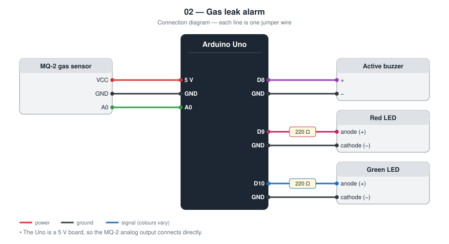
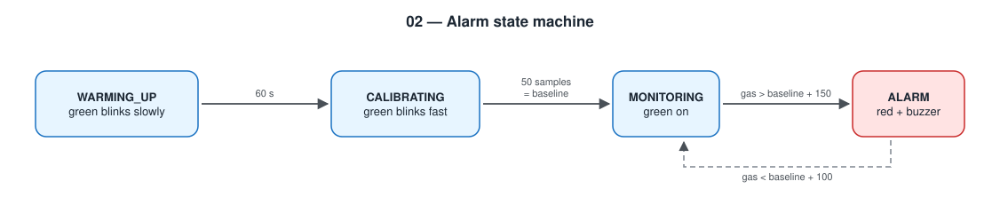

# 02 — Gas Leak Alarm

An Arduino Uno watches an MQ-2 gas sensor and sounds a buzzer when the
reading rises clearly above the clean-air level.

**Level 1 — basic electronics.** No network.

This is a classroom model. It is **not** a certified gas detector and must
not be relied on for safety at home.

TODO: Add prototype photo (`images/prototype.jpg`)

## Contents

1. [At a glance](#at-a-glance)
2. [Why I built it](#why-i-built-it)
3. [Problem and context](#problem-and-context)
4. [Objectives and success criteria](#objectives-and-success-criteria)
5. [What it does](#what-it-does)
6. [Background: how it works physically](#background-how-it-works-physically)
7. [Parts](#parts)
8. [Wiring](#wiring)
9. [Build steps](#build-steps)
10. [How it works](#how-it-works)
11. [Build and upload](#build-and-upload)
12. [Code walkthrough](#code-walkthrough)
13. [Engineering notes](#engineering-notes)
14. [Test checklist](#test-checklist)
15. [Results and discussion](#results-and-discussion)
16. [Troubleshooting](#troubleshooting)
17. [Challenges log](#challenges-log)
18. [Demo script (about one minute)](#demo-script-about-one-minute)
19. [What I learned](#what-i-learned)
20. [Limitations](#limitations)
21. [Future improvements](#future-improvements)
22. [Connection to further study](#connection-to-further-study)
23. [References](#references)

## At a glance

|  |  |
| --- | --- |
| **Board** | Arduino Uno |
| **Input** | MQ-2 gas sensor (analog) |
| **Outputs** | Active buzzer, red LED, green LED |
| **Network** | None |
| **Key ideas** | Warm-up, baseline calibration, moving average, hysteresis, state machine |
| **Firmware** | 125 lines of C++ in [`firmware/src/main.cpp`](firmware/src/main.cpp) |
| **Tests defined** | 5 (see [Test checklist](#test-checklist)) |
| **Hardware status** | TODO: built on (date) / tested on (date) |

## Why I built it

The MQ-2 is the first sensor I used whose output does not mean anything by
itself: the number depends on the heater, the room, and the individual
part. I wanted to learn how to turn a drifting analog value into a reliable
yes / no decision.

## Problem and context

Many homes cook with bottled LPG. A loose hose or a burner left open
without a flame releases gas that is heavier than air, collects near the
floor, and can ignite from a spark. People often notice by smell, but not
when they are asleep, in another room, or have a poor sense of smell.

A detector has to do one thing well: make a loud, unmistakable signal when
the gas concentration rises above normal, and not cry wolf when it does
not. This project is a model of that function. It teaches the hard part,
which is not reading the sensor but deciding reliably from a signal that
drifts and is different on every unit.

## Objectives and success criteria

Each objective has a test I can pass or fail, so “it works” is not an opinion.

| # | Objective | How I will know it is met |
| --- | --- | --- |
| 1 | Do not arm before the sensor is ready | No alarm is possible in the first 60 s; the LED shows the warm-up |
| 2 | Adapt to this sensor and this room | A baseline value is measured and printed after warm-up |
| 3 | Alarm on a clear rise in gas | Brief gas from an unlit lighter triggers red LED and buzzer within a few seconds |
| 4 | No chattering at the threshold | The buzzer starts once and stops once per event |
| 5 | Recover by itself | The alarm ends when the reading falls below the lower threshold |

## What it does

- Waits 60 s for the MQ-2 heater to warm up (green LED blinks slowly)
- Measures the clean-air baseline (green LED blinks fast)
- Alarm (red LED + beeping buzzer) when the reading is 150 counts above baseline
- Alarm stops only when the reading falls below baseline + 100
- Prints the reading and both thresholds for the Serial Plotter

## Background: how it works physically

**The sensor.** The MQ-2 is a metal-oxide semiconductor sensor. Inside the
steel mesh is a small ceramic tube coated with tin dioxide (SnO₂) and a
heater coil that keeps it at a few hundred degrees Celsius. In clean air,
oxygen molecules stick to the hot surface and trap electrons, so the layer
conducts poorly. A combustible gas (LPG, propane, hydrogen, smoke, alcohol
vapour) reacts with that oxygen and releases the electrons, so the
resistance **falls** as the gas concentration rises.

**From resistance to voltage.** The module puts the sensor in series with
a fixed load resistor, forming a voltage divider. Lower sensor resistance
means a higher voltage on the `A0` pin. The Arduino's ADC turns 0–5 V into
0–1023.

**Why the value is only relative.** The resistance also depends on
temperature, humidity, the age of the sensor, and manufacturing spread,
and the sensor needs a warm-up (minutes for a quick test, a day or more
for stable readings according to the datasheet). Turning the reading into
ppm requires calibration against a known gas concentration, which a school
lab does not have. So this project never claims ppm: it compares the
reading with the same sensor's own clean-air level.

## Parts

| Qty | Part | Notes |
| --- | ---- | ----- |
| 1 | Arduino Uno | |
| 1 | MQ-2 gas sensor module | Uses the analog output A0 |
| 1 | Active buzzer | On / off type |
| 2 | LED (red, green) + 220 Ω resistors | |

## Wiring



| Module pin | Arduino Uno |
| ---------- | ----------- |
| MQ-2 VCC | 5 V |
| MQ-2 GND | GND |
| MQ-2 A0 | **A0** |
| Buzzer + | **D8** (− to GND) |
| Red LED anode | **D9** through 220 Ω (cathode to GND) |
| Green LED anode | **D10** through 220 Ω (cathode to GND) |

The Uno is a 5 V board, so the MQ-2 analog output can connect directly.
On the ESP32 in project 07 it needs a voltage divider.

## Build steps

1. Connect MQ-2 VCC to 5 V, GND to GND, A0 to A0.
2. Connect the buzzer: + to D8, − to GND.
3. Connect each LED through its own 220 Ω resistor: red to D9, green to D10, cathodes to GND.
4. Check the LED direction: the longer leg (anode) goes toward the resistor and the pin.
5. Upload, open the Serial monitor at 9600 baud, and wait for the baseline line.
6. Leave the sensor powered for several minutes before judging the baseline.
7. Run the test checklist in a ventilated room with an adult present.

## How it works



The program is a four-state machine:

```
WARMING_UP ──60 s──▶ CALIBRATING ──50 samples──▶ MONITORING ◀──▶ ALARM
```

Three ideas make the decision stable:

1. **Smoothing** — an exponential moving average removes single noisy samples.
2. **Baseline** — the threshold is relative to this sensor in this room,
   not a number copied from a tutorial.
3. **Hysteresis** — the alarm turns on at +150 and off at +100, so a reading
   that hovers near the limit cannot make the buzzer chatter.

## Build and upload

```bash
cd firmware
pio run --target upload
pio device monitor
```

No extra libraries are needed.

## Code walkthrough

The excerpts below are copied from [`firmware/src/main.cpp`](firmware/src/main.cpp).

### Smoothing

One line replaces an array of past samples. Each new sample moves the
stored value 10 % of the way toward itself, so a single spike changes the
result very little.

```cpp
// Exponential moving average: 90 % old value, 10 % new sample.
smoothed = 0.9f * smoothed + 0.1f * analogRead(PIN_GAS);
```

### `MONITORING` state

The alarm starts only when the smoothed value is above
`baseline + ALARM_MARGIN`.

```cpp
case MONITORING:
  setOutputs(false, true, false);
  if (smoothed > baseline + ALARM_MARGIN) {
    state = ALARM;
    Serial.println("# ALARM: gas above threshold");
  }
  report(now);
  break;
```

### `ALARM` state

The buzzer is toggled by a timer, not by `delay()`, so the gas level is
still being checked while it beeps. The alarm ends at the *lower* margin,
`CLEAR_MARGIN`; the gap between the two margins is the hysteresis.

```cpp
case ALARM:
  if (now - lastBeepMs >= BEEP_INTERVAL_MS) {
    lastBeepMs = now;
    beepOn = !beepOn;
  }
  setOutputs(true, false, beepOn);
  if (smoothed < baseline + CLEAR_MARGIN) {
    state = MONITORING;
    beepOn = false;
    Serial.println("# Cleared");
  }
  report(now);
  break;
```

## Engineering notes

### Design decisions

| Decision | Alternative I considered | Why I chose this |
| -------- | ------------------------ | ---------------- |
| Threshold relative to a measured baseline | Fixed number such as `> 400` | MQ-2 modules differ from each other and drift with temperature and humidity |
| Two thresholds (hysteresis) | One threshold | With one threshold the buzzer chatters when the reading hovers at the limit |
| Exponential moving average | Average of N stored samples | Same smoothing effect with one variable instead of an array |
| Analog output A0 | Digital output D0 with the on-board potentiometer | The analog value lets me see and plot what the sensor is doing |
| Explicit state machine | Nested `if` statements | Each state has one clear job, and adding a state later is safe |

### Calculations

- **ADC resolution.** The Uno's ADC has 10 bits over 5 V: 5 V / 1024 =
  4.88 mV per count. The alarm margin of 150 counts is 0.73 V above clean
  air; the clear margin of 100 counts is 0.49 V. The 50-count gap (0.24 V)
  is the hysteresis band.
- **Filter time constant.** Each sample is `0.9 × old + 0.1 × new` every
  100 ms. The time constant is τ = −Δt / ln(1 − α) = −0.1 / ln(0.9) ≈
  0.95 s. A sudden change is 63 % visible after about 1 s and 95 % visible
  after about 3 s. That delay is the price of ignoring single noisy samples.
- **Baseline.** 50 samples × 100 ms = 5 s of averaging after the warm-up.
- **Power.** The MQ-2 heater is about 33 Ω, so it draws 5 V / 33 Ω ≈ 150 mA
  (0.75 W) continuously. That is fine for USB (500 mA) but it is why the
  sensor feels warm and why this design is not suitable for a small battery.
- **LED current.** (5 V − 2.0 V) / 220 Ω ≈ 13.6 mA for the red LED, below
  the 20 mA I allow per Uno pin.
- **Memory (measured by the compiler).** 4 184 bytes of flash (13.0 %) and
  319 bytes of RAM (15.6 %).

### Failure modes I designed for

| What can go wrong | What the device does |
| ----------------- | -------------------- |
| Reading taken before the heater is warm | Not used: the alarm is not armed for the first 60 s, and the LED shows it |
| One noisy ADC sample | Smoothed away by the moving average |
| Reading sits exactly at the threshold | Hysteresis keeps the last state |
| Sensor unplugged (pin floats) | **Not handled**: a floating pin can read anything. Listed under Limitations |
| Gas present during calibration | **Not handled**: the baseline would be too high. Listed under Limitations |

## Test checklist

Test with the gas from an **unlit** lighter held near the sensor for a
second, in a ventilated room, with an adult or teacher present.

| # | Test | Expected | Result |
| - | ---- | -------- | ------ |
| 1 | Power on | Slow green blink for 60 s, then fast, then solid | TODO |
| 2 | Note the baseline printed on Serial | A stable number | TODO |
| 3 | Brief gas near the sensor | Red LED + beeping within a few seconds | TODO |
| 4 | Remove the gas | Alarm stops by itself after the reading falls | TODO |
| 5 | Serial Plotter | Reading crosses the upper line, alarm ends below the lower line | TODO |

## Results and discussion

**Not yet filled from hardware.** I complete this section only with what I observed on the real circuit.

| Item | Result |
| --- | --- |
| Date tested | TODO |
| Tests passed | TODO: __ of 5 |
| Tests failed at first, then fixed | TODO |
| Baseline (ADC counts) after 60 s warm-up | TODO |
| Baseline after 10 minutes powered | TODO |
| Peak reading during the gas test | TODO |
| Seconds from gas release to alarm | TODO |
| Seconds from removing gas to alarm stop | TODO |

Questions I answer here after testing:

- How much did the baseline drift between 1 minute and 10 minutes? Is 60 s of warm-up enough?
- Were the margins (150 / 100) well chosen for my sensor, or should they change?
- Did anything other than gas trigger it (perfume, cooking, alcohol hand gel)?

TODO: Add one photo or screenshot that shows the main result.

## Troubleshooting

Common faults for this parts list and how to find them. These are checks to run, not a record of problems I had; my own are in the next section.

| Symptom | Likely cause | What to check or change |
| --- | --- | --- |
| Alarm straight after calibration | Sensor still warming; baseline measured too early | Increase `WARMUP_MS`; keep it powered longer |
| Never alarms | Margin too large, or A0 not connected | Watch the Serial Plotter during a test; lower `ALARM_MARGIN` |
| Reading stuck at 0 or 1023 | A0 wire loose or wrong pin | Check the A0 connection and the module's power LED |
| Buzzer very quiet or silent | Passive buzzer used, or wired backwards | Use an *active* buzzer; + to D8 |
| Uno resets or USB disconnects | Heater current (about 150 mA) too much for a weak port | Use a powered hub or a 5 V adapter |
| LED does not light | Reversed, or no resistor path | Flip the LED; check the 220 Ω resistor |

## Challenges log

A lab-notebook record of real problems from my own build. Empty until they happen.

| Date | What I saw | What I tried | Real cause | Fix | What I learned |
| --- | --- | --- | --- | --- | --- |
| TODO |  |  |  |  |  |
| TODO |  |  |  |  |  |

## Demo script (about one minute)

1. Power on and explain the slow green blink: “It is warming up and it
   tells you so. An alarm that looks ready but is not is dangerous.”
2. After calibration, read the baseline from Serial.
3. Open the Serial Plotter: three lines (reading, alarm-on, alarm-off).
4. Brief gas from an unlit lighter: the reading crosses the upper line and
   the alarm starts.
5. Take the gas away: the alarm continues until the reading is below the
   *lower* line. Point at the gap: “That gap is hysteresis.”

## What I learned

- Some sensors need warm-up time before their data means anything
- Calibrating against a baseline is more honest than a fixed magic number
- Hysteresis is the standard fix for an output that flickers at a threshold
- A state machine makes “what is the device doing right now?” easy to answer

## Limitations

- The MQ-2 reacts to LPG, smoke, alcohol vapour, and more; it cannot tell them apart
- Values are raw ADC counts, not ppm
- If gas is already present during calibration, the baseline will be wrong
- The alarm is only local: nobody outside the room knows

## Future improvements

Project [07 — Internet Gas Alert](../07-internet-gas-alert/) keeps this
detection logic and adds a phone notification.

Further ideas, in the order I would attempt them:

| Improvement | What it needs | Difficulty |
| --- | --- | --- |
| Detect a disconnected sensor | Check for readings near 0; add a fault state | Low |
| Mute button with automatic re-arm | Push button and a new state (see project 03) | Low |
| Show the level on an LCD bar | LCD from project 01 | Medium |
| Add a carbon monoxide sensor (MQ-7) | Second analog channel and its heater cycle | Medium |
| Close a gas valve automatically | Solenoid valve, relay, separate supply; adult supervision | High |

## Connection to further study

| Idea used in this project | Where it continues at university |
| --- | --- |
| Semiconductor gas sensing | Materials science; solid-state physics; chemistry of surfaces |
| Filtering a noisy signal | Signals and systems; digital signal processing |
| Hysteresis in a comparator | Analog electronics (Schmitt trigger); control engineering |
| Finite state machines | Digital logic; theory of computation; embedded software |

## References

- MQ-2 gas sensor datasheet (Hanwei / Winsen)
- Background reading on exponential moving averages and Schmitt-trigger hysteresis
- Arduino language reference — https://docs.arduino.cc/language-reference/
- PlatformIO documentation — https://docs.platformio.org/
- TODO: list the tutorials, videos, courses, and people that actually helped me with this project
