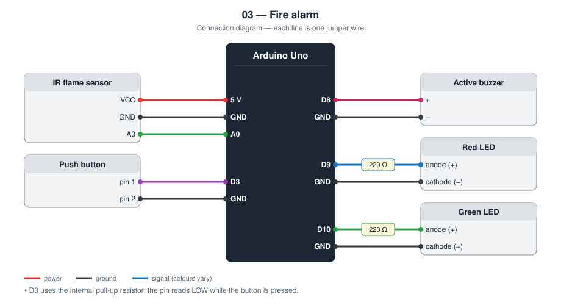
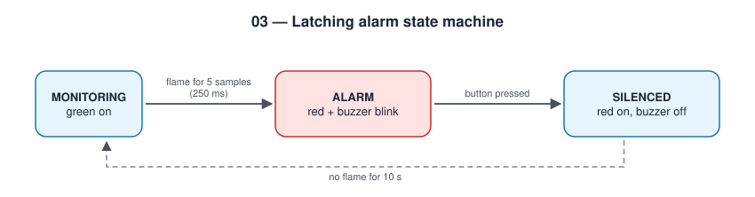

# 03 — Fire Alarm

An Arduino Uno with an infrared flame sensor, a latching alarm, and a
silence button.

**Level 1 — basic electronics.** No network.

This is a classroom model. It is **not** a certified fire alarm.

TODO: Add prototype photo (`images/prototype.jpg`)

## Contents

1. [At a glance](#at-a-glance)
2. [Why I built it](#why-i-built-it)
3. [Problem and context](#problem-and-context)
4. [Objectives and success criteria](#objectives-and-success-criteria)
5. [What it does](#what-it-does)
6. [Background: how it works physically](#background-how-it-works-physically)
7. [Parts](#parts)
8. [Wiring](#wiring)
9. [Build steps](#build-steps)
10. [How it works](#how-it-works)
11. [Build and upload](#build-and-upload)
12. [Code walkthrough](#code-walkthrough)
13. [Engineering notes](#engineering-notes)
14. [Test checklist](#test-checklist)
15. [Results and discussion](#results-and-discussion)
16. [Troubleshooting](#troubleshooting)
17. [Challenges log](#challenges-log)
18. [Demo script (about one minute)](#demo-script-about-one-minute)
19. [What I learned](#what-i-learned)
20. [Limitations](#limitations)
21. [Future improvements](#future-improvements)
22. [Connection to further study](#connection-to-further-study)
23. [References](#references)

## At a glance

|  |  |
| --- | --- |
| **Board** | Arduino Uno |
| **Inputs** | IR flame sensor (analog), push button |
| **Outputs** | Active buzzer, red LED, green LED |
| **Network** | None |
| **Key ideas** | Latching alarm, state machine, debouncing, confirmation by consecutive samples |
| **Firmware** | 129 lines of C++ in [`firmware/src/main.cpp`](firmware/src/main.cpp) |
| **Tests defined** | 6 (see [Test checklist](#test-checklist)) |
| **Hardware status** | TODO: built on (date) / tested on (date) |

## Why I built it

In the gas alarm (project 02) the buzzer stops as soon as the reading is
normal again. A real fire panel does not behave like that: it keeps
sounding until a person acknowledges it. I wanted to build that behaviour
and to handle a push button properly.

## Problem and context

A fire grows quickly, and the first minutes decide the outcome. An alarm
has two jobs that pull in opposite directions: react fast to a real flame,
and not react to sunlight, a lamp, or a camera flash. It also has to behave
correctly *after* detection. If the flame moves out of the sensor's view,
an alarm that simply follows the sensor would go quiet while the fire is
still burning.

This project models the behaviour of an alarm panel: confirm before
sounding, keep sounding until a person acknowledges, and keep a visible
reminder after the buzzer is silenced.

## Objectives and success criteria

Each objective has a test I can pass or fail, so “it works” is not an opinion.

| # | Objective | How I will know it is met |
| --- | --- | --- |
| 1 | Detect a small flame | A lighter flame at 30 cm triggers the alarm |
| 2 | Reject short flashes | A camera flash does not trigger it |
| 3 | Latch the alarm | The buzzer continues after the flame is removed |
| 4 | Acknowledge with one button press | One press silences the buzzer exactly once; the red LED stays on |
| 5 | Re-arm automatically | Green LED returns 10 s after the last flame signal |

## What it does

- Confirms a flame only after five readings in a row (250 ms), so a flash of
  sunlight or a camera flash does not trigger it
- **Latches**: the alarm continues after the flame is gone
- A button silences the buzzer; the red LED stays on as a reminder
- Re-arms by itself when no flame has been seen for 10 s after silencing

## Background: how it works physically

**Flames emit infrared.** A hydrocarbon flame radiates strongly in the
infrared, especially from hot carbon dioxide and soot. The sensor on the
module is an infrared photodiode or phototransistor behind a dark filter
that blocks visible light; it is most sensitive around 760–1100 nm. More
infrared means more current through it.

**The module.** The photodiode forms a divider with a resistor, so the
analog pin `A0` gives a voltage that changes with infrared intensity (on
the common KY-026 type it falls as the flame gets closer). The module also
has a comparator with a potentiometer that produces a digital output; I
use the analog output so that I can see the signal and choose my own
threshold.

**Its weak point.** The sun, incandescent and halogen lamps, and hot
objects also emit infrared in this band. Professional flame detectors
solve this by looking for the flicker frequency of a real flame (about
1–20 Hz) or by comparing two or three wavelengths. This project uses the
simplest defence, which is time: the signal must be present for several
samples in a row.

**Button bounce.** When the metal contacts of a push button close, they
bounce for a few milliseconds and produce several fast on / off edges. A
microcontroller is fast enough to see each one as a separate press.

## Parts

| Qty | Part | Notes |
| --- | ---- | ----- |
| 1 | Arduino Uno | |
| 1 | IR flame sensor module (KY-026 type) | Uses the analog output |
| 1 | Push button | Wired to GND, no external resistor |
| 1 | Active buzzer | |
| 2 | LED (red, green) + 220 Ω resistors | |

## Wiring



| Module pin | Arduino Uno |
| ---------- | ----------- |
| Flame VCC | 5 V |
| Flame GND | GND |
| Flame A0 | **A0** |
| Button | **D3** to GND (internal pull-up) |
| Buzzer + | **D8** (− to GND) |
| Red LED anode | **D9** through 220 Ω |
| Green LED anode | **D10** through 220 Ω |

## Build steps

1. Connect the flame sensor: VCC to 5 V, GND to GND, A0 to A0.
2. Connect the push button between D3 and GND. No resistor is needed.
3. Connect the buzzer to D8 and the LEDs (through 220 Ω) to D9 and D10.
4. Upload and open the Serial Plotter. Note the value with no flame.
5. Hold a flame at 30 cm and note the new value.
6. Set `FLAME_THRESHOLD` halfway between the two values and upload again.
7. Run the test checklist on a non-flammable surface with an adult present.

## How it works



```
MONITORING ──flame confirmed──▶ ALARM ──button──▶ SILENCED ──10 s clear──▶ MONITORING
```

- The analog value **falls** when the sensor sees a flame. `FLAME_THRESHOLD`
  in `main.cpp` must be tuned to the real module (watch the Serial Plotter).
- The button is debounced in software: a change only counts after the pin
  has been stable for 40 ms, and one press produces exactly one event.

## Build and upload

```bash
cd firmware
pio run --target upload
pio device monitor
```

## Code walkthrough

The excerpts below are copied from [`firmware/src/main.cpp`](firmware/src/main.cpp).

### `buttonPressed()`

Two variables are needed: the last raw reading (to notice a change and
restart the timer) and the last *stable* state (to detect the edge). The
function returns `true` only at the moment the stable state becomes LOW, so
holding the button gives one event, not many.

```cpp
static bool buttonPressed(unsigned long now) {
  const bool reading = digitalRead(PIN_BUTTON);
  if (reading != buttonLastRead) {
    buttonLastRead = reading;
    buttonChangedMs = now;
  }
  if (now - buttonChangedMs > DEBOUNCE_MS && reading != buttonStable) {
    buttonStable = reading;
    return buttonStable == LOW;
  }
  return false;
}
```

### `ALARM` state

Notice what is *not* here: there is no check of the flame sensor. Once in
`ALARM`, only the button can leave it. That absence is what makes the
alarm latch.

```cpp
case ALARM: {
  const bool blink = (now / BLINK_INTERVAL_MS) % 2 == 0;
  setOutputs(blink, false, blink);
  if (pressed) {
    state = SILENCED;
    Serial.println("# Silenced by button");
  }
  break;
}
```

## Engineering notes

### Design decisions

| Decision | Alternative I considered | Why I chose this |
| -------- | ------------------------ | ---------------- |
| Latching alarm | Alarm that follows the sensor | A fire can move out of the sensor's view; the alarm must not stop by itself |
| Silence button keeps the red LED on | Button resets everything | Someone arriving later still sees that an alarm happened |
| 5 consecutive samples to confirm | Trigger on the first sample | Rejects camera flashes and reflections at the cost of 250 ms |
| Internal pull-up for the button | External resistor | One part fewer; the pin reads LOW when pressed |
| Software debounce with edge detection | `delay(200)` after a press | No blocking, and exactly one event per press |

### Calculations

- **Confirmation time.** 5 samples × 50 ms = 250 ms of continuous flame
  signal before the alarm starts.
- **Threshold.** 400 counts × 4.88 mV = 1.95 V. On this type of module the
  analog voltage falls as infrared increases, so “flame” means *below*
  1.95 V. The value must be tuned on the real module.
- **Debounce.** Contact bounce of a small push button typically lasts a few
  milliseconds. The pin must be stable for 40 ms before a change is
  accepted, which is long enough for the bounce and short enough to feel
  instant.
- **Internal pull-up.** The Uno's pull-up is 20–50 kΩ, so a pressed button
  draws at most 5 V / 20 kΩ = 0.25 mA.
- **Memory (measured by the compiler).** 2 976 bytes of flash (9.2 %) and
  285 bytes of RAM (13.9 %).

### State table

| State | Green LED | Red LED | Buzzer | Leaves when |
| ----- | --------- | ------- | ------ | ----------- |
| MONITORING | on | off | off | flame confirmed |
| ALARM | off | blinking | beeping | button pressed |
| SILENCED | off | on | off | no flame for 10 s |

### Failure modes I designed for

| What can go wrong | What the device does |
| ----------------- | -------------------- |
| Flame disappears from view | Alarm continues (latched) |
| Short flash of light | Ignored: fewer than 5 consecutive samples |
| Button bounce | One press is one event |
| Button held down | Still one event: the code reacts to the falling edge only |
| Flame still burning after silencing | Stays SILENCED with the red LED on. The buzzer does not restart, which is a limitation I would fix next |

## Test checklist

Use a lighter or a candle at 20–50 cm, on a non-flammable surface, with an
adult or teacher present.

| # | Test | Expected | Result |
| - | ---- | -------- | ------ |
| 1 | Power on | Green LED on | TODO |
| 2 | Flame in front of the sensor | Red LED and buzzer blink | TODO |
| 3 | Remove the flame | Alarm **continues** | TODO |
| 4 | Press the button | Buzzer stops, red LED solid | TODO |
| 5 | Wait 10 s without flame | Green LED returns | TODO |
| 6 | Phone flashlight / camera flash | No alarm | TODO |

## Results and discussion

**Not yet filled from hardware.** I complete this section only with what I observed on the real circuit.

| Item | Result |
| --- | --- |
| Date tested | TODO |
| Tests passed | TODO: __ of 6 |
| Tests failed at first, then fixed | TODO |
| Analog reading with no flame | TODO |
| Analog reading with a flame at 30 cm | TODO |
| Maximum distance at which a lighter flame is detected | TODO |
| Threshold chosen after tuning | TODO |

Questions I answer here after testing:

- At what angle off-centre does detection stop? (This is the sensor's field of view.)
- Does direct sunlight or a nearby lamp move the reading toward the threshold?
- Is 250 ms of confirmation a good balance between speed and false alarms here?

TODO: Add one photo or screenshot that shows the main result.

## Troubleshooting

Common faults for this parts list and how to find them. These are checks to run, not a record of problems I had; my own are in the next section.

| Symptom | Likely cause | What to check or change |
| --- | --- | --- |
| Alarm as soon as it powers on | Threshold too high for this module, or bright light on the sensor | Read the idle value on Serial; lower `FLAME_THRESHOLD` |
| Never detects the flame | Threshold too low, or sensor pointing away | Aim the black LED-shaped sensor at the flame; retune |
| Value rises (not falls) with a flame | Different module type | Change the comparison in `flameSeen()` to `>` |
| Button does nothing | Wired to the two legs that are always joined | Use diagonally opposite legs of the button |
| Button silences and re-triggers | Debounce time too short for this button | Increase `DEBOUNCE_MS` |
| False alarms near a window | Sunlight contains infrared | Shade the sensor; raise `CONFIRM_SAMPLES` |

## Challenges log

A lab-notebook record of real problems from my own build. Empty until they happen.

| Date | What I saw | What I tried | Real cause | Fix | What I learned |
| --- | --- | --- | --- | --- | --- |
| TODO |  |  |  |  |  |
| TODO |  |  |  |  |  |

## Demo script (about one minute)

1. Green LED on: “Monitoring.”
2. Flash a phone camera at the sensor: nothing happens. “It needs 250 ms
   of continuous signal.”
3. Show a flame: red LED and buzzer.
4. Remove the flame: the alarm **keeps going**. “That is the difference
   from my gas alarm. This one latches.”
5. Press the button: silent, but the red LED stays. Wait 10 s: green again.

## What I learned

- A latching alarm and a threshold alarm are different designs with
  different purposes
- Mechanical buttons bounce; debouncing is necessary, not optional
- Requiring several consecutive samples trades a little delay for far fewer
  false alarms

## Limitations

- The sensor only sees infrared in a narrow cone in front of it
- Sunlight and hot lamps also emit infrared and can still cause false alarms
- There is no smoke or heat detection in this version
- After silencing, a flame that is still burning does not sound the buzzer again

## Future improvements

Project [08 — Real-Time Fire Alert](../08-realtime-fire-alert/) adds a
temperature check and pushes the alarm to a browser over MQTT.

Further ideas, in the order I would attempt them:

| Improvement | What it needs | Difficulty |
| --- | --- | --- |
| Re-sound if the flame is still present after silencing | A timer in the `SILENCED` state | Low |
| Add a temperature sensor as a second sign | DHT or thermistor (done in project 08) | Medium |
| Flicker detection to reject steady lamps | Sample faster and measure variation over time | High |
| Smoke detection | MQ-2 or an optical smoke sensor | Medium |

## Connection to further study

| Idea used in this project | Where it continues at university |
| --- | --- |
| Infrared emission from flames | Thermal physics; optics; spectroscopy |
| Photodiodes and comparators | Analog electronics; optoelectronics |
| Latching behaviour and state machines | Digital logic (latches, flip-flops); safety-critical systems |
| Debouncing | Embedded systems; human–machine interfaces |

## References

- KY-026 flame sensor module documentation; datasheet of the YG1006 phototransistor
- ATmega328P datasheet (internal pull-up resistor values)
- Arduino language reference — https://docs.arduino.cc/language-reference/
- PlatformIO documentation — https://docs.platformio.org/
- TODO: list the tutorials, videos, courses, and people that actually helped me with this project
