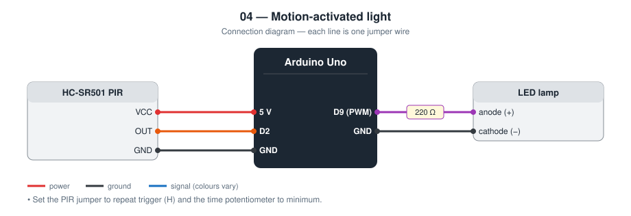
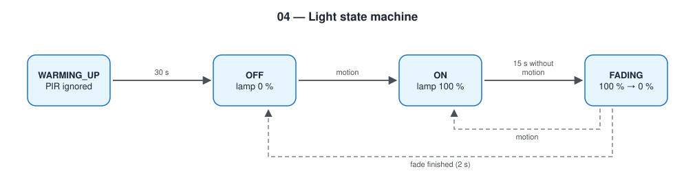

# 04 — Motion-Activated Light

A PIR sensor switches an LED lamp on when someone moves, keeps it on for a
hold time, and fades it out afterwards.

**Level 1 — basic electronics.** No network.

TODO: Add prototype photo (`images/prototype.jpg`)

## Contents

1. [At a glance](#at-a-glance)
2. [Why I built it](#why-i-built-it)
3. [Problem and context](#problem-and-context)
4. [Objectives and success criteria](#objectives-and-success-criteria)
5. [What it does](#what-it-does)
6. [Background: how it works physically](#background-how-it-works-physically)
7. [Parts](#parts)
8. [Wiring](#wiring)
9. [Build steps](#build-steps)
10. [How it works](#how-it-works)
11. [Build and upload](#build-and-upload)
12. [Code walkthrough](#code-walkthrough)
13. [Engineering notes](#engineering-notes)
14. [Test checklist](#test-checklist)
15. [Results and discussion](#results-and-discussion)
16. [Troubleshooting](#troubleshooting)
17. [Challenges log](#challenges-log)
18. [Demo script (about one minute)](#demo-script-about-one-minute)
19. [What I learned](#what-i-learned)
20. [Limitations](#limitations)
21. [Future improvements](#future-improvements)
22. [Connection to further study](#connection-to-further-study)
23. [References](#references)

## At a glance

|  |  |
| --- | --- |
| **Board** | Arduino Uno |
| **Input** | HC-SR501 passive infrared (PIR) motion sensor |
| **Output** | LED lamp on a PWM pin |
| **Network** | None |
| **Key ideas** | Timers with `millis()`, PWM dimming, state machine |
| **Firmware** | 89 lines of C++ in [`firmware/src/main.cpp`](firmware/src/main.cpp) |
| **Tests defined** | 5 (see [Test checklist](#test-checklist)) |
| **Hardware status** | TODO: built on (date) / tested on (date) |

## Why I built it

Corridor and staircase lights that switch themselves off save energy
without anyone having to remember. I wanted to build the timing logic
behind that, and to do it without `delay()` so the sensor is never ignored.

## Problem and context

Lights in corridors, stairwells, bathrooms, and store rooms are often left
on for hours with nobody there. Asking people to remember does not work
reliably. A light that switches itself on when someone arrives and off
when they leave removes the need to remember, and it helps anyone whose
hands are full or who cannot easily reach a switch.

The engineering question is the timing: stay on long enough that people
are not left in the dark, switch off soon enough to save energy, and give
a warning before going dark.

## Objectives and success criteria

Each objective has a test I can pass or fail, so “it works” is not an opinion.

| # | Objective | How I will know it is met |
| --- | --- | --- |
| 1 | Ignore the sensor while it settles | No reaction for 30 s after power-on |
| 2 | Switch on with movement | LED at full brightness within 1 s of a hand wave |
| 3 | Hold while there is activity | LED never switches off during one minute of continuous movement |
| 4 | Switch off after inactivity | Fade starts 15 s (±1 s) after the last movement |
| 5 | Warn before dark, and recover | 2 s fade; movement during the fade returns to full brightness |

## What it does

- Ignores the PIR for the first 30 s (it gives false triggers while settling)
- Motion → lamp on at full brightness
- Every new movement restarts a 15 s hold timer
- After the hold time the lamp fades out over 2 s
- Movement during the fade brings the lamp straight back on

## Background: how it works physically

**Passive infrared.** Every warm object emits infrared radiation; a person
at about 37 °C emits most strongly around 9–10 µm. The sensor is “passive”
because it only receives. Inside the metal can are two pyroelectric
elements, crystals that produce a small charge when their temperature
*changes*. They are wired in opposition, so a change that hits both
equally (the room slowly warming) cancels out.

**The lens.** The white dome is a Fresnel lens divided into many facets.
Each facet focuses a different slice of the room onto the elements. When a
warm body crosses from one slice to the next, first one element and then
the other sees a change, producing a positive and then a negative pulse.
The module's chip (BISS0001) detects that pattern and sets the output HIGH.

**Consequences.** A PIR detects *movement across* its view, not presence.
A person sitting still becomes invisible. Movement straight toward the
sensor is detected less well than movement across it. The module needs
30–60 s after power-on to settle.

**PWM.** A digital pin can only be fully on or fully off. Switching it
hundreds of times a second and changing the fraction of time it is on
(the duty cycle) changes the average power, which the eye sees as
brightness.

## Parts

| Qty | Part | Notes |
| --- | ---- | ----- |
| 1 | Arduino Uno | |
| 1 | HC-SR501 PIR sensor | Set the jumper to “repeat trigger” (H) |
| 1 | LED + 220 Ω resistor | Stands in for a lamp |

## Wiring



| Module pin | Arduino Uno |
| ---------- | ----------- |
| PIR VCC | 5 V |
| PIR OUT | **D2** |
| PIR GND | GND |
| LED anode | **D9** (PWM) through 220 Ω, cathode to GND |

Turn the PIR “time” potentiometer fully anticlockwise (shortest). The hold
time is then controlled by the code, not by the module.

## Build steps

1. On the HC-SR501, move the jumper to **H** (repeat trigger).
2. Turn the *time* potentiometer fully anticlockwise and the *sensitivity* one to the middle.
3. Connect PIR VCC to 5 V, GND to GND, OUT to D2.
4. Connect the LED: D9 → 220 Ω → LED anode; cathode to GND.
5. Upload and open the Serial monitor. Wait for `Ready`.
6. Stand still out of view, then wave: the LED should light.
7. Adjust the sensitivity potentiometer for the size of the room.
8. Run the test checklist with a stopwatch.

## How it works



```
WARMING_UP ──30 s──▶ OFF ──motion──▶ ON ──15 s quiet──▶ FADING ──2 s──▶ OFF
                                      ▲                    │
                                      └───────motion───────┘
```

The fade uses PWM: `analogWrite()` changes how long the pin is HIGH in each
cycle, and `map()` converts elapsed time into brightness.

## Build and upload

```bash
cd firmware
pio run --target upload
pio device monitor
```

## Code walkthrough

The excerpts below are copied from [`firmware/src/main.cpp`](firmware/src/main.cpp).

### `switchOn()`

The one place where the lamp is turned on. It is called from both `OFF`
and `FADING`, and counts a new trigger only when coming from `OFF`.

```cpp
static void switchOn(unsigned long now) {
  if (state == OFF) {
    triggerCount++;
    Serial.print("Motion #");
    Serial.println(triggerCount);
  }
  lastMotionMs = now;
  state = ON;
  analogWrite(PIN_LAMP, FULL_BRIGHTNESS);
}
```

### `loop()`

The whole behaviour is this `switch`. `FADING` computes brightness from
elapsed time with `map()`, so the fade lasts exactly `FADE_MS` however fast
the loop runs. There is no `delay()`: the PIR is read on every pass.

```cpp
void loop() {
  const unsigned long now = millis();
  const bool motion = digitalRead(PIN_PIR) == HIGH;

  switch (state) {
    case WARMING_UP:
      if (now >= PIR_WARMUP_MS) {
        state = OFF;
        Serial.println("Ready");
      }
      break;

    case OFF:
      if (motion) {
        switchOn(now);
      }
      break;

    case ON:
      if (motion) {
        lastMotionMs = now;
      } else if (now - lastMotionMs >= HOLD_MS) {
        state = FADING;
        fadeStartMs = now;
      }
      break;

    case FADING: {
      if (motion) {
        switchOn(now);
        break;
      }
      const unsigned long elapsed = now - fadeStartMs;
      if (elapsed >= FADE_MS) {
        analogWrite(PIN_LAMP, 0);
        state = OFF;
        Serial.println("Light off");
      } else {
        analogWrite(PIN_LAMP, map(elapsed, 0, FADE_MS, FULL_BRIGHTNESS, 0));
      }
      break;
    }
  }
}
```

## Engineering notes

### Design decisions

| Decision | Alternative I considered | Why I chose this |
| -------- | ------------------------ | ---------------- |
| Hold time in software | The PIR module's own time potentiometer | Exact, repeatable, and changeable in one line of code |
| Fade out over 2 s | Switch off instantly | A fade warns the person and gives time to move before it is dark |
| Motion during the fade returns to full | Finish the fade first | Otherwise the room goes dark while someone is waving |
| 30 s warm-up lock | Start immediately | The HC-SR501 gives false triggers while its sensor settles |
| PWM pin D9 | Any digital pin | Only PWM pins can produce the fade |

### Calculations

- **PWM.** Pin 9 on the Uno runs at about 490 Hz with 8-bit duty (0–255).
  At 490 Hz the LED switches far faster than the eye can follow, so it
  looks dimmer instead of flickering.
- **Fade step.** 255 steps over 2 000 ms is one step every 7.8 ms. The loop
  runs much faster than that, so the fade looks smooth.
- **LED current.** (5 V − 2.0 V) / 220 Ω ≈ 13.6 mA at full brightness.
- **PIR output.** The HC-SR501 has its own regulator and outputs about
  3.3 V for HIGH. The Uno reads anything above 3.0 V as HIGH at 5 V supply,
  so it works directly.
- **PIR blocking time.** After its output falls, the module ignores motion
  for about 2.5 s. With the jumper on *repeat trigger* and my 15 s hold
  time, that blind period falls inside the time the lamp is already on.
- **Memory (measured by the compiler).** 2 926 bytes of flash (9.1 %) and
  246 bytes of RAM (12.0 %).

### Failure modes I designed for

| What can go wrong | What the device does |
| ----------------- | -------------------- |
| False trigger at power-on | Ignored for 30 s |
| Person keeps moving | Timer restarts on every movement; the lamp never times out |
| Person moves while the lamp fades | Back to full brightness at once |
| Person sits still for more than 15 s | Lamp goes off. A PIR cannot solve this; it is a limit of the sensor type |

## Test checklist

| # | Test | Expected | Result |
| - | ---- | -------- | ------ |
| 1 | Power on, wave immediately | Nothing for 30 s, then `Ready` on Serial | TODO |
| 2 | Wave a hand | LED on, `Motion #1` printed | TODO |
| 3 | Stay still | LED fades out about 15 s later | TODO |
| 4 | Wave during the fade | LED returns to full brightness | TODO |
| 5 | Keep moving for 1 minute | LED never switches off | TODO |

## Results and discussion

**Not yet filled from hardware.** I complete this section only with what I observed on the real circuit.

| Item | Result |
| --- | --- |
| Date tested | TODO |
| Tests passed | TODO: __ of 5 |
| Tests failed at first, then fixed | TODO |
| Hold time measured with a stopwatch (design value 15 s) | TODO |
| Fade time measured (design value 2 s) | TODO |
| Maximum distance at which a walking person is detected | TODO |
| Number of false triggers in one hour with nobody in the room | TODO |

Questions I answer here after testing:

- Is detection better when I walk across the sensor's view than straight toward it?
- What caused any false triggers (sunlight, a fan, a pet, a heater)?
- Is 15 s the right hold time for the place I would install this?

TODO: Add one photo or screenshot that shows the main result.

## Troubleshooting

Common faults for this parts list and how to find them. These are checks to run, not a record of problems I had; my own are in the next section.

| Symptom | Likely cause | What to check or change |
| --- | --- | --- |
| LED always on | PIR time potentiometer set long, or sensitivity too high | Turn *time* fully anticlockwise; reduce sensitivity |
| Triggers with nobody there | Warm air, sunlight, or a moving curtain in view | Re-aim; shield from windows and heaters |
| Never triggers | OUT on the wrong pin, or still in warm-up | Wait for `Ready`; check D2; measure OUT with a multimeter |
| LED switches without fading | LED not on a PWM pin | Use a pin marked ~ (D9) |
| Short gaps where motion is ignored | Module's built-in blocking time after its output falls | Use repeat-trigger mode (jumper on H) |
| Resets when the LED turns on | Too much current from the pin | Use a transistor or MOSFET for anything larger than one LED |

## Challenges log

A lab-notebook record of real problems from my own build. Empty until they happen.

| Date | What I saw | What I tried | Real cause | Fix | What I learned |
| --- | --- | --- | --- | --- | --- |
| TODO |  |  |  |  |  |
| TODO |  |  |  |  |  |

## Demo script (about one minute)

1. Power on and wave: nothing. “The sensor needs 30 seconds to settle, so
   I ignore it.”
2. After `Ready`, wave: the LED comes on.
3. Stand still and count: at 15 s it starts to fade.
4. Wave during the fade: full brightness again.
5. “There is no `delay()` anywhere in this program, which is why step 4
   works.”

## What I learned

- Timer-based control with `millis()` instead of blocking delays
- PWM as a way to get “analog” brightness from a digital pin
- Reading a module's own settings (jumper, potentiometers) before blaming the code

## Limitations

- A PIR detects *movement* of warm bodies, not presence: a person sitting
  still will be left in the dark
- An LED on a GPIO pin is a model; a real lamp needs a MOSFET or relay and a
  separate supply
- The lamp also switches on in daylight

## Future improvements

Project [05 — Ambient-Light Automatic Lamp](../05-ambient-light-auto-lamp/)
solves the daylight problem with a light sensor. The capstone
([14](../14-smart-home-capstone/)) combines both conditions.

Further ideas, in the order I would attempt them:

| Improvement | What it needs | Difficulty |
| --- | --- | --- |
| Only switch on when it is dark | LDR from project 05 as a second condition (done in the capstone) | Low |
| Adjustable hold time | Potentiometer on an analog pin | Low |
| Drive a real 12 V LED strip | Logic-level MOSFET and a 12 V supply | Medium |
| Detect people who sit still | Microwave or mmWave presence sensor | High |

## Connection to further study

| Idea used in this project | Where it continues at university |
| --- | --- |
| Pyroelectric detection and black-body radiation | Thermal physics; sensors and transducers |
| Fresnel lenses | Optics |
| Pulse-width modulation | Power electronics; motor and LED drivers |
| Event-driven, non-blocking programs | Real-time and embedded systems; operating systems |

## References

- HC-SR501 PIR module datasheet; BISS0001 PIR controller datasheet
- Arduino `analogWrite()` reference (PWM pins and frequencies)
- Arduino language reference — https://docs.arduino.cc/language-reference/
- PlatformIO documentation — https://docs.platformio.org/
- TODO: list the tutorials, videos, courses, and people that actually helped me with this project
