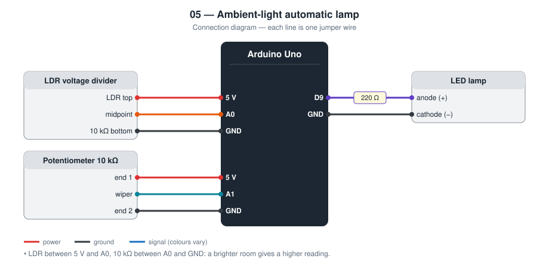
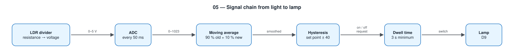

# 05 — Ambient-Light Automatic Lamp

A lamp that switches on when the room gets dark and off when it is bright
again, without flickering at dusk.

**Level 1 — basic electronics.** No network.

TODO: Add prototype photo (`images/prototype.jpg`)

## Contents

1. [At a glance](#at-a-glance)
2. [Why I built it](#why-i-built-it)
3. [Problem and context](#problem-and-context)
4. [Objectives and success criteria](#objectives-and-success-criteria)
5. [What it does](#what-it-does)
6. [Background: how it works physically](#background-how-it-works-physically)
7. [Parts](#parts)
8. [Wiring](#wiring)
9. [Build steps](#build-steps)
10. [How it works](#how-it-works)
11. [Build and upload](#build-and-upload)
12. [Code walkthrough](#code-walkthrough)
13. [Engineering notes](#engineering-notes)
14. [Test checklist](#test-checklist)
15. [Results and discussion](#results-and-discussion)
16. [Troubleshooting](#troubleshooting)
17. [Challenges log](#challenges-log)
18. [Demo script (about one minute)](#demo-script-about-one-minute)
19. [What I learned](#what-i-learned)
20. [Limitations](#limitations)
21. [Future improvements](#future-improvements)
22. [Connection to further study](#connection-to-further-study)
23. [References](#references)

## At a glance

|  |  |
| --- | --- |
| **Board** | Arduino Uno |
| **Inputs** | LDR in a voltage divider (analog), potentiometer (analog) |
| **Output** | LED lamp |
| **Network** | None |
| **Key ideas** | Voltage divider, ADC, smoothing, hysteresis, dwell time |
| **Firmware** | 72 lines of C++ in [`firmware/src/main.cpp`](firmware/src/main.cpp) |
| **Tests defined** | 5 (see [Test checklist](#test-checklist)) |
| **Hardware status** | TODO: built on (date) / tested on (date) |

## Why I built it

The simplest version of this project is one line: `if (light < 500) lamp on`.
It works on a desk and fails in real life, because at dusk the light level
sits on the threshold and the lamp flickers. I wanted to understand why and
fix it properly.

## Problem and context

Outdoor and entrance lights are often run by a fixed timer, but sunset
moves by hours across the year, and a storm can make an afternoon dark. A
light that responds to the actual brightness is on exactly when it is
needed.

The naive version of such a switch has a well-known defect. Around dusk
the light level drifts slowly through the threshold, and small
fluctuations (clouds, passing cars, electrical noise) carry it back and
forth across it. The lamp flickers on and off for minutes. Fixing that
properly is the point of this project.

## Objectives and success criteria

Each objective has a test I can pass or fail, so “it works” is not an opinion.

| # | Objective | How I will know it is met |
| --- | --- | --- |
| 1 | Switch on in the dark and off in the light | Covering the LDR turns the lamp on; uncovering turns it off |
| 2 | Exactly one switch per slow transition | Lowering a hand slowly over the LDR produces a single change, no flicker |
| 3 | Ignore brief shadows | A shadow shorter than 0.5 s causes no change |
| 4 | Adjust without reprogramming | Turning the potentiometer moves the switching level on the plotter |
| 5 | Limit the switching rate | The lamp never changes state twice within 3 s |

## What it does

- Reads room brightness with an LDR voltage divider
- A potentiometer sets the switching level without re-uploading code
- Three protections against flicker: smoothing, hysteresis, minimum dwell time
- Serial Plotter shows the light level, both thresholds, and the lamp state

## Background: how it works physically

**The LDR.** A light-dependent resistor is a strip of cadmium sulphide, a
semiconductor. In the dark it has few free electrons and a resistance of a
megaohm or more. Photons with enough energy free electrons, so the
resistance falls with brightness, to around a kilohm in a bright room. The
relationship is roughly a power law, R ∝ lux<sup>−γ</sup> with γ around
0.7, so the response is strongly non-linear.

**Reading a resistance.** A microcontroller measures voltage, not
resistance. Putting the LDR in series with a fixed resistor across 5 V
makes a divider whose midpoint voltage depends on the LDR.

**Where the flicker comes from.** With a single threshold *T*, the output
is “on” when the signal is below *T*. Any real signal has noise of some
size *n*. While the true level is within *n* of *T*, the noise alone
decides the output. Hysteresis replaces *T* with two levels further apart
than the noise, so that after switching, the signal must travel the whole
gap before it can switch back. This is the same principle as the Schmitt
trigger in electronics and the differential of a room thermostat.

**Three different disturbances, three tools.**

| Disturbance | Example | Tool |
| ----------- | ------- | ---- |
| Fast noise | Mains flicker of lamps, ADC noise | Moving average |
| Slow drift through the threshold | Dusk | Hysteresis |
| Repeated large changes | Car headlights sweeping past | Minimum dwell time |

## Parts

| Qty | Part | Notes |
| --- | ---- | ----- |
| 1 | Arduino Uno | |
| 1 | LDR (photoresistor) + 10 kΩ resistor | Voltage divider |
| 1 | 10 kΩ potentiometer | Set point |
| 1 | LED + 220 Ω resistor | Stands in for a lamp |

## Wiring



```
5 V ─── LDR ───┬─── 10 kΩ ─── GND
               └─── A0            (brighter room = higher reading)

5 V ─── potentiometer ─── GND,  wiper ─── A1

D9 ─── 220 Ω ─── LED ─── GND
```

## Build steps

1. Build the divider: 5 V → LDR → row X → 10 kΩ → GND. Connect row X to A0.
2. Connect the potentiometer: outer legs to 5 V and GND, middle leg to A1.
3. Connect the LED: D9 → 220 Ω → LED → GND.
4. Bend the LDR so that it faces away from the LED.
5. Upload and open the Serial Plotter (four lines).
6. Note the light reading with the room light on, off, and with the LDR covered.
7. Turn the potentiometer until the two threshold lines sit between “on” and “off”.
8. Run the test checklist.

## How it works



| Protection | What it does | Value |
| ---------- | ------------ | ----- |
| Smoothing | Moving average hides a passing shadow | 90 % old + 10 % new, every 50 ms |
| Hysteresis | On below `set − 40`, off above `set + 40` | ±40 ADC counts |
| Dwell time | The lamp must hold a state before it may change again | 3 s |

The lamp's own light must not shine on the LDR. If it does, the lamp turns
itself off, the room goes dark, and it turns on again: a feedback loop that
no software setting fully fixes. Point the LDR away from the LED.

## Build and upload

```bash
cd firmware
pio run --target upload
pio device monitor
```

## Code walkthrough

The excerpts below are copied from [`firmware/src/main.cpp`](firmware/src/main.cpp).

### `loop()`

The order of operations is the signal chain in the diagram: sample,
smooth, compute the two thresholds from the potentiometer, check the dwell
time, then decide. The lamp state changes in only two places, and each
records `lastSwitchMs` so the dwell timer restarts.

```cpp
void loop() {
  const unsigned long now = millis();
  if (now - lastSampleMs < SAMPLE_INTERVAL_MS) {
    return;
  }
  lastSampleMs = now;

  // Exponential moving average hides a hand shadow or a camera flash.
  light = 0.9f * light + 0.1f * analogRead(PIN_LDR);

  const int setPoint = analogRead(PIN_POT);
  const int turnOnBelow = setPoint - HYSTERESIS;
  const int turnOffAbove = setPoint + HYSTERESIS;

  const bool dwellPassed = now - lastSwitchMs >= MIN_DWELL_MS;
  if (dwellPassed) {
    if (!lampOn && light < turnOnBelow) {
      lampOn = true;
      lastSwitchMs = now;
    } else if (lampOn && light > turnOffAbove) {
      lampOn = false;
      lastSwitchMs = now;
    }
  }
  digitalWrite(PIN_LAMP, lampOn ? HIGH : LOW);

  if (now - lastReportMs >= REPORT_INTERVAL_MS) {
    lastReportMs = now;
    Serial.print(static_cast<int>(light));
    Serial.print(",");
    Serial.print(turnOnBelow);
    Serial.print(",");
    Serial.print(turnOffAbove);
    Serial.print(",");
    Serial.println(lampOn ? 1000 : 0);  // scaled so it is visible on the plotter
  }
}
```

## Engineering notes

### Design decisions

| Decision | Alternative I considered | Why I chose this |
| -------- | ------------------------ | ---------------- |
| LDR on the high side of the divider | LDR on the low side | Brighter room gives a higher number, which is easier to reason about |
| 10 kΩ fixed resistor | 1 kΩ or 100 kΩ | Closest to the LDR's resistance around dusk, where I need the most sensitivity |
| Potentiometer for the set point | Constant in the code | Every room is different; tuning should not need a computer |
| Hysteresis **and** dwell time | Hysteresis only | Hysteresis handles slow drift; dwell time handles repeated fast changes such as car headlights |
| Smoothing before the decision | Decide on raw samples | Removes 50 Hz flicker from mains lighting and short shadows |

### Calculations

- **Divider.** V<sub>A0</sub> = 5 V × R / (R<sub>LDR</sub> + R), with R = 10 kΩ.
  Using *typical datasheet* values for a GL5528 LDR (not my own
  measurements, which go in the table below):

  | Light | R<sub>LDR</sub> (typical) | V<sub>A0</sub> | ADC |
  | ----- | ------------------------- | -------------- | --- |
  | Bright room | 1 kΩ | 4.55 V | ≈ 930 |
  | Dusk (about 10 lux) | 10 kΩ | 2.50 V | ≈ 512 |
  | Dark | 1 MΩ | 0.05 V | ≈ 10 |

- **Why 10 kΩ.** A divider is most sensitive when the two resistances are
  equal. Choosing R equal to the LDR's value at dusk puts the switching
  point near the middle of the ADC range, where a small change in light
  gives the largest change in counts.
- **Filter time constant.** α = 0.1 every 50 ms gives τ = −0.05 / ln(0.9)
  ≈ 0.47 s. A shadow shorter than about half a second barely moves the
  smoothed value.
- **Hysteresis band.** ±40 counts = 80 counts wide = 0.39 V.
- **Worst-case switching rate.** With a 3 s dwell time the lamp can change
  state at most once every 3 s, whatever the sensor does.
- **Memory (measured by the compiler).** 3 580 bytes of flash (11.1 %) and
  247 bytes of RAM (12.1 %).

### Failure modes I designed for

| What can go wrong | What the device does |
| ----------------- | -------------------- |
| Light level sits at the threshold | Hysteresis keeps the last state |
| Passing shadow or flash | Smoothed away |
| Rapid repeated changes | Dwell time limits switching to once per 3 s |
| Lamp shines on its own sensor | Oscillates slowly. This is a physical feedback loop; the fix is mechanical (shield or re-aim the LDR) |
| LDR disconnected | A0 is pulled to 0 V by the 10 kΩ resistor, so the lamp turns on. Failing “on” is the safer side for a night light |

## Test checklist

| # | Test | Expected | Result |
| - | ---- | -------- | ------ |
| 1 | Cover the LDR slowly | Lamp turns on once, no flicker | TODO |
| 2 | Uncover slowly | Lamp turns off once | TODO |
| 3 | Quick hand shadow (< 0.5 s) | Lamp does not react | TODO |
| 4 | Turn the potentiometer | Switching level moves on the plotter | TODO |
| 5 | Hold the light level between the two thresholds | Lamp keeps its last state | TODO |

Record the ADC values of your own room here after testing:

| Condition | ADC reading |
| --------- | ----------- |
| Room light on | TODO |
| Room light off | TODO |
| LDR covered | TODO |

## Results and discussion

**Not yet filled from hardware.** I complete this section only with what I observed on the real circuit.

| Item | Result |
| --- | --- |
| Date tested | TODO |
| Tests passed | TODO: __ of 5 |
| Tests failed at first, then fixed | TODO |
| ADC reading: room light on | TODO |
| ADC reading: room light off | TODO |
| ADC reading: LDR covered | TODO |
| Set point chosen | TODO |
| Number of lamp changes during one slow hand pass (target: 1) | TODO |

Questions I answer here after testing:

- With `HYSTERESIS` set to 0, how many times does the lamp switch during a slow pass? (Try it and record the difference.)
- Is ±40 counts larger than the noise I see on the plotter?
- Does the lamp's own light change the reading, and how did I prevent that?

TODO: Add one photo or screenshot that shows the main result.

## Troubleshooting

Common faults for this parts list and how to find them. These are checks to run, not a record of problems I had; my own are in the next section.

| Symptom | Likely cause | What to check or change |
| --- | --- | --- |
| Reading stuck near 0 or 1023 | Divider wired wrongly | A0 must be at the junction between the LDR and the 10 kΩ |
| Lamp behaves the opposite way | LDR and resistor swapped | Swap them, or swap the comparisons in the code |
| Lamp oscillates slowly on and off | LDR sees the lamp's own light | Re-aim or shield the LDR |
| Potentiometer has no effect | Middle leg not on A1 | Check the wiper connection |
| Lamp reacts very slowly | Dwell time or smoothing too large for the test | Reduce `MIN_DWELL_MS` while testing |
| Reading jumps around | Loose breadboard contact | Re-seat the LDR legs and resistor |

## Challenges log

A lab-notebook record of real problems from my own build. Empty until they happen.

| Date | What I saw | What I tried | Real cause | Fix | What I learned |
| --- | --- | --- | --- | --- | --- |
| TODO |  |  |  |  |  |
| TODO |  |  |  |  |  |

## Demo script (about one minute)

1. Open the Serial Plotter: light level, two threshold lines, lamp state.
2. Lower a hand slowly over the LDR: the lamp switches once when the level
   crosses the *lower* line.
3. Raise the hand slowly: it switches off at the *upper* line.
4. Flick a hand across quickly: nothing happens.
5. Turn the potentiometer and show both threshold lines moving together.
6. “My first version was one `if`. It flickered. These three protections
   are what I added, each for a different cause.”

## What I learned

- A voltage divider turns a changing resistance into a voltage an ADC can read
- Why one threshold is not enough, and how hysteresis and dwell time differ
- Physical feedback between an actuator and its own sensor

## Limitations

- The reading is a relative ADC value, not lux
- An LDR reacts slowly and differently to different colours of light
- No motion input: the lamp stays on all night

## Future improvements

The capstone ([14 — Smart Home](../14-smart-home-capstone/)) uses
“dark **and** recent motion” to control its light.

Further ideas, in the order I would attempt them:

| Improvement | What it needs | Difficulty |
| --- | --- | --- |
| Combine with motion | PIR from project 04 (done in the capstone) | Low |
| Dim gradually instead of on / off | PWM proportional to darkness | Medium |
| Measure real lux | BH1750 digital light sensor over I2C | Medium |
| Learn the set point from sunrise and sunset | Record daily minimum and maximum; adapt | High |

## Connection to further study

| Idea used in this project | Where it continues at university |
| --- | --- |
| Photoconductivity in semiconductors | Solid-state physics; optoelectronics |
| Voltage dividers and sensor interfacing | Circuit analysis |
| Low-pass filtering | Signals and systems; digital signal processing |
| Hysteresis and on–off control | Control engineering; analog electronics (Schmitt trigger) |

## References

- GL55 series photoresistor datasheet (GL5528)
- ATmega328P datasheet, analog-to-digital converter chapter
- Background reading on the Schmitt trigger and on–off (bang-bang) control
- Arduino language reference — https://docs.arduino.cc/language-reference/
- PlatformIO documentation — https://docs.platformio.org/
- TODO: list the tutorials, videos, courses, and people that actually helped me with this project
