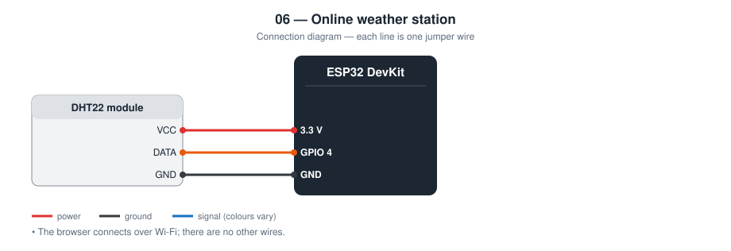
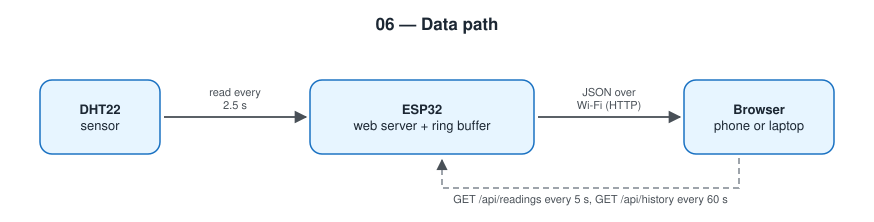

# 06 — Online Temperature and Humidity Station

An ESP32 that measures temperature and humidity and serves them as a web
page to any phone or laptop on the same Wi-Fi network.

**Level 2 — IoT.** First networked project.

TODO: Add prototype photo (`images/prototype.jpg`)

TODO: Add screenshot of the page (`images/page.png`)

## Contents

1. [At a glance](#at-a-glance)
2. [Why I built it](#why-i-built-it)
3. [Problem and context](#problem-and-context)
4. [Objectives and success criteria](#objectives-and-success-criteria)
5. [What it does](#what-it-does)
6. [Background: how it works physically](#background-how-it-works-physically)
7. [Parts](#parts)
8. [Wiring](#wiring)
9. [Build steps](#build-steps)
10. [How it works](#how-it-works)
11. [Setup](#setup)
12. [Code walkthrough](#code-walkthrough)
13. [Engineering notes](#engineering-notes)
14. [Test checklist](#test-checklist)
15. [Results and discussion](#results-and-discussion)
16. [Troubleshooting](#troubleshooting)
17. [Challenges log](#challenges-log)
18. [Demo script (about one minute)](#demo-script-about-one-minute)
19. [What I learned](#what-i-learned)
20. [Limitations](#limitations)
21. [Future improvements](#future-improvements)
22. [Connection to further study](#connection-to-further-study)
23. [References](#references)

## At a glance

|  |  |
| --- | --- |
| **Board** | ESP32 DevKit |
| **Input** | DHT22 temperature and humidity sensor |
| **Output** | Web page and JSON API over Wi-Fi |
| **Network** | Local network only; HTTP server on port 80; mDNS name |
| **Key ideas** | HTTP, JSON, client / server, ring buffer, reconnect without blocking |
| **Firmware** | 176 lines of C++ in [`firmware/src/main.cpp`](firmware/src/main.cpp) |
| **Tests defined** | 5 (see [Test checklist](#test-checklist)) |
| **Hardware status** | TODO: built on (date) / tested on (date) |

## Why I built it

Project 01 could only show its readings on an LCD next to the sensor. I
wanted to learn the smallest possible step to “IoT”: the same measurement,
readable from another device, with no cloud account in between.

## Problem and context

A reading on an LCD is only useful to someone standing in front of it. I
wanted to check a room from another room: is the greenhouse too hot, is
the bedroom too humid, without walking there.

The usual tutorial answer is to send the data to a cloud service. That
adds an account, an Internet dependency, and a third party that sees the
data. For a reading that only needs to be seen inside one building, none
of that is necessary. This project finds out how far a microcontroller
can go alone: it serves its own web page to any phone on the same Wi-Fi.

## Objectives and success criteria

Each objective has a test I can pass or fail, so “it works” is not an opinion.

| # | Objective | How I will know it is met |
| --- | --- | --- |
| 1 | Readable from any device on the Wi-Fi | A phone and a laptop both open the page with no app installed |
| 2 | Live values without reloading | A change at the sensor appears on the page within 5 s |
| 3 | Show the recent trend | After one hour the chart contains 60 points |
| 4 | Usable by other programs | `/api/readings` returns valid JSON |
| 5 | Survive network problems | After the router is restarted the page works again without resetting the ESP32 |

## What it does

- Connects to Wi-Fi and runs a web server on port 80
- `http://weather.local/` shows live temperature and humidity
- Draws a chart of the last hour (one point per minute)
- Shows sensor health, uptime, and Wi-Fi signal strength
- Keeps measuring if the Wi-Fi drops and reconnects by itself

## Background: how it works physically

**Client and server.** On the web, a *client* (the browser) sends a
request and a *server* answers. Here the ESP32 is the server. A request
has a method and a path, for example `GET /api/readings`; the response has
a status code (`200` for OK, `404` for not found), a content type, and a
body.

**Addresses.** The router gives the ESP32 an IP address such as
`192.168.1.42`. Because that number can change, the ESP32 also announces a
name with mDNS, so `http://weather.local/` finds it on most devices.

**HTML and JSON.** HTML describes a page for people. JSON is a compact
text format for data, for example `{"temperature":28.4}`, that almost
every programming language can read. The browser's JavaScript requests
JSON with `fetch()` and writes the numbers into the page.

**Why separate them.** If the ESP32 rebuilt the whole page for every
update, each refresh would resend all the HTML and the screen would flash.
Sending the page once and then only small JSON messages is faster, and the
same JSON can be used by a script, a spreadsheet, or another device.

**Ring buffer.** To keep “the last 60 values” in fixed memory, the program
writes into an array and moves an index forward, wrapping to the start at
the end. The newest value always overwrites the oldest.

## Parts

| Qty | Part | Notes |
| --- | ---- | ----- |
| 1 | ESP32 DevKit (30-pin) | |
| 1 | DHT22 module | DHT11 works: change `DHT_TYPE` |

## Wiring



| Module pin | ESP32 |
| ---------- | ----- |
| DHT VCC | 3.3 V |
| DHT DATA | **GPIO 4** (10 kΩ pull-up to 3.3 V if the breakout has none) |
| DHT GND | GND |

## Build steps

1. Connect the DHT22: VCC to 3.3 V, GND to GND, DATA to GPIO 4.
2. Copy `config.example.h` to `include/config.h` and enter the Wi-Fi name and password.
3. Upload and open the Serial monitor at 115200 baud.
4. Note the IP address that is printed.
5. On a phone connected to the same Wi-Fi, open that address in a browser.
6. Try `http://weather.local/` as well.
7. Open `/api/readings` and `/api/history` directly to see the raw JSON.
8. Run the test checklist.

## How it works



```
Browser ──GET /──────────────▶ ESP32   returns the HTML page (stored in flash)
Browser ──GET /api/readings──▶ ESP32   returns {"temperature":..,"humidity":..}
Browser ──GET /api/history───▶ ESP32   returns the last 60 one-minute samples
```

The page and the data are separate. The page is sent once; after that the
browser's JavaScript asks for small JSON messages every five seconds. This
is the same pattern larger web applications use.

History is kept in a **ring buffer**: a fixed array where the newest sample
overwrites the oldest, so memory use never grows.

## Setup

```bash
cd firmware
mkdir -p include && cp config.example.h include/config.h   # then edit Wi-Fi values
pio run --target upload
pio device monitor
```

The Serial monitor prints the IP address. Open it in a browser, or use
`http://weather.local/` if your device supports mDNS.

## Code walkthrough

The excerpts below are copied from [`firmware/src/main.cpp`](firmware/src/main.cpp).

### `handleReadings()`

The JSON is built by hand as a string. For five fields that is clearer
than adding a JSON library, and it shows exactly what is sent.

```cpp
static void handleReadings() {
  String json = "{";
  json += "\"temperature\":" + jsonNumber(temperature, 1);
  json += ",\"humidity\":" + jsonNumber(humidity, 1);
  json += ",\"ok\":" + String(sensorOk ? "true" : "false");
  json += ",\"uptime_s\":" + String(millis() / 1000);
  json += ",\"rssi\":" + String(WiFi.RSSI());
  json += "}";
  server.send(200, "application/json", json);
}
```

### `storeHistory()`

The ring buffer: write at `historyHead`, advance with wrap-around, and
count up until the buffer is full. A failed sensor read stores `NAN`,
which becomes `null` in JSON and a gap in the chart.

```cpp
static void storeHistory() {
  historyTemperature[historyHead] = sensorOk ? temperature : NAN;
  historyHumidity[historyHead] = sensorOk ? humidity : NAN;
  historyHead = (historyHead + 1) % HISTORY_SIZE;
  if (historyCount < HISTORY_SIZE) {
    historyCount++;
  }
}
```

### `ensureWiFi()`

Called on every pass of `loop()`. It does nothing while connected, and
when disconnected it starts a new attempt at most every 10 s, without
waiting for the result. The sensor and the rest of the program keep
running.

```cpp
static void ensureWiFi() {
  static unsigned long lastAttemptMs = 0;
  if (WiFi.status() == WL_CONNECTED) {
    return;
  }
  const unsigned long now = millis();
  if (now - lastAttemptMs < WIFI_RETRY_INTERVAL_MS) {
    return;
  }
  lastAttemptMs = now;
  Serial.println("[wifi] retry");
  WiFi.disconnect();
  WiFi.begin(WIFI_SSID, WIFI_PASSWORD);
}
```

## Engineering notes

### Design decisions

| Decision | Alternative I considered | Why I chose this |
| -------- | ------------------------ | ---------------- |
| ESP32 as its own web server | Cloud service from the start | No account, no Internet needed; I can see every part of the path |
| Page and data separated (HTML once, JSON after) | Rebuild the whole HTML with the values inside | The page updates without reloading, and the same API can serve other programs |
| Polling every 5 s | WebSocket push | The sensor only changes every 2.5 s; polling is simpler and enough |
| History in a ring buffer | Growing list | Fixed memory: it can run for months without filling RAM |
| HTML stored in flash (`PROGMEM`) | File system (SPIFFS / LittleFS) | One upload step instead of two |
| Chart drawn on a `<canvas>` by my own code | Chart library from a CDN | Works with no Internet access |
| `null` for a missing reading | `0` or the last value | JSON has no NaN, and a fake 0 °C would be a lie |

### Calculations

- **History memory.** 60 points × 2 values × 4 bytes (float) = 480 bytes of
  the ESP32's 320 kB RAM.
- **Traffic.** One `/api/readings` response is about 80 bytes of JSON every
  5 s per open browser: roughly 1 kB per minute. Negligible on Wi-Fi.
- **Supply.** The DHT22 works from 3.3 V to 6 V, so it runs directly from
  the ESP32's 3.3 V pin and its data line is already at the right level.
- **Connect timeout.** 20 s. After that the program continues without
  Wi-Fi and retries every 10 s.
- **Memory (measured by the compiler).** 807 881 bytes of flash (61.6 % of
  the default 1.3 MB app partition) and 47 544 bytes of RAM (14.5 %). Most
  of it is the Wi-Fi stack, not my code.

### API reference

| Endpoint | Example response |
| -------- | ---------------- |
| `GET /api/readings` | `{"temperature":28.4,"humidity":71.0,"ok":true,"uptime_s":3605,"rssi":-58}` |
| `GET /api/history` | `{"interval_s":60,"temperature":[28.1,28.2,…],"humidity":[70.5,70.8,…]}` |

The numbers above show the format only. They are not measurements.

### Failure modes I designed for

| What can go wrong | What the device does |
| ----------------- | -------------------- |
| Wi-Fi not available at boot | Continues after 20 s, retries every 10 s, keeps measuring |
| Wi-Fi drops later | Reconnects without a reset; history is kept |
| Sensor read fails | `ok:false`, value kept from the last good read, `null` stored in history so the chart shows a gap |
| Browser cannot reach the ESP32 | Page shows “Cannot reach the ESP32” instead of freezing on old values |
| Unknown URL | 404 response |

## Test checklist

| # | Test | Expected | Result |
| - | ---- | -------- | ------ |
| 1 | Open the page from a phone on the same Wi-Fi | Values appear | TODO |
| 2 | Open `/api/readings` directly | Valid JSON | TODO |
| 3 | Unplug the DHT data wire | Page shows “Sensor read failed” | TODO |
| 4 | Switch the router off and on | ESP32 reconnects without a reset | TODO |
| 5 | Leave running for 1 hour | Chart shows 60 points | TODO |

## Results and discussion

**Not yet filled from hardware.** I complete this section only with what I observed on the real circuit.

| Item | Result |
| --- | --- |
| Date tested | TODO |
| Tests passed | TODO: __ of 5 |
| Tests failed at first, then fixed | TODO |
| IP address and whether `weather.local` worked on my devices | TODO |
| Wi-Fi signal strength shown on the page (dBm) at the installed position | TODO |
| Seconds to reconnect after the router restarts | TODO |
| Longest continuous run without a reset | TODO |

Questions I answer here after testing:

- Which of my devices resolved the `.local` name and which needed the IP address?
- How does the signal strength change with distance from the router, and when does the page become unreliable?
- What does the one-hour chart show about the room (for example, the effect of opening a window)?

TODO: Add one photo or screenshot that shows the main result.

## Troubleshooting

Common faults for this parts list and how to find them. These are checks to run, not a record of problems I had; my own are in the next section.

| Symptom | Likely cause | What to check or change |
| --- | --- | --- |
| Stuck printing dots, then “timed out” | Wrong Wi-Fi name / password, or a 5 GHz-only network | Check `config.h`; the ESP32 needs 2.4 GHz |
| Page does not open from the phone | Phone on mobile data or a guest network | Join the same Wi-Fi; disable “client isolation” on the router |
| `weather.local` not found | Device without mDNS support | Use the IP address |
| Values show `--` | DHT read failing | Check GPIO 4, 3.3 V, and `DHT_TYPE` |
| Upload fails with “Failed to connect” | Board not in download mode | Hold the BOOT button while the upload starts |
| Compile error: `config.h` not found | File not copied | Copy `config.example.h` to `include/config.h` |

## Challenges log

A lab-notebook record of real problems from my own build. Empty until they happen.

| Date | What I saw | What I tried | Real cause | Fix | What I learned |
| --- | --- | --- | --- | --- | --- |
| TODO |  |  |  |  |  |
| TODO |  |  |  |  |  |

## Demo script (about one minute)

1. Show the breadboard: one sensor, three wires.
2. Open the page on a phone: live values and the one-hour chart.
3. Open `/api/readings` in a second tab: “The page is just one client of
   this small API.”
4. Breathe on the sensor: the humidity value changes within 5 s.
5. Pull the sensor wire: the status line turns red. “It tells you when it
   does not know.”

## What I learned

- How a microcontroller can be an HTTP server
- The difference between serving a page and serving an API
- JSON as the common language between firmware and a browser
- Why network code needs timeouts and retry instead of `while (!connected)`

## Limitations

- Only reachable inside the local network, not from the Internet
- No login and no HTTPS: anyone on the Wi-Fi can read it
- History lives in RAM and is lost on reset
- The chart scales each line separately, so the two lines cannot be compared by height

## Future improvements

Project [13 — Cloud Data Logging](../13-cloud-data-logging/) stores the
readings permanently and makes them reachable from anywhere.

Further ideas, in the order I would attempt them:

| Improvement | What it needs | Difficulty |
| --- | --- | --- |
| Fixed IP address | Static IP settings or a router reservation | Low |
| Password on the page | HTTP basic authentication | Low |
| Push updates instead of polling | WebSocket or Server-Sent Events | Medium |
| Barometric pressure | BME280 sensor over I2C | Medium |
| Keep history through a reset | Store the buffer in flash (LittleFS) | Medium |

## Connection to further study

| Idea used in this project | Where it continues at university |
| --- | --- |
| HTTP requests and responses | Computer networks; web engineering |
| Client–server architecture and APIs | Distributed systems; software architecture |
| Ring buffers | Data structures and algorithms |
| Wi-Fi and IP addressing | Computer networks; wireless communication |

## References

- DHT22 (AM2302) datasheet, Aosong Electronics
- ESP32 `WebServer` and `ESPmDNS` library documentation
- MDN Web Docs: HTTP overview, Fetch API, Canvas API — https://developer.mozilla.org/
- Arduino core for ESP32 documentation — https://docs.espressif.com/projects/arduino-esp32/
- PlatformIO documentation — https://docs.platformio.org/
- TODO: list the tutorials, videos, courses, and people that actually helped me with this project
