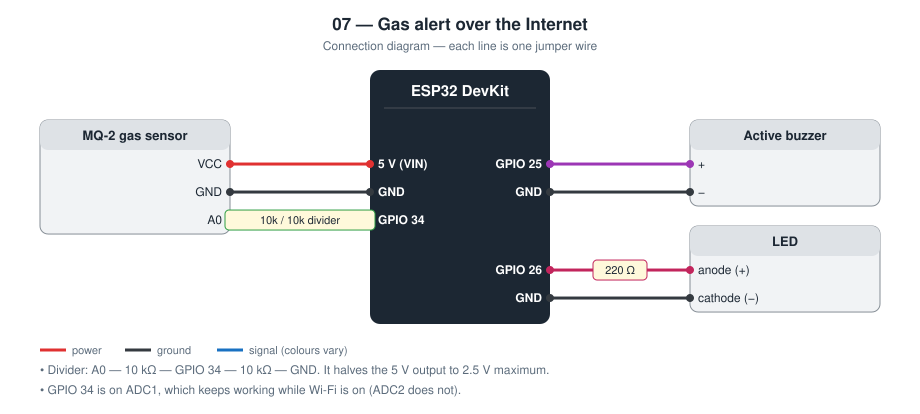
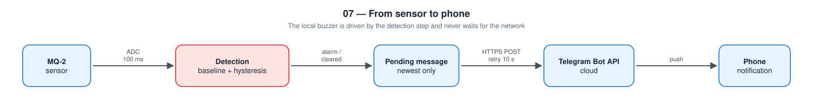

# 07 — Gas Alert over the Internet

An ESP32 gas alarm that sounds a local buzzer **and** sends a Telegram
message to a phone when gas is detected and when the air is clear again.

**Level 2 — IoT.** Builds on project [02](../02-gas-leak-alarm/).

This is a classroom model. It is **not** a certified gas detector.

TODO: Add prototype photo (`images/prototype.jpg`)

TODO: Add screenshot of the Telegram messages (`images/telegram.png`)

## Contents

1. [At a glance](#at-a-glance)
2. [Why I built it](#why-i-built-it)
3. [Problem and context](#problem-and-context)
4. [Objectives and success criteria](#objectives-and-success-criteria)
5. [What it does](#what-it-does)
6. [Background: how it works physically](#background-how-it-works-physically)
7. [Parts](#parts)
8. [Wiring](#wiring)
9. [Build steps](#build-steps)
10. [How it works](#how-it-works)
11. [Setup](#setup)
12. [Code walkthrough](#code-walkthrough)
13. [Engineering notes](#engineering-notes)
14. [Test checklist](#test-checklist)
15. [Results and discussion](#results-and-discussion)
16. [Troubleshooting](#troubleshooting)
17. [Challenges log](#challenges-log)
18. [Demo script (about one minute)](#demo-script-about-one-minute)
19. [What I learned](#what-i-learned)
20. [Limitations](#limitations)
21. [Future improvements](#future-improvements)
22. [Connection to further study](#connection-to-further-study)
23. [References](#references)

## At a glance

|  |  |
| --- | --- |
| **Board** | ESP32 DevKit |
| **Input** | MQ-2 gas sensor through a 10 kΩ / 10 kΩ divider |
| **Outputs** | Buzzer, LED, Telegram messages |
| **Network** | Wi-Fi; HTTPS requests to the Telegram Bot API |
| **Key ideas** | Level shifting, calling a web API, retry, local-first safety |
| **Firmware** | 232 lines of C++ in [`firmware/src/main.cpp`](firmware/src/main.cpp) |
| **Tests defined** | 6 (see [Test checklist](#test-checklist)) |
| **Hardware status** | TODO: built on (date) / tested on (date) |

## Why I built it

The alarm in project 02 is useless if nobody is in the room. I wanted the
same detection to reach a person who is somewhere else, and I wanted to
make sure the network part could never weaken the local alarm.

## Problem and context

The gas alarm in project 02 protects only people who can hear it. The
dangerous cases are the others: nobody home, an elderly relative alone, a
family asleep upstairs. In those cases someone *elsewhere* has to be told.

Adding the Internet creates a new risk. Home networks fail often: the
router restarts, the provider has an outage, the Wi-Fi password changes.
If the alarm waits for the network before sounding, or freezes while
trying to send, the connection has made the device less safe than the
simple version. The design rule for this project is therefore: the
network may add to the local alarm, and must never be able to take
anything away from it.

## Objectives and success criteria

Each objective has a test I can pass or fail, so “it works” is not an opinion.

| # | Objective | How I will know it is met |
| --- | --- | --- |
| 1 | Keep the local alarm independent | With the router off, gas still triggers the buzzer with no added delay |
| 2 | Notify a phone | A Telegram message arrives when the alarm starts and when it clears |
| 3 | Do not lose the alert to a brief outage | A message queued while offline arrives after the Wi-Fi returns |
| 4 | Do not spam | During a long alarm, messages arrive at most every 5 minutes |
| 5 | Protect the ESP32's input | The voltage on GPIO 34 never exceeds 3.3 V (measured with a multimeter) |

## What it does

- Same warm-up, baseline, and hysteresis logic as project 02
- Telegram message on: device online, alarm start, alarm cleared
- Reminder every 5 minutes while the alarm is still active
- Messages that fail to send are retried every 10 s
- The buzzer works with no Wi-Fi at all

## Background: how it works physically

The sensor physics is the same as in [project 02](../02-gas-leak-alarm/#background-how-it-works-physically).
What is new is everything between the sensor and the phone.

**Two logic levels.** The MQ-2 module runs on 5 V and its output can reach
5 V. An ESP32 pin tolerates 3.3 V. Two equal resistors in series halve the
voltage, so the pin sees at most 2.5 V.

**A web API.** Telegram offers a *Bot API*: a program sends an HTTPS
request to a URL that contains the bot's secret token, with the chat and
the text as parameters, and Telegram delivers the text as a normal
message. From the ESP32's side it is one `POST` request and one status
code to check.

**HTTPS.** The “S” means the connection is wrapped in TLS, which does two
things: it encrypts the data, and it lets the client verify that the
server really is `api.telegram.org` by checking its certificate. This
firmware does the first but skips the second (`setInsecure()`), which I
list as a limitation.

**URL encoding.** In a form-encoded request, characters such as spaces
and `&` have special meaning, so the text is sent with those characters
replaced by `%` and their hexadecimal code (a space becomes `%20`).

**Push notifications.** The phone is not asking the ESP32 anything. The
ESP32 tells Telegram's servers, and they use the phone's existing push
connection. That is why the alert arrives even when the phone is on
mobile data in another city.

## Parts

| Qty | Part | Notes |
| --- | ---- | ----- |
| 1 | ESP32 DevKit (30-pin) | |
| 1 | MQ-2 gas sensor module | Heater needs 5 V |
| 2 | 10 kΩ resistors | Voltage divider for the analog output |
| 1 | Active buzzer | |
| 1 | LED + 220 Ω resistor | |

## Wiring



| Module pin | ESP32 |
| ---------- | ----- |
| MQ-2 VCC | 5 V (VIN) |
| MQ-2 GND | GND |
| MQ-2 A0 | **GPIO 34** through the divider below |
| Buzzer + | **GPIO 25** (− to GND) |
| LED anode | **GPIO 26** through 220 Ω |

**Required divider.** The MQ-2 output can reach 5 V; ESP32 pins accept 3.3 V
at most.

```
MQ-2 A0 ─── 10 kΩ ───┬─── 10 kΩ ─── GND
                     └─── GPIO 34
```

## Build steps

1. Build the divider on the breadboard: MQ-2 A0 → 10 kΩ → row X → 10 kΩ → GND.
2. **Before connecting the ESP32**, power the MQ-2 from 5 V and measure row X with a multimeter. It must be below 3.3 V.
3. Connect row X to GPIO 34, MQ-2 VCC to VIN (5 V), and all grounds together.
4. Connect the buzzer to GPIO 25 and the LED (through 220 Ω) to GPIO 26.
5. Create the bot with @BotFather and get the chat ID (see Setup).
6. Copy `config.example.h` to `include/config.h` and fill in Wi-Fi, token, and chat ID.
7. Upload, open the Serial monitor, and wait for the baseline and the “online” message.
8. Run the test checklist in a ventilated room with an adult present.

## How it works



Each pass of `loop()` has two parts, always in this order:

1. **Detect and sound the local alarm.** No network calls.
2. **Network work.** Reconnect Wi-Fi if needed, try to send the waiting message.

Only the newest message is kept. If the alarm starts and clears while the
Wi-Fi is down, the phone receives the current state when the connection
returns, not a backlog of old news.

The message is sent with an HTTPS `POST` to the Telegram Bot API.

## Setup

1. In Telegram, talk to **@BotFather**, create a bot, copy the token.
2. Send any message to your new bot.
3. Open `https://api.telegram.org/bot<TOKEN>/getUpdates` and copy the chat `id`.
4. Configure and upload:

```bash
cd firmware
mkdir -p include && cp config.example.h include/config.h   # then edit
pio run --target upload
pio device monitor
```

The bot token is a secret. It stays in `include/config.h`, which is
gitignored.

## Code walkthrough

The excerpts below are copied from [`firmware/src/main.cpp`](firmware/src/main.cpp).

### `sendTelegram()`

One HTTPS `POST`. The function returns `true` only for status 200, so the
caller knows whether to keep the message for another attempt.

```cpp
static bool sendTelegram(const String& text) {
  if (WiFi.status() != WL_CONNECTED) {
    return false;
  }

  WiFiClientSecure client;
  // Encrypts the connection but does not verify Telegram's certificate.
  // Listed under Limitations in the README.
  client.setInsecure();

  HTTPClient https;
  https.setTimeout(8000);
  if (!https.begin(client, "https://api.telegram.org/bot" TELEGRAM_BOT_TOKEN "/sendMessage")) {
    return false;
  }
  https.addHeader("Content-Type", "application/x-www-form-urlencoded");

  const String body = "chat_id=" + urlEncode(TELEGRAM_CHAT_ID) + "&text=" + urlEncode(text);
  const int code = https.POST(body);
  https.end();

  if (code != 200) {
    Serial.printf("[telegram] send failed, HTTP %d\n", code);
    return false;
  }
  Serial.println("[telegram] sent");
  return true;
}
```

### `flushMessage()`

The retry logic. If nothing is pending it returns at once. Otherwise it
tries at most once every 10 s and clears the message only after a
confirmed send.

```cpp
static void flushMessage(unsigned long now) {
  if (pendingMessage.isEmpty()) {
    return;
  }
  if (lastSendAttemptMs != 0 && now - lastSendAttemptMs < SEND_RETRY_INTERVAL_MS) {
    return;
  }
  lastSendAttemptMs = now;
  if (sendTelegram(pendingMessage)) {
    pendingMessage = "";
  }
}
```

### `urlEncode()`

Letters, digits, and four safe symbols pass through; every other byte
becomes `%XX`.

```cpp
static String urlEncode(const String& text) {
  String out;
  char buffer[4];
  for (size_t i = 0; i < text.length(); i++) {
    const unsigned char c = text[i];
    if (isalnum(c) || c == '-' || c == '_' || c == '.' || c == '~') {
      out += static_cast<char>(c);
    } else {
      snprintf(buffer, sizeof(buffer), "%%%02X", c);
      out += buffer;
    }
  }
  return out;
}
```

## Engineering notes

### Design decisions

| Decision | Alternative I considered | Why I chose this |
| -------- | ------------------------ | ---------------- |
| Detection runs before any network code | Send first, then sound | A slow or dead network must never delay the local alarm |
| Telegram Bot API | E-mail (SMTP) or SMS gateway | Free, one HTTPS request, real push notification on a phone |
| Keep only the newest pending message | Queue every event | After an outage the phone should get the current state, not a backlog |
| Reminder every 5 minutes | One message only | A single message is easy to miss; every loop would be spam |
| GPIO 34 (ADC1) | A pin on ADC2 | ADC2 cannot be used while Wi-Fi is active on the ESP32 |
| Resistor divider on A0 | Connect A0 directly | The MQ-2 output can reach 5 V; ESP32 pins are 3.3 V maximum |

### Calculations

- **Divider.** V<sub>pin</sub> = V<sub>A0</sub> × 10 kΩ / (10 kΩ + 10 kΩ) =
  V<sub>A0</sub> / 2. The worst case of 5 V becomes 2.5 V, safely below
  3.3 V. The divider draws at most 5 V / 20 kΩ = 0.25 mA.
- **ADC resolution.** 12 bits over about 3.3 V is roughly 0.8 mV per count.
  The alarm margin of 400 counts is about 0.32 V at the pin, which is
  0.64 V at the sensor. That is close to the 0.73 V margin used on the
  Arduino in project 02, so both versions react at a similar gas level.
- **Loading.** The 20 kΩ divider loads the sensor output slightly. Because
  the baseline is measured with the divider already in place, the effect
  cancels out.
- **ESP32 ADC accuracy.** The ESP32 ADC is not linear near 0 V and near
  full scale. The divider keeps the signal in the middle of the range, and
  the decision is relative to a baseline, so absolute accuracy matters less.
- **Message timing.** Retry every 10 s, HTTPS timeout 8 s, reminder every
  300 s. Worst case, one failed send blocks the loop for 8 s; detection
  runs again immediately after.
- **Memory (measured by the compiler).** 921 429 bytes of flash (70.3 %)
  and 47 008 bytes of RAM (14.3 %). TLS is the largest part.

### Message sequence

```
ESP32                         Telegram                      Phone
  │ POST /bot<token>/sendMessage  │                            │
  │  chat_id=…&text=GAS%20ALARM…  │                            │
  ├──────────────────────────────▶│                            │
  │            200 OK             │──── push notification ────▶│
  │◀──────────────────────────────┤                            │
  │ (not 200: keep message, retry in 10 s)                     │
```

### Failure modes I designed for

| What can go wrong | What the device does |
| ----------------- | -------------------- |
| No Wi-Fi at boot or later | Buzzer and LED work normally; message waits and is retried |
| Telegram unreachable or returns an error | Message kept, retried every 10 s |
| Alarm starts and clears while offline | Only the newest state is sent after reconnecting |
| Alarm lasts a long time | Reminder every 5 minutes |
| Special characters in the text | URL-encoded before sending |
| Power cut | **Not handled**: no battery, no message |

## Test checklist

Test with gas from an **unlit** lighter, briefly, in a ventilated room,
with an adult or teacher present.

| # | Test | Expected | Result |
| - | ---- | -------- | ------ |
| 1 | Power on | “online and monitoring” message after about 70 s | TODO |
| 2 | Brief gas near the sensor | Buzzer + “GAS ALARM” message | TODO |
| 3 | Remove the gas | Buzzer stops + “back to normal” message | TODO |
| 4 | Router off, trigger the alarm | Buzzer still sounds | TODO |
| 5 | Router back on | The waiting message arrives | TODO |
| 6 | Time from buzzer to phone notification | Record the seconds: TODO | TODO |

## Results and discussion

**Not yet filled from hardware.** I complete this section only with what I observed on the real circuit.

| Item | Result |
| --- | --- |
| Date tested | TODO |
| Tests passed | TODO: __ of 6 |
| Tests failed at first, then fixed | TODO |
| Voltage at GPIO 34 in clean air (multimeter) | TODO |
| Baseline (ADC counts) | TODO |
| Seconds from buzzer to phone notification (5 runs: min / median / max) | TODO |
| Seconds until a queued message arrives after Wi-Fi returns | TODO |

Questions I answer here after testing:

- How long does the phone notification take compared with the buzzer, and what does that say about relying on it?
- Did every queued message arrive after an outage?
- How long did the HTTPS request block the loop? (Add a `millis()` print around `sendTelegram()`.)

TODO: Add one photo or screenshot that shows the main result.

## Troubleshooting

Common faults for this parts list and how to find them. These are checks to run, not a record of problems I had; my own are in the next section.

| Symptom | Likely cause | What to check or change |
| --- | --- | --- |
| `[telegram] send failed, HTTP 401` | Wrong bot token | Copy the token again from @BotFather |
| `HTTP 400` | Wrong chat ID, or the bot was never messaged | Send the bot a message first; re-read `getUpdates` |
| `HTTP -1` or other negative code | No Internet, DNS failure, or TLS error | Check that the Wi-Fi has Internet access |
| Reading stuck at 4095 | No divider: pin over-driven | **Disconnect immediately**; build and measure the divider |
| Reading always 0 | Divider midpoint not connected, or a pin on ADC2 | Use GPIO 34; check row X |
| Alarm right after calibration | Sensor not warm | Leave it powered longer; raise `WARMUP_MS` |
| ESP32 resets when the buzzer sounds | Weak USB supply with the heater on | Use a 1 A or larger 5 V supply |

## Challenges log

A lab-notebook record of real problems from my own build. Empty until they happen.

| Date | What I saw | What I tried | Real cause | Fix | What I learned |
| --- | --- | --- | --- | --- | --- |
| TODO |  |  |  |  |  |
| TODO |  |  |  |  |  |

## Demo script (about one minute)

1. Show the two messages already on the phone from power-on.
2. Brief gas from an unlit lighter: buzzer first, then the phone buzzes.
3. Remove the gas: “back to normal” arrives.
4. Switch the router off and trigger again: “The buzzer does not care
   about the Internet.”
5. Router on: the waiting message arrives. “The loop always detects first
   and talks to the network second.”

## What I learned

- Calling a real web API (HTTPS, form encoding, status codes) from a microcontroller
- Safety logic must not depend on the network
- Why an alert system needs retry, and why it should not spam
- A 5 V sensor and a 3.3 V controller need level matching

## Limitations

- The firmware does not verify Telegram's TLS certificate (`setInsecure()`),
  so the connection is encrypted but not authenticated
- Sending a message blocks the loop for up to a few seconds
- No message can be sent during a power cut or Internet outage
- The MQ-2 cannot tell which gas it detected, and values are not ppm

## Future improvements

Certificate pinning for the HTTPS connection, and a `/status` command so
the bot can be asked for the current reading.

Further ideas, in the order I would attempt them:

| Improvement | What it needs | Difficulty |
| --- | --- | --- |
| Verify Telegram's certificate | Embed the root certificate; `setCACert()` | Medium |
| Answer a `/status` command | Poll `getUpdates` and parse commands | Medium |
| Send without blocking the loop | Move sending to a second FreeRTOS task | High |
| Work during a power cut | Battery, charger module, low-power design | High |
| Alert several people | A Telegram group chat ID | Low |

## Connection to further study

| Idea used in this project | Where it continues at university |
| --- | --- |
| Voltage dividers for level shifting | Circuit analysis; mixed-voltage digital design |
| HTTPS, TLS, and certificates | Computer networks; cryptography; cybersecurity |
| Designing for network failure | Distributed systems; fault-tolerant design |
| Separating safety logic from convenience features | Safety engineering; systems engineering |

## References

- Telegram Bot API, `sendMessage` method — https://core.telegram.org/bots/api
- MQ-2 gas sensor datasheet
- ESP32 ADC documentation (ADC1 / ADC2 and Wi-Fi, attenuation) — Espressif
- Arduino core for ESP32 documentation — https://docs.espressif.com/projects/arduino-esp32/
- PlatformIO documentation — https://docs.platformio.org/
- TODO: list the tutorials, videos, courses, and people that actually helped me with this project
