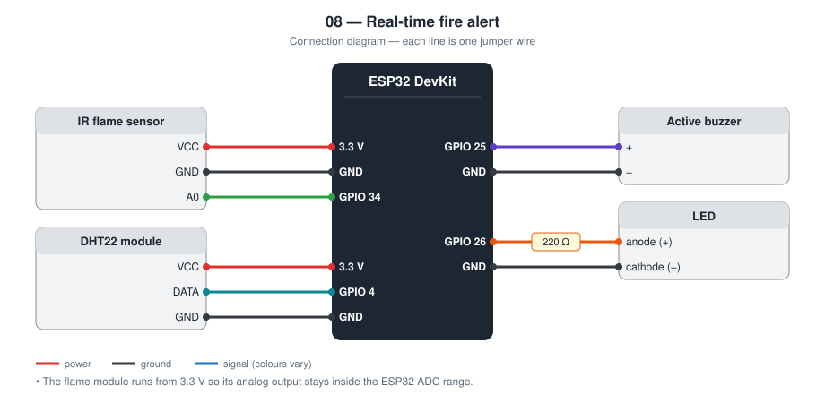
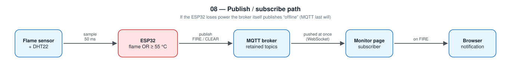

# 08 — Real-Time Fire Alert

An ESP32 fire detector that publishes its alarm over MQTT. A web page
subscribed to the same broker shows the alarm and raises a browser
notification the moment it happens.

**Level 2 — IoT.** Builds on project [03](../03-fire-alarm/).

This is a classroom model. It is **not** a certified fire alarm.

TODO: Add prototype photo (`images/prototype.jpg`)

TODO: Add screenshot of the monitor page (`images/monitor.png`)

## Contents

1. [At a glance](#at-a-glance)
2. [Why I built it](#why-i-built-it)
3. [Problem and context](#problem-and-context)
4. [Objectives and success criteria](#objectives-and-success-criteria)
5. [What it does](#what-it-does)
6. [Background: how it works physically](#background-how-it-works-physically)
7. [Parts](#parts)
8. [Wiring](#wiring)
9. [Build steps](#build-steps)
10. [How it works](#how-it-works)
11. [Setup](#setup)
12. [Code walkthrough](#code-walkthrough)
13. [Engineering notes](#engineering-notes)
14. [Test checklist](#test-checklist)
15. [Results and discussion](#results-and-discussion)
16. [Troubleshooting](#troubleshooting)
17. [Challenges log](#challenges-log)
18. [Demo script (about one minute)](#demo-script-about-one-minute)
19. [What I learned](#what-i-learned)
20. [Limitations](#limitations)
21. [Future improvements](#future-improvements)
22. [Connection to further study](#connection-to-further-study)
23. [References](#references)

## At a glance

|  |  |
| --- | --- |
| **Board** | ESP32 DevKit |
| **Inputs** | IR flame sensor (analog), DHT22 temperature |
| **Outputs** | Buzzer, LED, MQTT messages, browser monitor page |
| **Network** | Wi-Fi; MQTT over TCP for the device, MQTT over WebSocket for the browser |
| **Key ideas** | Publish / subscribe, retained messages, last will, sensor fusion |
| **Firmware** | 215 lines of C++ in [`firmware/src/main.cpp`](firmware/src/main.cpp) |
| **Tests defined** | 7 (see [Test checklist](#test-checklist)) |
| **Hardware status** | TODO: built on (date) / tested on (date) |

## Why I built it

In projects 06 and 09 the browser has to keep *asking* the ESP32 for news.
For an alarm that is the wrong way round: the device should *tell* everyone
who is listening. MQTT is the protocol most IoT systems use for that, so I
wanted to learn it on a problem where speed matters.

## Problem and context

For a fire, seconds matter and several people may need to know at once: a
family in different rooms, a neighbour, a building manager. Each of them
may open the monitoring page at a different time, and each must see the
*current* state immediately, including whether the detector itself is
still alive.

A page that polls the device every few seconds does this badly. It is
always a few seconds late, every viewer adds load to the device, and a
device that has burnt or lost power simply stops answering, which looks
the same as a slow network. This project uses a message broker so that
the device announces changes, and the broker tells everyone, including
latecomers.

## Objectives and success criteria

Each objective has a test I can pass or fail, so “it works” is not an opinion.

| # | Objective | How I will know it is met |
| --- | --- | --- |
| 1 | Two independent fire signs | Flame alone triggers; high temperature alone triggers (tested with a warm-air source) |
| 2 | Local alarm without network | Buzzer works with the router off |
| 3 | Immediate delivery to viewers | The monitor turns red as soon as the buzzer starts (measured delay recorded) |
| 4 | Correct state for late viewers | A monitor opened during an alarm shows `FIRE` at once |
| 5 | Detect a dead device | After unplugging the ESP32 the monitor shows `offline` within about 30 s |

## What it does

- Alarm when a flame is confirmed for 250 ms **or** the temperature reaches 55 °C
- Local buzzer and LED, independent of the network
- Publishes `FIRE` / `CLEAR` as a retained MQTT message on every change
- Publishes telemetry (flame reading, temperature) every 5 s
- Uses an MQTT **last will** so the monitor shows `offline` if the device loses power
- Monitor page with live status, event log, and browser notifications

## Background: how it works physically

The flame sensor is described in [project 03](../03-fire-alarm/#background-how-it-works-physically).
The new part is MQTT.

**Publish / subscribe.** In MQTT, devices do not talk to each other
directly. A central server, the *broker*, receives messages that clients
*publish* to named *topics* and forwards each one to every client that has
*subscribed* to that topic. The publisher does not know who is listening
or how many.

**Topics** are text paths such as `students/fire-alarm/room1/alarm`.
Subscribers can use wildcards: `…/room1/#` matches everything below
`room1`.

**Retained messages.** Normally a message is delivered to current
subscribers and then forgotten. A message published with the *retain*
flag is also stored by the broker and sent immediately to anyone who
subscribes later. This is how a monitor opened in the middle of an alarm
learns the state without waiting for the next change.

**Last will.** When connecting, a client can leave a message with the
broker “to be published if I disappear”. If the broker stops receiving
the client's keep-alive packets, it publishes that message itself. Here
the will is `offline` on the status topic.

**Quality of service.** MQTT has three delivery levels: 0 (at most once),
1 (at least once), 2 (exactly once). The library used here publishes at
level 0.

**WebSocket.** Browsers cannot open raw TCP connections, so brokers also
accept MQTT inside a WebSocket. The monitor page uses that.

**Sensor fusion.** Combining different sensors to make one decision is
called fusion. Here it is the simplest kind, a logical OR: either sign is
enough. That raises sensitivity (fewer missed fires) at the cost of more
possible false alarms, which is the right direction for an alarm.

## Parts

| Qty | Part | Notes |
| --- | ---- | ----- |
| 1 | ESP32 DevKit (30-pin) | |
| 1 | IR flame sensor module | Powered from 3.3 V |
| 1 | DHT22 module | |
| 1 | Active buzzer | |
| 1 | LED + 220 Ω resistor | |

## Wiring



| Module pin | ESP32 |
| ---------- | ----- |
| Flame VCC | **3.3 V** (so the analog output stays within the ADC range) |
| Flame GND | GND |
| Flame A0 | **GPIO 34** |
| DHT VCC | 3.3 V |
| DHT DATA | **GPIO 4** |
| DHT GND | GND |
| Buzzer + | **GPIO 25** |
| LED anode | **GPIO 26** through 220 Ω |

## Build steps

1. Connect the flame sensor: VCC to **3.3 V**, GND to GND, A0 to GPIO 34.
2. Connect the DHT22: VCC to 3.3 V, DATA to GPIO 4, GND to GND.
3. Connect the buzzer to GPIO 25 and the LED (through 220 Ω) to GPIO 26.
4. Choose a broker and a unique topic base; put them in `include/config.h`.
5. Upload and check the Serial monitor for `[mqtt] connected`.
6. Copy `monitor/config.example.js` to `monitor/config.js` with the same broker and topic.
7. Serve the monitor folder (`python3 -m http.server 8080`) and open it.
8. Read the flame value from the telemetry and tune `FLAME_THRESHOLD`.
9. Run the test checklist on a non-flammable surface with an adult present.

## How it works



```
ESP32 ──publish──▶ MQTT broker ──push──▶ monitor page (and any other subscriber)
```

| Topic (under the base topic) | Payload | Retained | Purpose |
| ----- | ------- | -------- | ------- |
| `status` | `online` / `offline` | yes | `offline` is published by the broker itself (last will) |
| `alarm` | `FIRE` / `CLEAR` | yes | A page opened later still sees the current state |
| `telemetry` | JSON | no | Live readings |

After every reconnect the ESP32 sends the alarm state again, so a broker
outage cannot leave subscribers with a stale `CLEAR`.

## Setup

**Broker.** For a demo, a public test broker such as `broker.hivemq.com`
works (TCP port 1883 for the ESP32, WebSocket port 8884 for the browser).
Anyone can read a public broker, so choose a unique topic and do not treat
it as private.

**Firmware**

```bash
cd firmware
mkdir -p include && cp config.example.h include/config.h   # then edit
pio run --target upload
pio device monitor
```

**Monitor page**

```bash
cd monitor
cp config.example.js config.js    # same broker and topic as the firmware
python3 -m http.server 8080
```

Open http://localhost:8080 and press *Enable browser notifications*.

## Code walkthrough

The excerpts below are copied from [`firmware/src/main.cpp`](firmware/src/main.cpp).

### `ensureMqtt()`

The connection call carries the last will (topic, QoS 1, retained,
`offline`). Right after connecting, the device publishes `online` to the
same topic and marks the alarm state as needing to be sent again.

```cpp
static void ensureMqtt() {
  static unsigned long lastAttemptMs = 0;
  if (mqtt.connected() || WiFi.status() != WL_CONNECTED) {
    return;
  }
  const unsigned long now = millis();
  if (lastAttemptMs != 0 && now - lastAttemptMs < MQTT_RETRY_INTERVAL_MS) {
    return;
  }
  lastAttemptMs = now;

  const String clientId = "fire-alarm-" + String(static_cast<uint32_t>(ESP.getEfuseMac()), HEX);
  const String statusTopic = topic("status");
  const char* user = strlen(MQTT_USER) > 0 ? MQTT_USER : nullptr;
  const char* password = strlen(MQTT_PASSWORD) > 0 ? MQTT_PASSWORD : nullptr;

  // Last will: if the ESP32 loses power, the broker publishes "offline" for it.
  if (mqtt.connect(clientId.c_str(), user, password, statusTopic.c_str(), 1, true, "offline")) {
    Serial.println("[mqtt] connected");
    mqtt.publish(statusTopic.c_str(), "online", true);
    alarmDirty = true;  // re-send the alarm state after every reconnect
  } else {
    Serial.printf("[mqtt] connect failed, state %d\n", mqtt.state());
  }
}
```

### `detect()`

Two timers sample the two sensors at their own rates. The final `if` is
the fusion rule; `lastDangerMs` is refreshed while either sign is present,
so the alarm clears only after both have been absent for 10 s.

```cpp
static void detect(unsigned long now) {
  if (now - lastSampleMs >= SAMPLE_INTERVAL_MS) {
    lastSampleMs = now;
    flameReading = analogRead(PIN_FLAME);
    if (flameReading < FLAME_THRESHOLD) {
      if (confirmCount < CONFIRM_SAMPLES) {
        confirmCount++;
      }
    } else {
      confirmCount = 0;
    }
  }

  if (now - lastDhtMs >= DHT_INTERVAL_MS) {
    lastDhtMs = now;
    const float t = dht.readTemperature();
    if (!isnan(t)) {
      temperature = t;
    }
  }

  const bool flameConfirmed = confirmCount >= CONFIRM_SAMPLES;
  const bool tooHot = !isnan(temperature) && temperature >= TEMPERATURE_ALARM_C;

  if (flameConfirmed || tooHot) {
    lastDangerMs = now;
    setAlarm(true);
  } else if (alarmActive && now - lastDangerMs >= CLEAR_HOLD_MS) {
    setAlarm(false);
  }
}
```

## Engineering notes

### Design decisions

| Decision | Alternative I considered | Why I chose this |
| -------- | ------------------------ | ---------------- |
| MQTT publish / subscribe | HTTP polling as in project 06 | The device pushes the alarm; any number of listeners get it without asking |
| Retained `alarm` and `status` topics | Normal messages | A monitor opened *after* the alarm still sees the current state |
| Last will = `offline` | Heartbeat checked by the page | The broker itself reports a dead device, even if the page was closed |
| Flame **or** temperature | Flame only | Two independent signs; a hidden fire can still be caught by heat |
| Re-publish the alarm after every reconnect | Publish only on change | A broker restart must not leave a stale `CLEAR` |
| Socket timeout 3 s | Library default of 15 s | A dead broker must not freeze the buzzer for long |

### Calculations

- **Confirmation time.** 5 samples × 50 ms = 250 ms.
- **Temperature limit.** 55 °C is close to the 57 °C (135 °F) rating of
  common fixed-temperature heat detectors, and far above any normal room
  temperature. The DHT22 measures up to 80 °C but reacts slowly, so heat is
  the backup signal and the flame sensor is the fast one.
- **Keep-alive.** The PubSubClient library uses a 15 s keep-alive. A broker
  declares a client dead after 1.5 × that time, so `offline` appears about
  22 s after power is lost.
- **Message size.** The telemetry JSON is about 70 bytes plus the topic
  name, well inside the library's 256-byte packet buffer.
- **Quality of service.** The library publishes at QoS 0 (no delivery
  confirmation). I reduce that risk with a retained alarm topic and by
  re-sending the state after every reconnect.
- **Memory (measured by the compiler).** 758 353 bytes of flash (57.9 %)
  and 45 024 bytes of RAM (13.7 %).

### Topic design

```
students/fire-alarm/<unique-name>/status      online | offline      retained, last will
students/fire-alarm/<unique-name>/alarm       FIRE | CLEAR          retained
students/fire-alarm/<unique-name>/telemetry   {"flame":…,"temperature":…,"alarm":…,"uptime_s":…}
```

The monitor subscribes to `…/<unique-name>/#`, which matches all three.

### HTTP polling compared with MQTT

| | Project 06 (HTTP polling) | This project (MQTT) |
| - | ------------------------- | ------------------- |
| Who starts the exchange | Browser asks | Device publishes |
| Delay until the page knows | Up to the polling interval | As fast as the network delivers |
| Several viewers | Each one polls the ESP32 | Broker fans out; the ESP32 sends once |
| Works across the Internet | No (local network) | Yes, through the broker |
| Extra infrastructure | None | A broker |

### Failure modes I designed for

| What can go wrong | What the device does |
| ----------------- | -------------------- |
| No Wi-Fi or no broker | Local buzzer works; reconnect attempts every 5–10 s |
| Device loses power | Broker publishes `offline` from the last will |
| Monitor opened late | Gets the retained `alarm` and `status` at once |
| Broker restarts | ESP32 reconnects and publishes the alarm state again |
| DHT read fails | Last good temperature is kept; the flame path still works |

## Test checklist

Use a lighter or candle at 20–50 cm on a non-flammable surface, with an
adult or teacher present. Tune `FLAME_THRESHOLD` from the telemetry values
first.

| # | Test | Expected | Result |
| - | ---- | -------- | ------ |
| 1 | Open the monitor | Device `online`, telemetry updating | TODO |
| 2 | Flame in front of the sensor | Buzzer, page turns red, notification | TODO |
| 3 | Remove the flame | `All clear` about 10 s later | TODO |
| 4 | Open the monitor in a second tab during an alarm | Shows `FIRE` immediately (retained) | TODO |
| 5 | Unplug the ESP32 | Device `offline` after the keep-alive expires | TODO |
| 6 | Router off, show a flame | Buzzer still works | TODO |
| 7 | Delay from flame to page | Record the seconds: TODO | TODO |

## Results and discussion

**Not yet filled from hardware.** I complete this section only with what I observed on the real circuit.

| Item | Result |
| --- | --- |
| Date tested | TODO |
| Tests passed | TODO: __ of 7 |
| Tests failed at first, then fixed | TODO |
| Flame reading idle / with flame at 30 cm | TODO |
| `FLAME_THRESHOLD` after tuning | TODO |
| Seconds from flame to red monitor page (5 runs: min / median / max) | TODO |
| Seconds from unplugging to `offline` | TODO |
| Broker used | TODO |

Questions I answer here after testing:

- How does the measured delay compare with the 5 s polling interval of project 06?
- Did the retained message behave as expected when I opened a second monitor?
- What happened to the monitor when I restarted the broker connection or the Wi-Fi?

TODO: Add one photo or screenshot that shows the main result.

## Troubleshooting

Common faults for this parts list and how to find them. These are checks to run, not a record of problems I had; my own are in the next section.

| Symptom | Likely cause | What to check or change |
| --- | --- | --- |
| `[mqtt] connect failed, state -2` | Broker host unreachable or wrong port | Check `MQTT_HOST`, port 1883, and Internet access |
| `state 5` | Broker requires a username and password | Fill in `MQTT_USER` / `MQTT_PASSWORD` |
| Monitor stays “connecting…” | Wrong WebSocket URL or port | Use the broker's `wss://` address and WebSocket port |
| Monitor connected, no data | Topic base differs between firmware and page | Make both strings identical, including case |
| Page shows data from a stranger | Topic not unique on a public broker | Change the last part of the topic base |
| No browser notification | Permission not granted, or page opened as `file://` | Serve over `http://localhost`; press the enable button |
| Alarm at power-on | Threshold above the idle reading | Lower `FLAME_THRESHOLD` |

## Challenges log

A lab-notebook record of real problems from my own build. Empty until they happen.

| Date | What I saw | What I tried | Real cause | Fix | What I learned |
| --- | --- | --- | --- | --- | --- |
| TODO |  |  |  |  |  |
| TODO |  |  |  |  |  |

## Demo script (about one minute)

1. Open the monitor: `online`, telemetry ticking every 5 s.
2. Show a flame: buzzer, the page turns red, a browser notification pops up.
3. Open the monitor in a new tab *during* the alarm: it is red immediately.
   “Retained message.”
4. Remove the flame: `All clear` after 10 s.
5. Unplug the ESP32: after about 20 s the page says `offline`. “The device
   could not send that. The broker sent it for the device.”

## What I learned

- Publish / subscribe versus request / response
- What retained messages and a last will are for
- Using two different signals to make one decision
- The device and the page only share a topic name; neither knows the other's address

## Limitations

- A public broker is not private and has no delivery guarantee
- The connection to the broker is not encrypted on port 1883
- A dead broker can pause the loop for up to 3 s per reconnect attempt
- Browser notifications need the page to be open; this is not a phone push service
- No smoke sensor; the flame sensor only sees a narrow cone

## Future improvements

A private broker with accounts and TLS, and a smoke sensor as a third signal.

Further ideas, in the order I would attempt them:

| Improvement | What it needs | Difficulty |
| --- | --- | --- |
| Private broker with accounts and TLS | Mosquitto on a Raspberry Pi or a hosted broker; port 8883 | Medium |
| Smoke as a third sign | MQ-2 (with divider) or an optical smoke sensor | Medium |
| Acknowledge from the page | Subscribe to a command topic on the ESP32 | Medium |
| Phone push when the page is closed | Bridge MQTT to Telegram or a push service | High |
| Several detectors on one page | One topic branch per room; page lists them | Medium |

## Connection to further study

| Idea used in this project | Where it continues at university |
| --- | --- |
| Publish / subscribe messaging | Distributed systems; Internet of Things architectures |
| Keep-alive and failure detection | Computer networks; fault tolerance |
| Combining sensors | Sensor fusion; probability and statistics; robotics |
| Trade-off between missed alarms and false alarms | Detection theory; statistics |

## References

- MQTT specification and introduction — https://mqtt.org/
- PubSubClient library documentation (Nick O'Leary)
- MQTT.js client library documentation
- MDN Web Docs: Notifications API — https://developer.mozilla.org/
- Arduino core for ESP32 documentation — https://docs.espressif.com/projects/arduino-esp32/
- PlatformIO documentation — https://docs.platformio.org/
- TODO: list the tutorials, videos, courses, and people that actually helped me with this project
