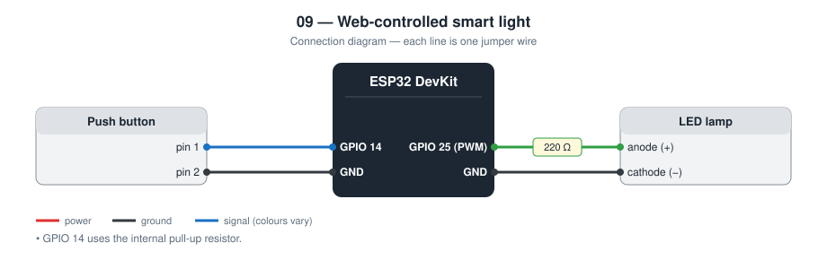
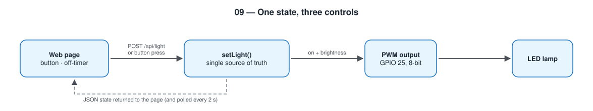

# 09 — Smart Light Controlled from a Web Page

A dimmable LED “lamp” on an ESP32 with three controls that stay in sync: a
web page, a physical push button, and an off-timer.

**Level 2 — IoT.** First project where the browser sends commands.

TODO: Add prototype photo (`images/prototype.jpg`)

TODO: Add screenshot of the page (`images/page.png`)

## Contents

1. [At a glance](#at-a-glance)
2. [Why I built it](#why-i-built-it)
3. [Problem and context](#problem-and-context)
4. [Objectives and success criteria](#objectives-and-success-criteria)
5. [What it does](#what-it-does)
6. [Background: how it works physically](#background-how-it-works-physically)
7. [Parts](#parts)
8. [Wiring](#wiring)
9. [Build steps](#build-steps)
10. [How it works](#how-it-works)
11. [Setup](#setup)
12. [Code walkthrough](#code-walkthrough)
13. [Engineering notes](#engineering-notes)
14. [Test checklist](#test-checklist)
15. [Results and discussion](#results-and-discussion)
16. [Troubleshooting](#troubleshooting)
17. [Challenges log](#challenges-log)
18. [Demo script (about one minute)](#demo-script-about-one-minute)
19. [What I learned](#what-i-learned)
20. [Limitations](#limitations)
21. [Future improvements](#future-improvements)
22. [Connection to further study](#connection-to-further-study)
23. [References](#references)

## At a glance

|  |  |
| --- | --- |
| **Board** | ESP32 DevKit |
| **Inputs** | Web requests, push button |
| **Output** | Dimmable LED lamp (PWM) |
| **Network** | Local network only; HTTP server with a small JSON API |
| **Key ideas** | REST-style API, single source of truth, input validation, PWM |
| **Firmware** | 172 lines of C++ in [`firmware/src/main.cpp`](firmware/src/main.cpp) |
| **Tests defined** | 7 (see [Test checklist](#test-checklist)) |
| **Hardware status** | TODO: built on (date) / tested on (date) |

## Why I built it

Project 06 only *reads* from the ESP32. Here the browser *changes*
something physical. That raises a new question: when a wall button and a
web page can both switch the same lamp, how does each one know the truth?

## Problem and context

A light switch on the wall is simple and reliable, but it is in one place.
Being able to switch a light from a phone helps someone who is in bed,
whose hands are full, or who has limited mobility, and a timer prevents a
light being left on all night.

Many “smart” lights get one thing wrong: the app and the physical switch
disagree. The app says on, the lamp is off, and the user stops trusting
both. A second common fault is that the light becomes unusable when the
network is down. This project is about getting those two things right on
a small scale.

## Objectives and success criteria

Each objective has a test I can pass or fail, so “it works” is not an opinion.

| # | Objective | How I will know it is met |
| --- | --- | --- |
| 1 | Control from a phone | ON / OFF, brightness, and timer all work from the page |
| 2 | Physical control always works | The button toggles the lamp with the router switched off |
| 3 | The page shows the truth | After a button press the page shows the new state within 2 s |
| 4 | Several users stay consistent | Two phones show the same state after either changes it |
| 5 | Reject bad input | `brightness=9999` is clamped to 255 and nothing crashes |

## What it does

- Web page with ON / OFF, a brightness slider, and off-timers (1, 10, 30 min)
- Physical button toggles the lamp even with no Wi-Fi
- The page shows the real state within 2 s, whoever changed it
- Small JSON API that could be called by another program

## Background: how it works physically

**REST style.** A common way to design a web API is to treat things as
*resources* with addresses and to use the HTTP method to say what you want:
`GET` reads without changing anything, `POST` (or `PUT`) changes
something. Keeping `GET` free of side effects matters in practice,
because browsers, link previews, and search tools issue `GET` requests on
their own.

**State and its owner.** “Is the lamp on?” has to be stored somewhere. If
both the page and the device keep their own copy, the copies will
eventually differ. The fix is a *single source of truth*: one owner (the
ESP32), and everyone else asks it.

**Synchronising a view.** The page learns the state in two ways: from the
response to its own commands, and by polling every two seconds to pick up
changes made by others. Polling is the simplest method; project 12 uses a
push connection instead.

**Input validation.** A slider in a web page limits what an honest user
can send, but the request can also be written by hand with a tool such as
`curl`. The device is the last line of defence, so it limits every value
before using it.

**PWM on the ESP32.** The ESP32 has a dedicated LED-control (LEDC)
peripheral that generates PWM in hardware. `analogWrite()` uses it with
8-bit resolution.

## Parts

| Qty | Part | Notes |
| --- | ---- | ----- |
| 1 | ESP32 DevKit (30-pin) | |
| 1 | LED + 220 Ω resistor | Stands in for a lamp |
| 1 | Push button | Wired to GND, no external resistor |

## Wiring



| Part | ESP32 |
| ---- | ----- |
| LED anode | **GPIO 25** through 220 Ω, cathode to GND |
| Button | **GPIO 14** to GND (internal pull-up) |

## Build steps

1. Connect the LED: GPIO 25 → 220 Ω → LED anode; cathode to GND.
2. Connect the push button between GPIO 14 and GND.
3. Copy `config.example.h` to `include/config.h` and enter the Wi-Fi details.
4. Upload and note the IP address on the Serial monitor.
5. Press the physical button first: the LED must toggle with no network involved.
6. Open the page on a phone and test each control.
7. Open the page on a second device at the same time.
8. Try the API by hand with `curl` (see *Example session*).
9. Run the test checklist.

## How it works



| Request | Meaning |
| ------- | ------- |
| `GET /` | The control page |
| `GET /api/state` | `{"on":true,"brightness":128,"timer_s":0}` |
| `POST /api/light` | Any of `on=0\|1`, `brightness=5..255`, `timer=<seconds>` |

The lamp state lives in **one place**, on the ESP32. The button, the timer,
and the web handler all call the same `setLight()` function, and every
`POST` answers with the resulting state. The page never assumes its click
worked; it displays what the device reports.

Brightness uses PWM. Values sent by the browser are clamped with
`constrain()` before use, because a device must not trust its input.

## Setup

```bash
cd firmware
mkdir -p include && cp config.example.h include/config.h   # then edit Wi-Fi values
pio run --target upload
pio device monitor
```

Open the printed IP address or `http://smartlight.local/`.

## Code walkthrough

The excerpts below are copied from [`firmware/src/main.cpp`](firmware/src/main.cpp).

### `setLight()`

The only function that changes the on / off state. The web handler, the
button, and the timer all call it, which is why they cannot disagree.

```cpp
static void setLight(bool on) {
  lightOn = on;
  if (!on) {
    timerActive = false;
  }
  applyOutput();
}
```

### `handleLight()`

Each parameter is optional and is validated with `constrain()`. The
function always ends with `sendState()`, so every command is answered
with the real resulting state.

```cpp
static void handleLight() {
  if (server.hasArg("brightness")) {
    brightness = constrain(server.arg("brightness").toInt(), MIN_BRIGHTNESS, MAX_BRIGHTNESS);
    applyOutput();
  }
  if (server.hasArg("on")) {
    setLight(server.arg("on") == "1");
  }
  if (server.hasArg("timer")) {
    const long seconds = constrain(server.arg("timer").toInt(), 0, MAX_TIMER_S);
    timerActive = seconds > 0 && lightOn;
    offAtMs = millis() + static_cast<unsigned long>(seconds) * 1000UL;
  }
  sendState();
}
```

### `buttonPressed()`

The same edge-detecting debounce as in project 03, reused unchanged.

```cpp
static bool buttonPressed(unsigned long now) {
  const bool reading = digitalRead(PIN_BUTTON);
  if (reading != buttonLastRead) {
    buttonLastRead = reading;
    buttonChangedMs = now;
  }
  if (now - buttonChangedMs > DEBOUNCE_MS && reading != buttonStable) {
    buttonStable = reading;
    return buttonStable == LOW;
  }
  return false;
}
```

## Engineering notes

### Design decisions

| Decision | Alternative I considered | Why I chose this |
| -------- | ------------------------ | ---------------- |
| State stored only on the ESP32 | Page remembers what it sent | Two controllers of one lamp must not each believe their own copy |
| Every `POST` returns the new state | Return only `OK` | The page displays what the device did, not what was requested |
| `GET` to read, `POST` to change | Everything through `GET` | A link preview or page refresh must never switch a lamp |
| Clamp all inputs with `constrain()` | Trust the slider's min / max | Anyone can send any number with `curl` |
| Slider sends on release | Send on every movement | Avoids dozens of requests per second |
| Physical button works without Wi-Fi | Web only | A lamp that cannot be switched when the router is down is worse than a normal lamp |

### Calculations

- **PWM.** `analogWrite()` on the ESP32 uses 8-bit duty at about 1 kHz by
  default: 256 brightness levels, no visible flicker.
- **LED current.** (3.3 V − 2.0 V) / 220 Ω ≈ 5.9 mA for a red LED. A white
  LED (about 3.0 V forward voltage) would get only about 1.4 mA and look
  dim on 3.3 V; a real lamp needs a MOSFET and its own supply.
- **Perceived brightness.** The eye's response is not linear: 50 % duty
  looks much brighter than “half”. A gamma correction table would make the
  slider feel even. I have not added it; it is listed as a next step.
- **Timer arithmetic.** The off-time is stored as a `millis()` value and
  compared with a signed difference, `(long)(now − offAt) >= 0`, so it
  stays correct when `millis()` wraps after 49.7 days.
- **Polling cost.** One small JSON response every 2 s per open page.
- **Memory (measured by the compiler).** 811 885 bytes of flash (61.9 %)
  and 47 192 bytes of RAM (14.4 %).

### Example session

```
$ curl http://smartlight.local/api/state
{"on":false,"brightness":255,"timer_s":0}

$ curl -X POST -d "on=1&brightness=128&timer=60" http://smartlight.local/api/light
{"on":true,"brightness":128,"timer_s":60}

$ curl -X POST -d "brightness=9999" http://smartlight.local/api/light
{"on":true,"brightness":255,"timer_s":58}
```

This shows the request format and the behaviour defined by the code. I
will replace it with a copy of my real terminal session after testing.

### Failure modes I designed for

| What can go wrong | What the device does |
| ----------------- | -------------------- |
| Out-of-range or non-numeric input | Clamped to the allowed range |
| Button and web page used at the same moment | Both go through `setLight()`; the last one wins and the page shows it |
| Wi-Fi down | Button still works |
| Lamp switched off while a timer runs | Timer is cancelled |
| Unknown URL | 404 response |

## Test checklist

| # | Test | Expected | Result |
| - | ---- | -------- | ------ |
| 1 | Press ON on the page | LED on, button turns yellow | TODO |
| 2 | Move the slider | Brightness changes on release | TODO |
| 3 | Press the physical button | LED toggles; page follows within 2 s | TODO |
| 4 | Set the 1 min timer | Countdown shown; LED off at zero | TODO |
| 5 | Two phones open at once | Both show the same state | TODO |
| 6 | Router off | Physical button still works | TODO |
| 7 | `POST brightness=9999` with curl | Clamped to 255, no crash | TODO |

## Results and discussion

**Not yet filled from hardware.** I complete this section only with what I observed on the real circuit.

| Item | Result |
| --- | --- |
| Date tested | TODO |
| Tests passed | TODO: __ of 7 |
| Tests failed at first, then fixed | TODO |
| Seconds from physical button press to page update (5 runs) | TODO |
| Seconds from tapping the page to the LED changing | TODO |
| Timer accuracy: 60 s setting measured with a stopwatch | TODO |
| Copy of my real `curl` session | TODO |

Questions I answer here after testing:

- Is a 2 s polling interval acceptable to a user, and what would it cost to make it 0.5 s?
- Does the slider feel even, or does most of the visible change happen at the low end? (Perceived brightness is not linear.)
- What should the lamp do after a power cut: stay off, or return to its last state?

TODO: Add one photo or screenshot that shows the main result.

## Troubleshooting

Common faults for this parts list and how to find them. These are checks to run, not a record of problems I had; my own are in the next section.

| Symptom | Likely cause | What to check or change |
| --- | --- | --- |
| LED very dim at 100 % | White or blue LED on 3.3 V through 220 Ω | Use a red or yellow LED, or a transistor and 5 V |
| Button toggles twice per press | Bounce longer than 40 ms | Increase `DEBOUNCE_MS` |
| Page shows “Cannot reach the ESP32” | Different network, or IP changed | Check the Serial monitor for the current IP |
| Slider jumps back while dragging | Poll arrives mid-drag | Already handled by the `dragging` flag; reload the page |
| ESP32 does not boot with the button held | Button on a strapping pin | Keep the button on GPIO 14, not GPIO 0 / 12 / 15 |
| `curl` returns 404 | Wrong method or path | Use `-X POST` for `/api/light` |

## Challenges log

A lab-notebook record of real problems from my own build. Empty until they happen.

| Date | What I saw | What I tried | Real cause | Fix | What I learned |
| --- | --- | --- | --- | --- | --- |
| TODO |  |  |  |  |  |
| TODO |  |  |  |  |  |

## Demo script (about one minute)

1. Press ON on the phone: the LED lights.
2. Drag the slider: brightness follows on release.
3. Press the physical button: the LED goes off, and two seconds later the
   phone shows OFF too. “The phone did not assume. It asked.”
4. Set the 1-minute timer and show the countdown.
5. From a laptop: `curl -X POST -d "brightness=9999" …` returns 255. “The
   device checks its input even when the page would never send that.”

## What I learned

- Designing a small REST-style API with `GET` for reading and `POST` for changing
- A single source of truth keeps several controls consistent
- Validating input on the device, not only in the page
- Debouncing a button without blocking the web server

## Limitations

- No login: anyone on the same Wi-Fi can switch the lamp
- Only works inside the local network
- The page polls every 2 s, so a button press is not shown instantly
- State is lost on reset (the lamp starts off)
- An LED on a GPIO pin is a model; a mains lamp needs proper isolated hardware

## Future improvements

Project [12 — Device Control from a Web App](../12-web-app-device-control/)
adds user login and works from outside the home network.

Further ideas, in the order I would attempt them:

| Improvement | What it needs | Difficulty |
| --- | --- | --- |
| Gamma-corrected brightness | A lookup table between slider value and duty cycle | Low |
| Remember the state through a reset | `Preferences` storage (see project 10) | Low |
| Password protection | HTTP basic authentication or a token | Medium |
| Instant updates | WebSocket instead of polling | Medium |
| Daily schedule | NTP time (see project 11) and stored on / off times | Medium |
| Control from outside the home | Cloud relay with login (done in project 12) | High |

## Connection to further study

| Idea used in this project | Where it continues at university |
| --- | --- |
| API design and HTTP methods | Web engineering; software architecture |
| Keeping distributed state consistent | Distributed systems; databases |
| Validating untrusted input | Cybersecurity; secure software engineering |
| PWM and LED driving | Power electronics |

## References

- ESP32 `WebServer` library documentation
- ESP32 LED control (LEDC) documentation — Espressif
- MDN Web Docs: HTTP request methods; Fetch API — https://developer.mozilla.org/
- Arduino core for ESP32 documentation — https://docs.espressif.com/projects/arduino-esp32/
- PlatformIO documentation — https://docs.platformio.org/
- TODO: list the tutorials, videos, courses, and people that actually helped me with this project
