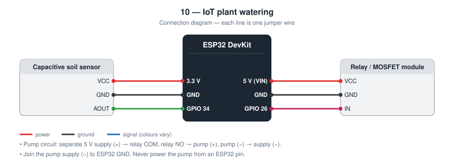
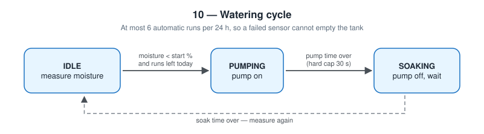

# 10 — IoT Automatic Plant Watering

An ESP32 that measures soil moisture, runs a small pump in short bursts
when the soil is dry, and has a web page for status, manual watering, and
settings.

**Level 2 — IoT.** First closed-loop control project.

TODO: Add prototype photo (`images/prototype.jpg`)

TODO: Add screenshot of the page (`images/page.png`)

## Contents

1. [At a glance](#at-a-glance)
2. [Why I built it](#why-i-built-it)
3. [Problem and context](#problem-and-context)
4. [Objectives and success criteria](#objectives-and-success-criteria)
5. [What it does](#what-it-does)
6. [Background: how it works physically](#background-how-it-works-physically)
7. [Parts](#parts)
8. [Wiring](#wiring)
9. [Build steps](#build-steps)
10. [How it works](#how-it-works)
11. [Setup](#setup)
12. [Code walkthrough](#code-walkthrough)
13. [Engineering notes](#engineering-notes)
14. [Test checklist](#test-checklist)
15. [Results and discussion](#results-and-discussion)
16. [Troubleshooting](#troubleshooting)
17. [Challenges log](#challenges-log)
18. [Demo script (about one minute)](#demo-script-about-one-minute)
19. [What I learned](#what-i-learned)
20. [Limitations](#limitations)
21. [Future improvements](#future-improvements)
22. [Connection to further study](#connection-to-further-study)
23. [References](#references)

## At a glance

|  |  |
| --- | --- |
| **Board** | ESP32 DevKit |
| **Input** | Capacitive soil moisture sensor (analog) |
| **Output** | Water pump through a relay or MOSFET module |
| **Network** | Local network only; web page for status, manual run, and settings |
| **Key ideas** | Feedback control with delay, two-point calibration, safety interlocks, non-volatile settings |
| **Firmware** | 272 lines of C++ in [`firmware/src/main.cpp`](firmware/src/main.cpp) |
| **Tests defined** | 7 (see [Test checklist](#test-checklist)) |
| **Hardware status** | TODO: built on (date) / tested on (date) |

## Why I built it

Earlier projects react to a sensor, but their output does not change what
the sensor reads. Here it does: the pump changes the moisture that decides
whether the pump runs. That is feedback control, and it has a trap, because
water needs minutes to spread through soil. A naive program keeps pumping
until the sensor finally reacts and floods the pot.

## Problem and context

Potted plants die more often from irregular watering than from anything
else: forgotten for a week during a trip, then overwatered to compensate.
A plant does not need water on a schedule; it needs the soil kept within
a range. That calls for measuring the soil, not the calendar.

Automating it introduces a risk that the manual method does not have. A
person stops pouring when the pot overflows. A controller keeps going for
as long as its sensor says “dry”, and a sensor can be wrong: knocked out
of the pot, disconnected, or simply slow to respond. The interesting part
of this project is making a controller that is safe when its only source
of information is unreliable.

## Objectives and success criteria

Each objective has a test I can pass or fail, so “it works” is not an opinion.

| # | Objective | How I will know it is met |
| --- | --- | --- |
| 1 | Measure moisture as a percentage | After calibration, air reads about 0 % and water about 100 % |
| 2 | Water automatically when dry | With the probe dry and auto on, exactly one burst runs, then the state is `soaking` |
| 3 | Never overwater from a failed sensor | With the probe left in air (pump disconnected) the relay stops after 6 runs |
| 4 | Keep settings through a power cut | After unplugging and replugging, the saved values are still shown |
| 5 | Work without Wi-Fi | Automatic watering runs with the router off |
| 6 | Pump is off at start-up | No relay click during boot or reset |

## What it does

- Converts the raw sensor value to 0–100 % using two calibration points
- Waters in a cycle: **pump** a few seconds → **soak** some minutes → measure again
- Safety limits: one run is at most 30 s; at most 6 automatic runs per 24 h
- Web page: moisture, pump state, *Water now* button, settings form
- Settings are saved in flash and survive a power cut
- Pump output is switched off first thing at boot

## Background: how it works physically

**Capacitive sensing.** The probe is a pair of copper tracks under a
protective coating, forming a capacitor whose “dielectric” is the soil
around it. Dry soil is mostly air and minerals, with a relative
permittivity of about 3–5. Water has a relative permittivity of about 80.
So the wetter the soil, the larger the capacitance. A small oscillator
circuit on the board (a 555 timer) converts that capacitance into a DC
voltage: **higher voltage when dry, lower when wet**.

**Why not the cheaper resistive probe.** A resistive probe passes current
through the soil between two bare metal prongs. That current causes
electrolysis, which corrodes the prongs within weeks and puts metal ions
into the soil. The capacitive probe has no exposed metal.

**Calibration.** The raw number depends on the individual sensor, the
soil type, how deep and how firmly the probe is inserted, and even the
fertiliser content. Two reference readings, in air and in water, define a
straight line that maps raw values to 0–100 %.

**Feedback control with dead time.** In a feedback loop the output (pump)
changes the quantity being measured (moisture). Here there is a long
*dead time*: water poured on the surface takes minutes to spread to the
sensor. A controller that pumps until the sensor responds will have
delivered far too much by then. The standard remedy is to act in small
steps and wait at least the dead time between them.

**Interlocks.** In industrial control, an interlock is a limit that holds
no matter what the main logic decides. This project has two (maximum run
time, maximum runs per day) plus a safe start-up state.

**Inductive loads.** A pump motor is a coil. When its current is switched
off, the collapsing magnetic field produces a voltage spike. A relay
isolates that from the ESP32; a MOSFET driver needs a flyback diode across
the motor.

## Parts

| Qty | Part | Notes |
| --- | ---- | ----- |
| 1 | ESP32 DevKit (30-pin) | |
| 1 | Capacitive soil moisture sensor v1.2 | Does not corrode like the two-prong resistive type |
| 1 | 3–6 V mini submersible pump + tube | |
| 1 | 1-channel relay module **or** MOSFET module | |
| 1 | Separate 5 V supply for the pump | For example a USB power bank |

## Wiring



| Part | ESP32 |
| ---- | ----- |
| Sensor VCC | **3.3 V** |
| Sensor GND | GND |
| Sensor AOUT | **GPIO 34** |
| Relay / MOSFET IN | **GPIO 26** |
| Relay VCC, GND | 5 V, GND |

```
Pump supply + ─── relay COM      relay NO ─── pump +
Pump supply − ─── pump −         Pump supply − ─── ESP32 GND (common ground)
```

Do not power the pump from the ESP32 3.3 V or 5 V pin: the motor's current
and electrical noise can reset the board. Keep water away from the
electronics, and put the board *above* the water container.

## Build steps

1. Connect the sensor: VCC to 3.3 V, GND to GND, AOUT to GPIO 34.
2. Connect the relay module: VCC to VIN (5 V), GND to GND, IN to GPIO 26.
3. **Leave the pump disconnected.** Upload the firmware and listen for the relay.
4. Open the web page. Note the raw value in air, then with the probe in a glass of water (only up to the line printed on the probe).
5. Enter both values as *Dry* and *Wet* calibration and save.
6. Press *Water now*: the relay should click on and then off after the set time.
7. Only now wire the pump circuit: separate 5 V (+) → relay COM; relay NO → pump (+); pump (−) → supply (−); supply (−) → ESP32 GND.
8. Put the pump in a container of water, the tube in the pot, and the electronics above water level.
9. Measure the pump's flow: time how long it takes to fill a measuring cup.
10. Run the test checklist.

## How it works



```
IDLE ──moisture < start % (and runs left today)──▶ PUMPING ──pump time──▶ SOAKING ──soak time──▶ IDLE
```

**Calibration.** Read the raw value on the page with the probe in air
(`Dry`) and in a glass of water (`Wet`), enter both, and save. A capacitive
probe reads *higher* when dry, so the conversion is inverted.

**Why the daily cap matters.** If the sensor falls out of the pot it reads
“dry” forever. Without a cap the pump would empty the whole tank onto the
desk.

## Setup

```bash
cd firmware
mkdir -p include && cp config.example.h include/config.h   # then edit
pio run --target upload
pio device monitor
```

Set `PUMP_ACTIVE_LOW` to `0` for a MOSFET module. Open the printed IP
address or `http://plant.local/`.

**First test without water:** disconnect the pump and listen for the relay click.

## Code walkthrough

The excerpts below are copied from [`firmware/src/main.cpp`](firmware/src/main.cpp).

### `toPercent()`

`map()` performs the two-point linear conversion. Because `dryRaw` is the
larger number, the mapping is inverted automatically. The guard at the top
prevents a division by zero if both calibration values are equal.

```cpp
static int toPercent(int raw) {
  if (settings.dryRaw == settings.wetRaw) {
    return 0;
  }
  const long percent = map(raw, settings.dryRaw, settings.wetRaw, 0, 100);
  return constrain(percent, 0, 100);
}
```

### `runController()`

The three-state cycle. `IDLE` starts a run only if auto is enabled, the
soil is below the threshold, **and** the daily count allows it. `PUMPING`
applies `min()` so that even a bad stored setting cannot exceed the hard
cap. `SOAKING` does nothing but wait.

```cpp
static void runController(unsigned long now) {
  if (now - dayStartMs >= DAY_MS) {
    dayStartMs = now;
    autoRuns = 0;
  }

  switch (phase) {
    case IDLE:
      if (settings.autoEnabled && moisturePercent < settings.startPercent) {
        if (autoRuns < MAX_AUTO_RUNS_PER_DAY) {
          autoRuns++;
          Serial.printf("[pump] auto run %d, moisture %d%%\n", autoRuns, moisturePercent);
          startPumping(now);
        }
      }
      break;

    case PUMPING: {
      const unsigned long runMs = static_cast<unsigned long>(
          min(settings.pumpSeconds, MAX_PUMP_SECONDS)) * 1000UL;
      if (now - phaseStartMs >= runMs) {
        setPump(false);
        phase = SOAKING;
        phaseStartMs = now;
      }
      break;
    }

    case SOAKING:
      if (now - phaseStartMs >= static_cast<unsigned long>(settings.soakMinutes) * 60000UL) {
        phase = IDLE;
      }
      break;
  }
}
```

## Engineering notes

### Design decisions

| Decision | Alternative I considered | Why I chose this |
| -------- | ------------------------ | ---------------- |
| Pump in short bursts, then wait | Pump until the sensor says “wet” | Water needs minutes to reach the sensor; continuous pumping overshoots and floods |
| Capacitive sensor | Resistive two-prong sensor | Resistive probes corrode within weeks because current flows through the soil |
| Two-point calibration stored in flash | Fixed numbers in the code | Every sensor and soil is different, and recalibration should not need a computer |
| Hard cap of 30 s per run | Trust the setting | A wrong setting or a bug must not run the pump for an hour |
| At most 6 automatic runs per 24 h | Unlimited | A sensor that falls out of the pot reads “dry” forever |
| Pump output off as the first line of `setup()` | Initialise in any order | A reset must never leave the pump running |
| Separate pump supply | Power the pump from the ESP32 | Motor current and electrical noise reset the microcontroller |

### Calculations

- **Moisture conversion.** percent = (dry − raw) / (dry − wet) × 100,
  limited to 0–100. With the default calibration (dry = 3000, wet = 1400),
  a raw reading of 2200 gives (3000 − 2200) / 1600 × 100 = 50 %. The
  defaults are placeholders until I calibrate my own sensor.
- **Filter.** α = 0.2 every 500 ms gives τ = −0.5 / ln(0.8) ≈ 2.2 s, which
  hides electrical noise from the pump.
- **Worst-case water per day.** The limits allow at most 6 × 30 s = 180 s
  of automatic pumping per 24 h. A small 5 V pump is typically rated around
  100 L/h (about 28 mL/s), so the absolute worst case is about 5 L. With
  the default 5 s burst it is 6 × 5 s ≈ 0.8 L. I will replace the flow
  figure with my own measurement (time to fill a measuring cup).
- **Flash wear.** Settings are written only when *Save* is pressed, not in
  the loop, so the flash memory is not worn out.
- **Memory (measured by the compiler).** 816 949 bytes of flash (62.3 %)
  and 47 304 bytes of RAM (14.4 %).

### Why bursts: a timing sketch

```
Pump     ████░░░░░░░░░░░░░░░░░░░░░░░░████░░░░░░░░░░░░░░░░░░░░░░░░
Moisture ────╱‾‾‾‾‾‾‾‾‾‾‾‾‾‾‾‾‾‾‾‾‾‾‾────╱‾‾‾‾‾‾‾‾‾‾‾‾‾‾‾‾‾‾‾‾‾‾‾
         pump  soak (water spreads)   pump  soak
```

The sketch shows the intended behaviour, not recorded data.

### Failure modes I designed for

| What can go wrong | What the device does |
| ----------------- | -------------------- |
| Sensor out of the soil or broken (reads dry) | Stops after 6 runs in 24 h |
| Bad setting sent to the API | Clamped: pump time 1–30 s, soak 1–240 min, threshold 5–90 % |
| Reset or crash while pumping | Pump is switched off first thing at boot |
| Wi-Fi down | Automatic watering continues; only the web page is unavailable |
| Dry and wet calibration equal | Guarded against division by zero; shows 0 % |
| Empty water tank | **Not handled**: no level sensor. Listed under Limitations |

## Test checklist

| # | Test | Expected | Result |
| - | ---- | -------- | ------ |
| 1 | Probe in air, then in water | Raw value changes clearly; note both: TODO | TODO |
| 2 | Enter calibration | Air ≈ 0 %, water ≈ 100 % | TODO |
| 3 | *Water now* | Pump runs for the set seconds, then stops | TODO |
| 4 | Dry probe, auto on | One burst, then `soaking` | TODO |
| 5 | Keep the probe dry all day (pump disconnected) | Stops after 6 runs | TODO |
| 6 | Power cycle | Settings are kept; pump stays off during boot | TODO |
| 7 | Router off | Automatic watering still runs | TODO |

## Results and discussion

**Not yet filled from hardware.** I complete this section only with what I observed on the real circuit.

| Item | Result |
| --- | --- |
| Date tested | TODO |
| Tests passed | TODO: __ of 7 |
| Tests failed at first, then fixed | TODO |
| Raw value in air | TODO |
| Raw value in water | TODO |
| Raw value in my soil when it looks dry / just watered | TODO |
| Pump flow (mL per second) | TODO |
| Water delivered per burst (mL) | TODO |
| Minutes until the sensor reading stops rising after one burst | TODO |

Questions I answer here after testing:

- How long is the real dead time in my pot, and is my soak time longer than it?
- How many bursts does it take to go from the start threshold to a stable wet reading?
- What is the worst-case volume per day with my measured flow, and would my saucer hold it?
- Did the reading jump while the pump was running (electrical noise), and did the filter hide it?

TODO: Add one photo or screenshot that shows the main result.

## Troubleshooting

Common faults for this parts list and how to find them. These are checks to run, not a record of problems I had; my own are in the next section.

| Symptom | Likely cause | What to check or change |
| --- | --- | --- |
| Percentage reads backwards | Dry and wet calibration swapped | Dry must be the larger raw number |
| Raw value barely changes | Probe not inserted far enough, or a faulty board | Insert to the line; compare air and water |
| Relay on at boot, off when it should pump | Active-HIGH module with `PUMP_ACTIVE_LOW 1` | Set `PUMP_ACTIVE_LOW 0` |
| ESP32 resets when the pump starts | Pump sharing the ESP32's supply | Give the pump its own 5 V; join only the grounds |
| Pump runs but no water | Air in the pump, or it is above the water | Submerge the pump fully; prime the tube |
| Water keeps flowing after the pump stops | Siphon: tube outlet lower than the tank level | Raise the outlet above the tank's water level |
| Stops watering after a few runs | Daily cap reached | Shown as `6 / 6` on the page; find out why the soil stays dry |

## Challenges log

A lab-notebook record of real problems from my own build. Empty until they happen.

| Date | What I saw | What I tried | Real cause | Fix | What I learned |
| --- | --- | --- | --- | --- | --- |
| TODO |  |  |  |  |  |
| TODO |  |  |  |  |  |

## Demo script (about one minute)

1. Show the page: moisture %, raw value, pump state.
2. Lift the probe out of the soil: the percentage drops, one short pump
   burst, then `soaking`.
3. “It will not pump again for ten minutes, even though it still reads
   dry. Water is slow; the controller has to be patient.”
4. Press *Water now* for a manual burst.
5. Point at `runs today 1 / 6`: “If the sensor fails, this number is what
   protects the desk.”

## What I learned

- Feedback control with a slow system, and why “pump then wait” works
- Two-point calibration of an analog sensor
- Designing for sensor failure, not only for the normal case
- Saving settings in non-volatile storage
- Separating a motor's power supply from the microcontroller's

## Limitations

- Calibration depends on the soil type and how deep the probe sits
- No water-level sensor: the pump can run dry if the tank is empty
- The “24 h” counter uses uptime and restarts after a reset
- No login on the web page, and it only works inside the local network
- Tested amounts of water are not measured in millilitres

## Future improvements

A float switch in the tank to block the pump when it is empty, and a
moisture log in the cloud (see project [13](../13-cloud-data-logging/)).

Further ideas, in the order I would attempt them:

| Improvement | What it needs | Difficulty |
| --- | --- | --- |
| Block the pump when the tank is empty | Float switch on a GPIO as a third interlock | Low |
| Log moisture over days | Queue and cloud upload from project 13 | Medium |
| Alert when the cap is reached | Telegram message from project 07 | Low |
| Several plants | One sensor and valve per pot; a multiplexed ADC | High |
| Run from a small solar panel | Battery, charge controller, deep sleep | High |

## Connection to further study

| Idea used in this project | Where it continues at university |
| --- | --- |
| Capacitance and permittivity | Electromagnetism; sensor design |
| Feedback, dead time, and stability | Control engineering |
| Interlocks and fail-safe states | Safety engineering; industrial automation |
| Calibration | Measurement science; statistics |
| Water use in agriculture | Agricultural and environmental engineering |

## References

- Capacitive soil moisture sensor v1.2 documentation; NE555 / TLC555 timer datasheet
- ESP32 `Preferences` (non-volatile storage) documentation — Espressif
- Datasheet of my relay or MOSFET module and of the pump (TODO: add exact models)
- Background reading on dead time in process control
- Arduino core for ESP32 documentation — https://docs.espressif.com/projects/arduino-esp32/
- PlatformIO documentation — https://docs.platformio.org/
- TODO: list the tutorials, videos, courses, and people that actually helped me with this project
