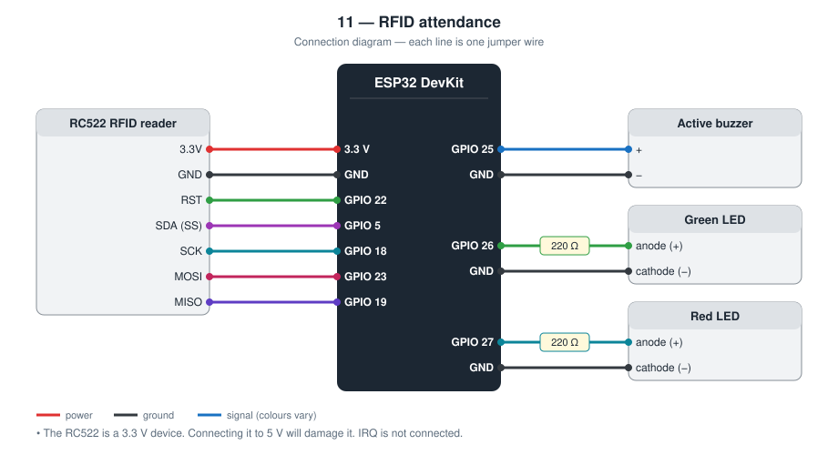
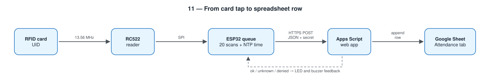

# 11 — RFID Attendance System

Tap a card on the reader and a row with the time, card ID, and name
appears in a Google Sheet.

**Level 2 — IoT.** First project that writes to a shared online document.

TODO: Add prototype photo (`images/prototype.jpg`)

TODO: Add screenshot of the sheet with **test names only** (`images/sheet.png`)

## Contents

1. [At a glance](#at-a-glance)
2. [Why I built it](#why-i-built-it)
3. [Problem and context](#problem-and-context)
4. [Objectives and success criteria](#objectives-and-success-criteria)
5. [What it does](#what-it-does)
6. [Background: how it works physically](#background-how-it-works-physically)
7. [Parts](#parts)
8. [Wiring](#wiring)
9. [Build steps](#build-steps)
10. [How it works](#how-it-works)
11. [Setup](#setup)
12. [Privacy](#privacy)
13. [Code walkthrough](#code-walkthrough)
14. [Engineering notes](#engineering-notes)
15. [Test checklist](#test-checklist)
16. [Results and discussion](#results-and-discussion)
17. [Troubleshooting](#troubleshooting)
18. [Challenges log](#challenges-log)
19. [Demo script (about one minute)](#demo-script-about-one-minute)
20. [What I learned](#what-i-learned)
21. [Limitations](#limitations)
22. [Future improvements](#future-improvements)
23. [Connection to further study](#connection-to-further-study)
24. [References](#references)

## At a glance

|  |  |
| --- | --- |
| **Board** | ESP32 DevKit |
| **Input** | RC522 RFID reader (SPI), MIFARE cards |
| **Outputs** | Buzzer, green and red LEDs, rows in a Google Sheet |
| **Network** | Wi-Fi; HTTPS to a Google Apps Script web app; NTP for time |
| **Key ideas** | SPI bus, RFID, queue between input and upload, server-side script, data privacy |
| **Firmware** | 234 lines of C++ in [`firmware/src/main.cpp`](firmware/src/main.cpp) |
| **Tests defined** | 7 (see [Test checklist](#test-checklist)) |
| **Hardware status** | TODO: built on (date) / tested on (date) |

## Why I built it

Taking attendance on paper is slow and has to be typed up afterwards. I
wanted to build the whole chain from a physical card to a spreadsheet a
teacher already knows how to use, and to make sure a tap is not lost when
the Wi-Fi is unreliable.

## Problem and context

Calling names takes several minutes of every lesson, and the paper
register then has to be typed into a spreadsheet by someone, with
mistakes. Over a school year that is hours of teaching time and a record
nobody fully trusts.

A card tap takes a second and creates the record directly. For a school,
though, a system like this is only acceptable if it fits how teachers
already work (a spreadsheet they can filter and print), copes with
unreliable Wi-Fi, and treats the data with care, because a list of who
was where and when is personal information about children.

## Objectives and success criteria

Each objective has a test I can pass or fail, so “it works” is not an opinion.

| # | Objective | How I will know it is met |
| --- | --- | --- |
| 1 | Record a tap as a row | A registered card produces a row with time, UID, name, and class |
| 2 | Give immediate feedback | Beep and LED within about 0.2 s of the tap, before any upload |
| 3 | One tap, one row | A card held on the reader for 10 s creates at most two rows |
| 4 | Lose nothing during short outages | Three taps made with the router off appear after it returns, with the original times |
| 5 | Handle unknown cards visibly | An unregistered card gives a red LED and a row marked `unknown card` |
| 6 | Refuse unauthorised requests | With the wrong secret, no row is added |

## What it does

- Reads the UID of MIFARE cards and key fobs with an RC522 reader
- Short beep + green LED as soon as a card is read
- Time-stamps the scan on the ESP32 (clock set from the Internet via NTP)
- Queues up to 20 scans in memory and uploads them in order
- Google Apps Script looks the card up in a `Students` tab and appends a row
  to an `Attendance` tab
- Red LED + long beep for a card that is not registered
- Ignores the same card for 5 s so one tap is one row

## Background: how it works physically

**RFID.** The reader's antenna coil produces a magnetic field alternating
at 13.56 MHz. A card contains a coil and a chip but no battery. Within a
few centimetres, the reader's field induces enough voltage in the card's
coil to power the chip (the same principle as a transformer). The card
answers by switching a load on and off across its coil, which the reader
detects as tiny changes in its own field (*load modulation*).

**The UID.** Each MIFARE card carries a factory-programmed identifier of
4 or 7 bytes. The reader obtains it in the anti-collision step, which also
allows several cards in the field to be told apart. The UID is sent
unencrypted and can be read by any reader.

**SPI.** The RC522 talks to the ESP32 over the Serial Peripheral
Interface: a clock line (SCK), one data line in each direction (MOSI and
MISO), and a select line (SS) that tells the device it is being
addressed. SPI is faster than I2C and uses more wires.

**Real time.** A microcontroller only counts milliseconds since power-on.
The Network Time Protocol lets it ask a time server for the current time,
expressed as seconds since 1 January 1970 UTC (*Unix time*).

**Apps Script web app.** Google Apps Script is JavaScript that runs on
Google's servers with access to a spreadsheet. Published as a web app, it
gets a URL; a `POST` to that URL runs the script's `doPost()` function.

**Queues.** A queue (first in, first out) between a fast producer and a
slow consumer lets each run at its own pace. It is how printers, network
routers, and message systems cope with bursts.

**Identification versus authentication.** The card says *which card* was
presented. It does not prove *who* presented it, and because the UID can
be copied, it does not even prove the card is the original.

## Parts

| Qty | Part | Notes |
| --- | ---- | ----- |
| 1 | ESP32 DevKit (30-pin) | |
| 1 | RC522 RFID module + cards / key fobs | **3.3 V only** |
| 1 | Active buzzer | |
| 2 | LED (green, red) + 220 Ω resistors | |

## Wiring



| RC522 pin | ESP32 |
| --------- | ----- |
| 3.3V | **3.3 V** (5 V will damage the module) |
| GND | GND |
| RST | **GPIO 22** |
| SDA (SS) | **GPIO 5** |
| SCK | **GPIO 18** |
| MOSI | **GPIO 23** |
| MISO | **GPIO 19** |
| IRQ | not connected |

| Part | ESP32 |
| ---- | ----- |
| Buzzer + | **GPIO 25** |
| Green LED anode | **GPIO 26** through 220 Ω |
| Red LED anode | **GPIO 27** through 220 Ω |

## Build steps

1. Solder the header pins to the RC522 if they came loose in the bag. Unsoldered pins are the most common cause of failure.
2. Wire the seven RC522 connections exactly as in the diagram. Power from **3.3 V**.
3. Connect the buzzer (GPIO 25) and the LEDs through 220 Ω (GPIO 26 green, GPIO 27 red).
4. Upload with any placeholder URL and check the Serial monitor for a firmware version such as `0x92`.
5. Tap a card and check that a UID is printed.
6. Create the spreadsheet with the two tabs and header rows.
7. Paste `apps-script/Code.gs`, set the secret, and deploy as a web app.
8. Put the URL and the same secret into `include/config.h`; upload again.
9. Tap a card, copy its UID from the `unknown card` row into the *Students* tab with an invented name.
10. Run the test checklist.

## How it works



```
Card ─▶ RC522 ─SPI─▶ ESP32 ─queue─▶ HTTPS POST ─▶ Apps Script ─▶ Google Sheet
```

The reader and the uploader are deliberately separated by a queue. Reading
a card takes milliseconds; an HTTPS request takes seconds and can fail. The
user gets feedback from the fast part, and the slow part catches up.

The request body is JSON:

```json
{"secret":"…","device":"classroom-door","uid":"04A1B2C3","scanned_at":1760000000}
```

The script answers `ok`, `unknown` (card not in the list), or `denied`
(wrong secret).

## Setup

**1. Spreadsheet.** Create a Google Sheet with two tabs:

| Tab | Header row |
| --- | ---------- |
| `Students` | `UID`, `Name`, `Class` |
| `Attendance` | `Time`, `UID`, `Name`, `Class`, `Device`, `Result` |

**2. Script.** *Extensions → Apps Script*, paste
[apps-script/Code.gs](apps-script/Code.gs), change `SHARED_SECRET`, then
*Deploy → New deployment → Web app* (Execute as **Me**, access **Anyone**).
Copy the URL ending in `/exec`.

**3. Firmware**

```bash
cd firmware
mkdir -p include && cp config.example.h include/config.h   # URL + same secret
pio run --target upload
pio device monitor
```

**4. Register cards.** Tap a card, read its UID from the Serial monitor or
from the `unknown card` row, and add it to the `Students` tab.

## Privacy

Attendance data is personal data. In this repository and in any screenshot
I use invented names only. The spreadsheet itself is private to the Google
account that owns it, and the real URL and secret are never committed.

## Code walkthrough

The excerpts below are copied from [`firmware/src/main.cpp`](firmware/src/main.cpp).

### `readCard()`

Everything here is fast and local: read the UID, apply the 5-second
repeat block, put the scan in the queue, give feedback. No network call
is made in this function.

```cpp
static void readCard(unsigned long now) {
  if (!rfid.PICC_IsNewCardPresent() || !rfid.PICC_ReadCardSerial()) {
    return;
  }

  char uid[UID_TEXT_SIZE];
  uidToText(rfid.uid, uid);
  rfid.PICC_HaltA();
  rfid.PCD_StopCrypto1();

  if (strcmp(uid, lastUid) == 0 && now - lastScanMs < SAME_CARD_BLOCK_MS) {
    return;
  }
  strncpy(lastUid, uid, UID_TEXT_SIZE);
  lastScanMs = now;

  if (enqueue(uid)) {
    Serial.printf("[rfid] %s queued (%d waiting)\n", uid, queueCount);
    feedback(true, false, 120);
  } else {
    Serial.println("[rfid] queue full, scan rejected");
    feedback(false, true, 800);
  }
}
```

### `enqueue()`

The scan is stored together with the current time. If the clock has not
been set yet, the time is stored as 0 and the server substitutes its own
arrival time.

```cpp
static bool enqueue(const char* uid) {
  if (queueCount >= QUEUE_SIZE) {
    return false;
  }
  const time_t now = time(nullptr);
  Scan& slot = queue[(queueHead + queueCount) % QUEUE_SIZE];
  strncpy(slot.uid, uid, UID_TEXT_SIZE - 1);
  slot.uid[UID_TEXT_SIZE - 1] = '\0';
  slot.scannedAt = now > CLOCK_VALID_AFTER ? now : 0;
  queueCount++;
  return true;
}
```

### `flushQueue()`

The slow side. It sends only the scan at the head of the queue and
removes it only when `upload()` reports that the server answered. On
failure the same scan is retried after 5 s.

```cpp
static void flushQueue(unsigned long now) {
  if (queueCount == 0 || WiFi.status() != WL_CONNECTED) {
    return;
  }
  if (lastUploadAttemptMs != 0 && now - lastUploadAttemptMs < UPLOAD_RETRY_INTERVAL_MS) {
    return;
  }

  if (upload(queue[queueHead])) {
    queueHead = (queueHead + 1) % QUEUE_SIZE;
    queueCount--;
    lastUploadAttemptMs = 0;  // send the next one straight away
  } else {
    lastUploadAttemptMs = now;
  }
}
```

## Engineering notes

### Design decisions

| Decision | Alternative I considered | Why I chose this |
| -------- | ------------------------ | ---------------- |
| Queue between reader and uploader | Upload inside the card-read code | A tap takes milliseconds, HTTPS takes seconds; the user should not wait or lose a tap |
| Timestamp on the ESP32 (NTP) | Let the spreadsheet add the time | A scan uploaded late must keep the time it really happened |
| Google Sheets through Apps Script | My own database and website | Teachers already know how to filter and print a spreadsheet |
| Name lookup in the sheet | Names stored in the firmware | Adding a student is editing a cell, not re-flashing a board |
| Shared secret in the request | Open URL | The web app URL must be public to work; the secret stops strangers adding rows |
| Ignore the same card for 5 s | Record every read | The reader sees a held card many times per second |
| Drop a scan the server rejected | Retry forever | A permanently bad request would block everyone behind it in the queue |

### Calculations

- **UID length.** MIFARE Classic cards have a 4-byte UID (8 hex
  characters); newer cards have 7 bytes (14 characters). The buffer holds
  up to 10 bytes (20 characters).
- **Queue memory.** 20 scans of under 32 bytes each: less than 1 kB.
- **Time.** NTP gives seconds since 1970 in UTC. The script converts that
  to a date, and the sheet displays it in its own time zone.
- **Reader.** The RC522 works at 13.56 MHz with a range of about 3 cm, and
  talks to the ESP32 over SPI (four signal wires plus reset).
- **Supply.** The RC522 is a 3.3 V part with no 5 V tolerance.
- **Memory (measured by the compiler).** 928 501 bytes of flash (70.8 %)
  and 47 496 bytes of RAM (14.5 %).

### Request and response

```
POST https://script.google.com/macros/s/<deployment>/exec
{"secret":"…","device":"classroom-door","uid":"04A1B2C3","scanned_at":1760000000}

→ {"status":"ok","name":"Test Student A"}      green LED, short beep
→ {"status":"unknown"}                          red LED, long beep, row marked “unknown card”
→ {"status":"denied"}                           wrong secret, nothing written
```

Apps Script answers a `POST` with a redirect (HTTP 302) to the real
response; the firmware follows it.

### Security and privacy review

| Risk | Status |
| ---- | ------ |
| Someone finds the web app URL | Mitigated: requests without the secret are refused |
| Secret leaks | Change it in the script and firmware, redeploy |
| Card UID is copied | **Not solved**: UIDs are readable by any reader. This identifies, it does not authenticate |
| One student taps for another | **Not solved** by technology; needs a person watching or a second factor |
| Network eavesdropping | Encrypted by HTTPS, but the certificate is not verified |
| Real names in a public repository | Avoided: invented names only in examples and screenshots |

### Failure modes I designed for

| What can go wrong | What the device does |
| ----------------- | -------------------- |
| Wi-Fi down | Scans queue (up to 20) and upload later with their original times |
| Queue full | Red LED, long beep; the scan is refused visibly rather than lost silently |
| Card held on the reader | One row per 5 s at most |
| Clock not yet synced | `scanned_at` is 0 and the script uses the arrival time instead |
| RC522 wired wrongly | Version printed at boot is `0x00` or `0xFF`, which shows the fault immediately |

## Test checklist

| # | Test | Expected | Result |
| - | ---- | -------- | ------ |
| 1 | Power on | Serial prints the RC522 firmware version (not `0x00` / `0xFF`) | TODO |
| 2 | Tap a registered card | Beep, then a row with the right name | TODO |
| 3 | Tap an unregistered card | Row marked `unknown card`, red LED | TODO |
| 4 | Hold a card on the reader for 10 s | At most two rows | TODO |
| 5 | Router off, tap 3 cards, router on | 3 rows appear with the **original** tap times | TODO |
| 6 | Wrong secret in `config.h` | No row is added | TODO |
| 7 | Time from tap to row | Record the seconds: TODO | TODO |

## Results and discussion

**Not yet filled from hardware.** I complete this section only with what I observed on the real circuit.

| Item | Result |
| --- | --- |
| Date tested | TODO |
| Tests passed | TODO: __ of 7 |
| Tests failed at first, then fixed | TODO |
| RC522 firmware version reported | TODO |
| Reading distance (mm) for a card and for a key fob | TODO |
| Seconds from tap to row (5 runs: min / median / max) | TODO |
| Outage test: taps made / rows received / were the times correct? | TODO |
| Cards registered | TODO |

Questions I answer here after testing:

- How many taps per minute can the system keep up with, given the upload time?
- What would a class of 40 arriving within two minutes do to a 20-slot queue?
- Who can see the spreadsheet, and who should be able to?
- How could this system be cheated, and how much does that matter for its purpose?

TODO: Add one photo or screenshot that shows the main result.

## Troubleshooting

Common faults for this parts list and how to find them. These are checks to run, not a record of problems I had; my own are in the next section.

| Symptom | Likely cause | What to check or change |
| --- | --- | --- |
| Version `0x00` or `0xFF` at boot | Wiring fault or unsoldered header | Re-check all seven wires; solder the header |
| Version is fine, but no card is read | Card not MIFARE 13.56 MHz, or held too far | Use the supplied card; hold within 2–3 cm |
| RC522 gets hot | Powered from 5 V | **Disconnect**; use 3.3 V (the module may be damaged) |
| `[upload] HTTP 302` or `401` | Web app not deployed for *Anyone* | Redeploy with access set to *Anyone* |
| `[upload] rejected: <!DOCTYPE html…` | Script error, or the old deployment URL | Open *Executions* in Apps Script; create a new deployment after editing |
| Serial shows `rejected` and no row is added | Secrets differ | Make `SCRIPT_SECRET` and `SHARED_SECRET` identical |
| Time column is wrong by hours | Spreadsheet time zone | *File → Settings → Time zone* in the sheet |
| Same card creates many rows | Repeat block too short for how cards are presented | Increase `SAME_CARD_BLOCK_MS` |

## Challenges log

A lab-notebook record of real problems from my own build. Empty until they happen.

| Date | What I saw | What I tried | Real cause | Fix | What I learned |
| --- | --- | --- | --- | --- | --- |
| TODO |  |  |  |  |  |
| TODO |  |  |  |  |  |

## Demo script (about one minute)

1. Show the two tabs of the sheet (test names only).
2. Tap a registered card: beep, and a row appears with the name.
3. Tap an unknown card: red LED, and a row marked `unknown card`. “That is
   how I register new cards.”
4. Router off, tap three cards, router on: three rows appear, each with
   the time of the tap, not the time of the upload.
5. “The reader and the Internet are separated by a queue. The fast part
   never waits for the slow part.”

## What I learned

- SPI wiring and reading a device over a bus
- Decoupling a fast input from a slow network with a queue
- Getting real time on a microcontroller with NTP
- Writing a small server-side script and protecting it with a shared secret
- Thinking about personal data before publishing a project

## Limitations

- A card UID can be copied; this is identification, not secure authentication
- Nothing stops one student from tapping a friend's card
- The queue is in RAM: scans waiting for upload are lost if power is cut
- While one upload is in progress (a few seconds) a new tap can be missed
- The firmware does not verify Google's TLS certificate (`setInsecure()`)
- The shared secret is the only protection of the web app URL

## Future improvements

An OLED that shows the student's name after a tap, and a daily summary tab
(present / late / absent) calculated in the sheet.

Further ideas, in the order I would attempt them:

| Improvement | What it needs | Difficulty |
| --- | --- | --- |
| Show the student's name after a tap | OLED display; parse the name from the response | Medium |
| Present / late / absent summary | Formulas or a second script in the sheet | Low |
| Keep the queue through a reset | Store pending scans in flash | Medium |
| Check-in and check-out | Alternate the row type per card per day | Medium |
| Stronger cards | MIFARE DESFire with mutual authentication | High |
| Verify Google's certificate | Embed the root certificate | Medium |

## Connection to further study

| Idea used in this project | Where it continues at university |
| --- | --- |
| Inductive coupling and resonance | Electromagnetism; RF engineering |
| Serial buses (SPI) | Digital systems; computer architecture |
| Queues and producer / consumer problems | Data structures; operating systems |
| Identification, authentication, and privacy | Cybersecurity; ethics and law in computing |
| Designing for real users | Human–computer interaction |

## References

- MFRC522 contactless reader IC datasheet, NXP Semiconductors
- MFRC522 Arduino library documentation (miguelbalboa)
- Google Apps Script: Web Apps and Spreadsheet service — https://developers.google.com/apps-script
- ISO/IEC 14443 (contactless cards) overview
- Arduino core for ESP32 documentation — https://docs.espressif.com/projects/arduino-esp32/
- PlatformIO documentation — https://docs.platformio.org/
- TODO: list the tutorials, videos, courses, and people that actually helped me with this project
