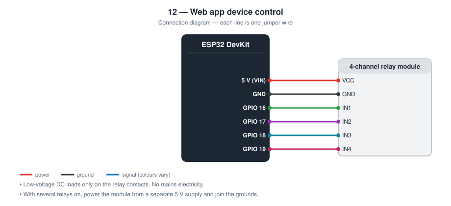
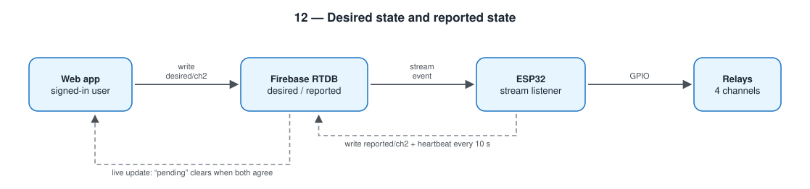

# 12 — Device Control from a Web App

Four relay channels switched from a web app with user login. It works from
any network, and the app only shows a channel as ON after the ESP32
confirms the relay really switched.

**Level 2 — IoT.** Builds on project [09](../09-web-controlled-smart-light/).

Low-voltage DC loads only. **Do not connect mains electricity to the relays.**

TODO: Add prototype photo (`images/prototype.jpg`)

TODO: Add screenshot of the web app (`images/web-app.png`)

## Contents

1. [At a glance](#at-a-glance)
2. [Why I built it](#why-i-built-it)
3. [Problem and context](#problem-and-context)
4. [Objectives and success criteria](#objectives-and-success-criteria)
5. [What it does](#what-it-does)
6. [Background: how it works physically](#background-how-it-works-physically)
7. [Parts](#parts)
8. [Wiring](#wiring)
9. [Build steps](#build-steps)
10. [How it works](#how-it-works)
11. [Setup](#setup)
12. [Code walkthrough](#code-walkthrough)
13. [Engineering notes](#engineering-notes)
14. [Test checklist](#test-checklist)
15. [Results and discussion](#results-and-discussion)
16. [Troubleshooting](#troubleshooting)
17. [Challenges log](#challenges-log)
18. [Demo script (about one minute)](#demo-script-about-one-minute)
19. [What I learned](#what-i-learned)
20. [Limitations](#limitations)
21. [Future improvements](#future-improvements)
22. [Connection to further study](#connection-to-further-study)
23. [References](#references)

## At a glance

|  |  |
| --- | --- |
| **Board** | ESP32 DevKit |
| **Input** | Commands from a cloud database (stream) |
| **Output** | 4-channel relay module (low-voltage DC loads) |
| **Network** | Wi-Fi; Firebase Authentication and Realtime Database; static web app |
| **Key ideas** | Desired vs reported state, authentication and authorisation, streaming, concurrency |
| **Firmware** | 218 lines of C++ in [`firmware/src/main.cpp`](firmware/src/main.cpp) |
| **Tests defined** | 8 (see [Test checklist](#test-checklist)) |
| **Hardware status** | TODO: built on (date) / tested on (date) |

## Why I built it

The smart light in project 09 has two weaknesses: it only works on the home
Wi-Fi, and anyone on that Wi-Fi can use it. I wanted remote access with a
login. I also wanted to fix something most hobby dashboards get wrong: a
button that turns green when you press it, whether or not the device ever
received the command.

## Problem and context

The smart light in project 09 stops at the front door: outside the home
Wi-Fi it cannot be reached, and inside it anyone can control it. Useful
remote control needs to work from anywhere and only for the right people.

Reaching a device inside a home network from outside is hard to do
safely. Opening a port on the router exposes the device to the whole
Internet. The common solution is to let both the device and the app make
*outgoing* connections to a shared cloud service that passes messages
between them.

That indirection creates the problem this project concentrates on. When
the user presses a button, the command travels app → cloud → device, and
any step can fail. An app that shows “ON” the moment the button is
pressed is showing a wish. For a heater, a pump, or a door, the
difference between “asked for” and “done” matters.

## Objectives and success criteria

Each objective has a test I can pass or fail, so “it works” is not an opinion.

| # | Objective | How I will know it is met |
| --- | --- | --- |
| 1 | Control from any network | A phone on mobile data switches a relay |
| 2 | Only signed-in users | Without signing in, the database refuses reads and writes |
| 3 | Fast response | Relay switches promptly after a click (measured delay recorded) |
| 4 | The app never lies | With the ESP32 unplugged, a clicked channel stays `pending` |
| 5 | Show device health | The pill shows offline within 30 s of unplugging |
| 6 | Catch up after an outage | On reconnecting, relays move to the desired state without user action |
| 7 | Safe start-up | No relay switches on during boot |

## What it does

- Sign-in with email and password (Firebase Authentication)
- Four channels, each with a label and a toggle
- Commands reach the ESP32 through a live stream, without polling
- Every channel shows **pending** until the device reports the new state
- Online / offline indicator based on a heartbeat every 10 s
- Relays are forced off at boot

## Background: how it works physically

**Authentication and authorisation.** *Authentication* answers “who are
you?” (here: an e-mail and password checked by Firebase). *Authorisation*
answers “what may you do?” (here: database rules that allow reads and
writes only when `auth != null`). A login screen without rules protects
nothing, because the database can be reached directly with the project's
public configuration values.

**A real-time database.** Firebase Realtime Database stores one large
JSON tree. Clients do not only read and write; they *listen* to a path
and are told immediately when it changes.

**Streaming.** The ESP32 keeps one HTTPS connection open to the path it
cares about, and the server sends an event down it whenever the data
changes (Server-Sent Events). This replaces asking “anything new?” every
second.

**Desired and reported state.** The app writes what the user *wants*. The
device writes what it has *done*. Nobody writes the other's value. The
interface compares the two: equal means confirmed, different means
pending. Large IoT platforms use exactly this pattern under the names
*device shadow* and *device twin*.

**Heartbeat.** A device that is switched off cannot say so. Instead it
regularly writes a timestamp while alive, and the app treats an old
timestamp as “offline”.

**Concurrency.** The library delivers stream events in a separate task
that can run at any moment. If both that task and the main loop changed
pins or used the network connection, they could interfere. The callback
therefore only records what was requested in `volatile` variables, and
the main loop does the work.

**Relays.** A relay is an electromagnet that moves a mechanical switch,
so a small current can control a separate circuit with no electrical
connection between them.

## Parts

| Qty | Part | Notes |
| --- | ---- | ----- |
| 1 | ESP32 DevKit (30-pin) | |
| 1 | 4-channel 5 V relay module | Usually active-LOW |
| — | Low-voltage loads | LEDs with resistors, a 5 V fan, etc. |

## Wiring



| Relay module | ESP32 |
| ------------ | ----- |
| VCC | 5 V (VIN) |
| GND | GND |
| IN1 | **GPIO 16** |
| IN2 | **GPIO 17** |
| IN3 | **GPIO 18** |
| IN4 | **GPIO 19** |

## Build steps

1. Connect the relay module: VCC to VIN (5 V), GND to GND, IN1–IN4 to GPIO 16–19.
2. Connect a harmless low-voltage load to one relay (an LED with a resistor on 5 V) or just listen for clicks.
3. In Firebase: create the project, enable Email/Password sign-in, add two users.
4. Create the Realtime Database and publish `database.rules.json`.
5. Register a web app to get the configuration values.
6. Fill in `firmware/include/config.h` (device user) and upload.
7. Check the Serial monitor for `listening for commands`.
8. Fill in `web-app/firebase-config.js`, serve the folder, and sign in with your own user.
9. Watch the database in the Firebase console while pressing buttons: `desired` changes first, then `reported`.
10. Run the test checklist, including the mobile-data test.

## How it works



The web app and the ESP32 never talk to each other directly. They share
three nodes in Firebase Realtime Database:

```
device_control/
├── desired/   ch1..ch4   written by the web app   “what the user wants”
├── reported/  ch1..ch4   written by the ESP32     “what the relay is doing”
└── status/    last_seen  written by the ESP32     server timestamp
```

```
click ─▶ desired/ch2 = true ─stream─▶ ESP32 switches relay ─▶ reported/ch2 = true ─▶ card shows ON
```

If the ESP32 is offline, `desired` and `reported` disagree and the card
stays **pending**. The interface cannot claim something that did not happen.

The stream callback runs in a separate task, so it only records the
request; the main loop does the pin and network work.

## Setup

**1. Firebase**

- Create a project, enable *Authentication → Email/Password*
- Add two users: one for you, one for the ESP32
- Create a *Realtime Database* and publish [database.rules.json](database.rules.json)
- Add a *Web app* to get the config values

**2. Firmware**

```bash
cd firmware
mkdir -p include && cp config.example.h include/config.h   # then edit
pio run --target upload
pio device monitor
```

**3. Web app**

```bash
cd web-app
cp firebase-config.example.js firebase-config.js           # then edit
python3 -m http.server 8080
```

Open http://localhost:8080 and sign in. The folder is static, so it can
also be put on Firebase Hosting or GitHub Pages.

## Code walkthrough

The excerpts below are copied from [`firmware/src/main.cpp`](firmware/src/main.cpp).

### `onStream()`

Runs in the library's task. It handles two event shapes: the whole node
as JSON (first event after connecting) and a single changed child. It
only stores the request and raises a flag.

```cpp
static void onStream(FirebaseStream data) {
  const String type = data.dataType();
  const String path = data.dataPath();

  if (type == "json") {
    // First event after (re)connecting: the whole "desired" node.
    FirebaseJson* json = data.to<FirebaseJson*>();
    FirebaseJsonData value;
    for (int i = 0; i < CHANNEL_COUNT; i++) {
      if (json->get(value, CHANNEL_KEYS[i]) && value.success) {
        desired[i] = value.to<bool>();
      }
    }
  } else if (type == "boolean") {
    // Later events: one changed child, for example "/ch2".
    for (int i = 0; i < CHANNEL_COUNT; i++) {
      if (path == String("/") + CHANNEL_KEYS[i]) {
        desired[i] = data.to<bool>();
      }
    }
  }
  desiredChanged = true;
}
```

### `applyDesired()`

Runs in the main loop. It switches only the relays whose desired state
differs from what is applied, then marks that a report is due.

```cpp
static void applyDesired() {
  if (!desiredChanged) {
    return;
  }
  desiredChanged = false;

  for (int i = 0; i < CHANNEL_COUNT; i++) {
    const bool want = desired[i];
    if (want != applied[i]) {
      writeRelay(i, want);
      Serial.printf("[relay] %s -> %s\n", CHANNEL_KEYS[i], want ? "ON" : "OFF");
    }
  }
  reportPending = true;
}
```

### `reportState()`

Writes what the relays are actually doing. `reportPending` is cleared
only after the write succeeds, so a failed report is retried on the next
pass.

```cpp
static void reportState() {
  if (!reportPending || !Firebase.ready()) {
    return;
  }
  FirebaseJson json;
  for (int i = 0; i < CHANNEL_COUNT; i++) {
    json.set(CHANNEL_KEYS[i], applied[i]);
  }
  if (Firebase.RTDB.updateNode(&fbdo, PATH_REPORTED, &json)) {
    reportPending = false;
  } else {
    Serial.printf("[firebase] report failed: %s\n", fbdo.errorReason().c_str());
  }
}
```

## Engineering notes

### Design decisions

| Decision | Alternative I considered | Why I chose this |
| -------- | ------------------------ | ---------------- |
| Separate `desired` and `reported` nodes | One node that both sides write | With one node the app shows ON even if the device never got the command |
| Stream (server pushes changes) | Poll every second as in the capstone | Faster reaction and far fewer requests |
| Sign-in form in the app | Password stored in a JavaScript file | A password in a file is readable by anyone who opens the page source |
| Separate Firebase user for the ESP32 | Share my own account | The device can be disabled without locking me out |
| Server timestamp for the heartbeat | ESP32's own clock | No clock to set on the device, and the app corrects for its own clock error |
| Callback only sets flags | Switch relays inside the callback | The callback runs in another task; pin and network work stays in one place |
| GPIO 16–19 | Any free pins | Not boot-strapping pins and not input-only pins |

### Calculations

- **Online detection.** Heartbeat every 10 s; the app shows *offline* after
  30 s without one, so three heartbeats must be missed. The app adds
  Firebase's `serverTimeOffset` to its own clock, so a wrong laptop clock
  does not cause a false “offline”.
- **Relay power.** Each relay coil on a typical 5 V module draws about
  70 mA. Four on at once is about 280 mA, on top of the ESP32's own peaks
  of roughly 250 mA during Wi-Fi transmission. That is at the limit of a
  500 mA USB port, so the module should have its own 5 V supply with a
  common ground.
- **Active-LOW inputs.** The module switches on when its input is pulled
  LOW. The firmware writes the *off* level to every pin as the first action
  in `setup()`.
- **Memory (measured by the compiler).** 1 086 769 bytes of flash (82.9 %)
  and 49 296 bytes of RAM (15.0 %). The Firebase and TLS libraries use most
  of it; a larger partition scheme would be needed to add much more.

### Sequence of one click

```
Web app                 Firebase                    ESP32               Relay
   │ set desired/ch2=true  │                           │                   │
   ├──────────────────────▶│ stream event "/ch2" true  │                   │
   │  card shows "pending" ├──────────────────────────▶│ digitalWrite      │
   │                       │                           ├──────────────────▶│ click
   │                       │ update reported/ch2=true  │                   │
   │   value event         │◀──────────────────────────┤                   │
   │◀──────────────────────┤                           │                   │
   │  "pending" clears                                                     │
```

This is the same idea that commercial IoT platforms call a *device shadow*
or *digital twin*.

### Failure modes I designed for

| What can go wrong | What the device or app does |
| ----------------- | --------------------------- |
| ESP32 offline when the user clicks | Card stays *pending*; pill shows *offline* within 30 s |
| ESP32 comes back | First stream event carries the whole `desired` node; relays are brought into line |
| Wrong password | Error message; no controls are shown and the database refuses access |
| Not signed in but URL known | Database rules reject every read and write |
| Stream connection times out | The library resumes it; logged on Serial |
| Reset or brown-out | All relays off before Wi-Fi starts |
| Internet down | **Not handled**: there are no local buttons. Listed under Limitations |

## Test checklist

| # | Test | Expected | Result |
| - | ---- | -------- | ------ |
| 1 | Sign in with a wrong password | Error message, no controls shown | TODO |
| 2 | Toggle channel 1 | Relay clicks; `pending` disappears | TODO |
| 3 | Phone on mobile data (not the home Wi-Fi) | Control still works | TODO |
| 4 | Unplug the ESP32, toggle a channel | Card stays `pending`; pill shows offline within 30 s | TODO |
| 5 | Plug the ESP32 back in | Relay takes the desired state; `pending` clears | TODO |
| 6 | Two browsers open | Both update together | TODO |
| 7 | Reset the ESP32 | No relay clicks on during boot | TODO |
| 8 | Delay from click to relay | Record the seconds: TODO | TODO |

## Results and discussion

**Not yet filled from hardware.** I complete this section only with what I observed on the real circuit.

| Item | Result |
| --- | --- |
| Date tested | TODO |
| Tests passed | TODO: __ of 8 |
| Tests failed at first, then fixed | TODO |
| Seconds from click to relay (5 runs: min / median / max), on Wi-Fi | TODO |
| The same on mobile data | TODO |
| Seconds until the app shows offline after unplugging | TODO |
| Seconds from plugging in to relays matching the desired state | TODO |
| Relay module: active-LOW or active-HIGH? | TODO |

Questions I answer here after testing:

- How much slower is control over mobile data than on the same Wi-Fi, and where is the time spent?
- After a power cut the relays return to the last desired state. For which loads is that right, and for which is it dangerous?
- What can a signed-in user do that they should not be able to do?
- What happens to control if Firebase itself is unavailable?

TODO: Add one photo or screenshot that shows the main result.

## Troubleshooting

Common faults for this parts list and how to find them. These are checks to run, not a record of problems I had; my own are in the next section.

| Symptom | Likely cause | What to check or change |
| --- | --- | --- |
| Relays click on at boot | Module is active-HIGH | Set `RELAY_ACTIVE_LOW 0` |
| `stream failed: … permission denied` | Rules not published, or device user wrong | Publish the rules; check the device e-mail and password |
| Token never ready | API key or database URL wrong | Copy both again from the Firebase console; include `https://` |
| Sign-in fails in the app | User not created, or Email/Password disabled | Check *Authentication* in the console |
| Cards stay `pending` forever | ESP32 offline, or writing to a different database | Check the Serial log and that both sides use the same URL |
| ESP32 resets when relays switch | USB supply cannot power four coils | Separate 5 V for the module; join grounds |
| App opened as a file shows nothing | Browser blocks scripts on `file://` | Use `python3 -m http.server` |

## Challenges log

A lab-notebook record of real problems from my own build. Empty until they happen.

| Date | What I saw | What I tried | Real cause | Fix | What I learned |
| --- | --- | --- | --- | --- | --- |
| TODO |  |  |  |  |  |
| TODO |  |  |  |  |  |

## Demo script (about one minute)

1. Sign in. “Without this account the database refuses everything, not
   just the page.”
2. Toggle a channel: the relay clicks and *pending* disappears.
3. Switch the phone to mobile data and toggle again: it still works.
4. Unplug the ESP32 and toggle: the card stays *pending* and the pill
   turns red. “The app cannot claim something that did not happen.”
5. Plug it back in: the relay clicks to the requested state by itself.

## What I learned

- Desired state versus reported state, the pattern cloud IoT platforms use
- Authentication plus database rules: a login screen alone protects nothing
- Streaming updates instead of polling
- Sharing data safely between a callback task and the main loop
- Making a UI tell the truth about hardware

## Limitations

- Any signed-in user of the project can control all channels
- If the Internet is down there is no local control (no physical buttons)
- After a power cut the relays return to the last *desired* state once the
  board is back online, which may not be what the user expects
- Depends on a third-party cloud service and its free-plan limits
- Relay modules in this model are for low-voltage DC loads only

## Future improvements

Physical buttons that also write `desired`, and per-user permissions in
the database rules.

Further ideas, in the order I would attempt them:

| Improvement | What it needs | Difficulty |
| --- | --- | --- |
| Local buttons | One button per channel that writes `desired` | Low |
| Choose power-on behaviour per channel | A `default` value per channel in the database | Low |
| Per-user permissions | User IDs in the rules; an `owners` node | Medium |
| Schedules and timers | Stored schedule; NTP time on the device | Medium |
| Host the app online | Firebase Hosting or GitHub Pages | Low |
| Activity log | Push a record on every change (see project 13) | Medium |

## Connection to further study

| Idea used in this project | Where it continues at university |
| --- | --- |
| Authentication, authorisation, and access rules | Cybersecurity; database systems |
| State synchronisation and eventual consistency | Distributed systems |
| Tasks, shared variables, and race conditions | Operating systems; concurrent programming |
| Electromechanical switching and isolation | Power electronics; electrical engineering |
| Honest interfaces | Human–computer interaction |

## References

- Firebase Realtime Database documentation — https://firebase.google.com/docs/database
- Firebase Security Rules and Firebase Authentication documentation
- Firebase Arduino Client Library for ESP8266 and ESP32 (mobizt), stream examples
- Background reading: AWS IoT Device Shadow and Azure IoT device twin (the same pattern at scale)
- Arduino core for ESP32 documentation — https://docs.espressif.com/projects/arduino-esp32/
- PlatformIO documentation — https://docs.platformio.org/
- TODO: list the tutorials, videos, courses, and people that actually helped me with this project
