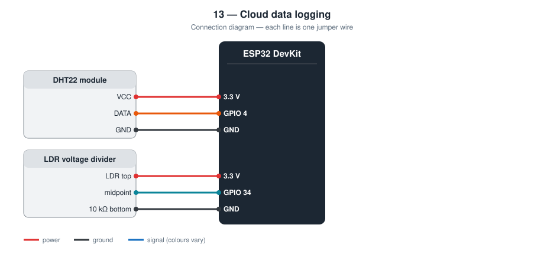
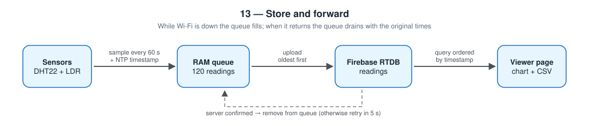

# 13 — Cloud Data Logging

An ESP32 data logger that stores temperature, humidity, and light readings
in a cloud database, with a viewer page for charts and CSV export. Readings
taken while the Wi-Fi is down are kept and uploaded later with their
original times.

**Level 2 — IoT.** Builds on project [06](../06-online-weather-station/).

TODO: Add prototype photo (`images/prototype.jpg`)

TODO: Add screenshot of the viewer (`images/viewer.png`)

## Contents

1. [At a glance](#at-a-glance)
2. [Why I built it](#why-i-built-it)
3. [Problem and context](#problem-and-context)
4. [Objectives and success criteria](#objectives-and-success-criteria)
5. [What it does](#what-it-does)
6. [Background: how it works physically](#background-how-it-works-physically)
7. [Parts](#parts)
8. [Wiring](#wiring)
9. [Build steps](#build-steps)
10. [How it works](#how-it-works)
11. [Setup](#setup)
12. [Code walkthrough](#code-walkthrough)
13. [Engineering notes](#engineering-notes)
14. [Test checklist](#test-checklist)
15. [Results](#results)
16. [Results and discussion](#results-and-discussion)
17. [Troubleshooting](#troubleshooting)
18. [Challenges log](#challenges-log)
19. [Demo script (about one minute)](#demo-script-about-one-minute)
20. [What I learned](#what-i-learned)
21. [Limitations](#limitations)
22. [Future improvements](#future-improvements)
23. [Connection to further study](#connection-to-further-study)
24. [References](#references)

## At a glance

|  |  |
| --- | --- |
| **Board** | ESP32 DevKit |
| **Inputs** | DHT22 temperature and humidity, LDR light level |
| **Output** | Time-stamped records in a cloud database; viewer page with chart and CSV |
| **Network** | Wi-Fi; Firebase Authentication and Realtime Database; NTP for time |
| **Key ideas** | Store and forward, timestamps, queues, indexed queries, data visualisation |
| **Firmware** | 201 lines of C++ in [`firmware/src/main.cpp`](firmware/src/main.cpp) |
| **Tests defined** | 7 (see [Test checklist](#test-checklist)) |
| **Hardware status** | TODO: built on (date) / tested on (date) |

## Why I built it

The weather station in project 06 forgets everything when it resets, and a
live value says nothing about yesterday. Data becomes useful when it is
kept. I also noticed that most logging tutorials silently lose every
reading taken while the network is down, and I wanted a log without holes.

## Problem and context

A live reading answers “what is it now?”. Most real questions are about
time: when does my room get hottest, how fast does humidity rise after a
shower, did the temperature in the store room ever exceed the limit last
night? Answering those needs a record.

The quality of a record depends on its gaps. Home Wi-Fi drops for minutes
at a time, and the simple logging programs in most tutorials silently
discard every reading taken during those minutes, or worse, upload them
later stamped with the wrong time. A chart with invisible holes or shifted
points can lead to wrong conclusions. This project is about producing a
log that can be trusted, and that says so when it cannot.

## Objectives and success criteria

Each objective has a test I can pass or fail, so “it works” is not an opinion.

| # | Objective | How I will know it is met |
| --- | --- | --- |
| 1 | Record regularly | Over 10 minutes, 10 records appear about 60 s apart |
| 2 | Correct times | Times in the viewer match the wall clock |
| 3 | No gaps from a short outage | After 5 minutes with the router off, all 5 readings appear with their original times |
| 4 | Never lose a reading to a failed upload | A reading is removed from the queue only after the server confirms |
| 5 | Make the data usable | The viewer draws a chart and exports a CSV that opens in a spreadsheet |
| 6 | Know what was lost | If the queue overflows, the number of dropped readings is reported |

## What it does

- One reading per minute: temperature, humidity, light level
- Each reading is time-stamped **on the ESP32** (UTC, from NTP)
- Readings wait in a 120-slot queue and are uploaded oldest first
- A reading leaves the queue only after the server confirms it
- Viewer page with login, a chart, a table, and CSV download

## Background: how it works physically

**Time series.** A sequence of (time, value) pairs is called a time
series. Two properties make one useful: a regular sampling interval and
correct timestamps.

**Sampling rate.** Room temperature changes over minutes, so one sample
per minute captures it fully. Sampling faster would only store more
copies of the same information.

**Event time and ingestion time.** *Event time* is when something was
measured. *Ingestion time* is when the database received it. They are the
same only when the network is perfect. A log should be ordered by event
time, which means the device must know the time itself.

**Clocks.** The ESP32 gets the time from an NTP server once and then
counts forward using its own crystal oscillator, which drifts by a few
seconds per day. While connected it resynchronises periodically. Times
are stored in UTC so that time zones and daylight saving cannot create
ambiguity; the viewer converts to local time for display.

**Store and forward.** Data is first stored locally, then forwarded when
a path is available, and deleted locally only after the receiver
acknowledges it. E-mail servers, space probes, and payment terminals all
work this way.

**Delivery guarantees.** Removing a record before sending gives *at most
once* delivery (it may be lost). Removing it after confirmation gives *at
least once* (it may be sent twice if the confirmation is lost, but never
lost). This project chooses the second.

**Indexes.** To return “the last 240 readings by time” quickly, the
database needs an index on the time field. Without it, the server would
have to send everything and let the browser sort.

## Parts

| Qty | Part | Notes |
| --- | ---- | ----- |
| 1 | ESP32 DevKit (30-pin) | |
| 1 | DHT22 module | |
| 1 | LDR + 10 kΩ resistor | Voltage divider |

## Wiring



| Part | ESP32 |
| ---- | ----- |
| DHT VCC / GND | 3.3 V / GND |
| DHT DATA | **GPIO 4** |
| LDR divider midpoint | **GPIO 34** |

```
3.3 V ─── LDR ───┬─── 10 kΩ ─── GND
                 └─── GPIO 34
```

## Build steps

1. Connect the DHT22 (3.3 V, GPIO 4, GND).
2. Build the LDR divider (3.3 V → LDR → GPIO 34 → 10 kΩ → GND).
3. In Firebase: enable Email/Password sign-in, add a user for the device and one for yourself.
4. Create the Realtime Database and publish `database.rules.json` (it contains the index).
5. Fill in `firmware/include/config.h` and upload.
6. Watch the Serial monitor: the first sample appears once the clock is synced.
7. Check the Firebase console: records appear under `data_logger/readings`.
8. Fill in `viewer/firebase-config.js`, serve the folder, and sign in.
9. Run the outage test: router off for 5 minutes, then on.
10. Leave it running for 24 hours and record the result.

## How it works



```
sample ─▶ [ queue in RAM ] ─▶ upload oldest ─▶ Firebase ─▶ viewer
              ▲ fills while offline, drains when back online
```

This pattern is called **store and forward**. Two details make it correct:

- **The timestamp is taken when the sample is taken**, not when it is
  uploaded. A reading from 14:05 that is uploaded at 14:40 is still stored
  as 14:05, and the viewer sorts by that time.
- **Confirm before delete.** If an upload fails, the reading stays at the
  front of the queue and is tried again.

If the outage is longer than the queue (2 hours at one reading per minute),
the oldest readings are dropped to keep the newest, and the number dropped
is printed on Serial.

Each record in `data_logger/readings`:

```json
{"ts": 1760000000, "temperature": 28.4, "humidity": 71, "light": 2130}
```

## Setup

**1. Firebase**

- Enable *Authentication → Email/Password*; add a user for you and one for the ESP32
- Create a *Realtime Database* and publish [database.rules.json](database.rules.json)
  (it includes the index on `ts` that the viewer's query needs)

**2. Firmware**

```bash
cd firmware
mkdir -p include && cp config.example.h include/config.h   # then edit
pio run --target upload
pio device monitor
```

**3. Viewer**

```bash
cd viewer
cp firebase-config.example.js firebase-config.js           # then edit
python3 -m http.server 8080
```

Open http://localhost:8080 and sign in.

## Code walkthrough

The excerpts below are copied from [`firmware/src/main.cpp`](firmware/src/main.cpp).

### `takeSample()`

A sample is taken only if the clock is valid and the sensor read
succeeded. The timestamp is captured here, at measurement time.

```cpp
static void takeSample() {
  // A reading without a real time cannot be placed on the chart, so the
  // logger waits for the first NTP sync. After that the ESP32 keeps time
  // by itself, even with the Wi-Fi down.
  if (!clockSynced()) {
    Serial.println("[sample] skipped, clock not synced yet");
    return;
  }

  const float temperature = dht.readTemperature();
  const float humidity = dht.readHumidity();
  if (isnan(temperature) || isnan(humidity)) {
    Serial.println("[sample] DHT read failed, skipped");
    return;
  }

  Reading reading;
  reading.timestamp = time(nullptr);
  reading.temperature = temperature;
  reading.humidity = humidity;
  reading.light = analogRead(PIN_LDR);
  enqueue(reading);

  Serial.printf("[sample] %.1f C, %.0f %%, light %d (%d queued)\n",
                temperature, humidity, reading.light, queueCount);
}
```

### `enqueue()`

The ring-buffer queue. When full, the head moves forward (dropping the
oldest reading) and a counter records the loss.

```cpp
static void enqueue(const Reading& reading) {
  if (queueCount >= QUEUE_SIZE) {
    // Full: give up the oldest reading to keep the newest.
    queueHead = (queueHead + 1) % QUEUE_SIZE;
    queueCount--;
    droppedCount++;
    Serial.printf("[queue] full, dropped oldest (%lu dropped in total)\n", droppedCount);
  }
  queue[(queueHead + queueCount) % QUEUE_SIZE] = reading;
  queueCount++;
}
```

### `uploadOldest()`

One upload per call. The head of the queue advances only inside the
`if` that confirms success; on failure the reading stays and the function
waits 5 s before trying again.

```cpp
static void uploadOldest(unsigned long now) {
  if (queueCount == 0 || !firebaseStarted || !Firebase.ready()) {
    return;
  }
  if (lastUploadAttemptMs != 0 && now - lastUploadAttemptMs < UPLOAD_RETRY_INTERVAL_MS) {
    return;
  }

  const Reading& reading = queue[queueHead];
  FirebaseJson json;
  json.set("ts", static_cast<int>(reading.timestamp));
  json.set("temperature", reading.temperature);
  json.set("humidity", reading.humidity);
  json.set("light", reading.light);

  if (Firebase.RTDB.pushJSON(&fbdo, PATH_READINGS, &json)) {
    // Remove from the queue only after the server confirmed the write.
    queueHead = (queueHead + 1) % QUEUE_SIZE;
    queueCount--;
    lastUploadAttemptMs = 0;
  } else {
    lastUploadAttemptMs = now;
    Serial.printf("[firebase] upload failed: %s\n", fbdo.errorReason().c_str());
  }
}
```

## Engineering notes

### Design decisions

| Decision | Alternative I considered | Why I chose this |
| -------- | ------------------------ | ---------------- |
| Queue, then upload | Upload directly from the sampling code | A failed upload would lose the reading |
| Timestamp at sampling time | Server timestamp at upload | A reading uploaded 40 minutes late must still be stored at its real time |
| Remove from the queue only after confirmation | Remove before sending | A failed request must be retried, not forgotten |
| When full, drop the oldest | Drop the newest | Recent data is usually worth more, and the count of dropped readings is reported |
| No sampling before the first clock sync | Guess the time | A reading with a wrong time damages the whole log |
| UTC in the database | Local time | No ambiguity with time zones or daylight saving; the viewer converts for display |
| Index and order by `ts` | Order by upload key | Late uploads would otherwise appear in the wrong place on the chart |

### Calculations

- **Queue.** One reading is 16 bytes (time 4, temperature 4, humidity 4,
  light 4). 120 readings use about 1.9 kB of RAM and cover a 2-hour outage
  at one reading per minute.
- **Data volume.** 1 440 readings per day. Each is roughly 70 bytes of JSON
  plus the key, so about 0.1 MB per day and about 40 MB per year: a small
  fraction of the 1 GB of storage in Firebase's free plan.
- **Viewer cost.** Loading the last 1 440 readings downloads about 0.1 MB.
- **Clock.** After the first NTP sync the ESP32 keeps time from its own
  crystal and re-syncs about once an hour while online, so time stays
  correct through an outage.
- **Year 2038.** The timestamp is stored as a 32-bit integer of seconds,
  which overflows in January 2038. Irrelevant for this prototype, but a
  real product would need 64 bits.
- **Memory (measured by the compiler).** 1 089 481 bytes of flash (83.1 %)
  and 50 144 bytes of RAM (15.3 %).

### What an outage looks like

```
time      14:00  14:01  14:02  14:03  14:04  14:05  14:06
sampled     ●      ●      ●      ●      ●      ●      ●
Wi-Fi      up     up    DOWN   DOWN   DOWN    up     up
uploaded    ●      ●                          ●●●●    ●
queue       0      0      1      2      3      0      0
```

The three readings taken during the outage are uploaded at 14:05 but
stored with their own times (14:02, 14:03, 14:04). The table illustrates
the design; my real outage test goes in the Results section.

### Failure modes I designed for

| What can go wrong | What the device does |
| ----------------- | -------------------- |
| Wi-Fi or Internet down | Readings queue and upload later, oldest first |
| Upload fails | Reading stays at the front of the queue; retry in 5 s |
| Outage longer than the queue | Oldest readings dropped, total reported on Serial |
| Sensor read fails | That sample is skipped; nothing false is stored |
| Clock not synced after power-on | No sampling until it is |
| Reset during an outage | **Not handled**: the RAM queue is lost. Listed under Limitations |

## Test checklist

| # | Test | Expected | Result |
| - | ---- | -------- | ------ |
| 1 | Power on | First reading uploaded after the clock syncs | TODO |
| 2 | Run 10 minutes | 10 records, about 60 s apart | TODO |
| 3 | Router off for 5 minutes, then on | 5 records appear with the correct **past** times, no gap in the chart | TODO |
| 4 | Viewer times | Match the wall clock in local time | TODO |
| 5 | Download CSV, open in a spreadsheet | Columns and times are correct | TODO |
| 6 | Cover the LDR | Light line drops on the next reading | TODO |
| 7 | Leave running for 24 h | Record the number of readings stored: TODO | TODO |

## Results

**Not yet filled from hardware.** After a 24-hour run I will add the chart
screenshot and note the temperature range, any gaps, and the number of
dropped readings. I will not put example numbers here.

## Results and discussion

**Not yet filled from hardware.** I complete this section only with what I observed on the real circuit.

| Item | Result |
| --- | --- |
| Date tested | TODO |
| Tests passed | TODO: __ of 7 |
| Tests failed at first, then fixed | TODO |
| Readings stored in 24 h (expected 1 440) | TODO |
| Longest gap between consecutive readings | TODO |
| Outage test: minutes offline / readings recovered / times correct? | TODO |
| Dropped-reading count at the end of the run | TODO |
| Temperature range and humidity range over 24 h | TODO |
| Time difference between the viewer and a reference clock (s) | TODO |

Questions I answer here after testing:

- What pattern does the 24-hour chart show, and what causes each feature (sunrise, cooking, air conditioning)?
- Were any readings missing, and can I explain each one (failed sensor read, reset)?
- How long an outage can my configuration survive, and what would I change for a longer one?
- Did any reading appear twice (the cost of at-least-once delivery)?

TODO: Add one photo or screenshot that shows the main result.

## Troubleshooting

Common faults for this parts list and how to find them. These are checks to run, not a record of problems I had; my own are in the next section.

| Symptom | Likely cause | What to check or change |
| --- | --- | --- |
| `[sample] skipped, clock not synced yet` forever | No Internet access, or NTP blocked on the network | Test on another network or a phone hotspot |
| `upload failed: permission denied` | Rules or device user wrong | Publish the rules; check the device credentials |
| Viewer shows “Cannot read the log… index not defined” | Rules without `.indexOn` | Publish `database.rules.json` again |
| Times are hours off | Looking at UTC in the console | The viewer converts to local time; the CSV is UTC by design |
| Chart is empty but the table has rows | Chart library blocked (no Internet / CDN) | Check the browser console; allow the CDN |
| Readings every few seconds | `SAMPLE_INTERVAL_S` changed for testing | Set it back to 60 |
| Light value stuck at 0 or 4095 | Divider wiring | GPIO 34 must be at the LDR / resistor junction |

## Challenges log

A lab-notebook record of real problems from my own build. Empty until they happen.

| Date | What I saw | What I tried | Real cause | Fix | What I learned |
| --- | --- | --- | --- | --- | --- |
| TODO |  |  |  |  |  |
| TODO |  |  |  |  |  |

## Demo script (about one minute)

1. Open the viewer and sign in: chart and table of the latest readings.
2. Cover the LDR: one minute later the light line drops.
3. Switch the router off for three minutes, then on. Reload the chart: no
   gap, and the three points sit at their real times.
4. Press *Download CSV* and open it in a spreadsheet.
5. “Most loggers I found lose data when the network drops. This one stores
   first and forwards later.”

## What I learned

- Store-and-forward, and why the timestamp belongs to the measurement
- Getting real time on a microcontroller with NTP
- Database indexes and ordered queries
- Turning stored data into a chart and an export other people can use
- A log is only trustworthy if you know what happens when things go wrong

## Limitations

- The queue is in RAM: a reset during an outage loses the waiting readings
- Nothing is logged until the clock has synced once after power-on
- The database grows forever; there is no clean-up of old data
- Light is a relative ADC value, not lux
- Depends on a third-party cloud service and its free-plan limits

## Future improvements

Keep the queue in flash so it survives a reset, and add daily min / max /
average summaries.

Further ideas, in the order I would attempt them:

| Improvement | What it needs | Difficulty |
| --- | --- | --- |
| Queue that survives a reset | Append pending readings to a file in flash (LittleFS) | Medium |
| Daily minimum / maximum / average | Computed in the viewer or by a cloud function | Medium |
| Automatic deletion of old data | Scheduled clean-up or a size cap | Medium |
| Alerts on limits | Telegram message from project 07 | Low |
| Avoid duplicates | Use the timestamp as the record key | Low |
| Battery operation | Deep sleep between samples | High |

## Connection to further study

| Idea used in this project | Where it continues at university |
| --- | --- |
| Time series and sampling | Signals and systems; data science |
| Reliable delivery over unreliable networks | Computer networks; distributed systems |
| Indexes and queries | Database systems |
| Reading and questioning a chart | Statistics; data visualisation |
| Environmental monitoring | Environmental engineering; building physics |

## References

- Firebase Realtime Database documentation — https://firebase.google.com/docs/database
- Firebase documentation: indexing data and ordering queries
- Chart.js documentation — https://www.chartjs.org/docs/
- Network Time Protocol overview; ESP32 system time (SNTP) documentation — Espressif
- Firebase Arduino Client Library for ESP8266 and ESP32 (mobizt)
- Arduino core for ESP32 documentation — https://docs.espressif.com/projects/arduino-esp32/
- PlatformIO documentation — https://docs.platformio.org/
- TODO: list the tutorials, videos, courses, and people that actually helped me with this project
