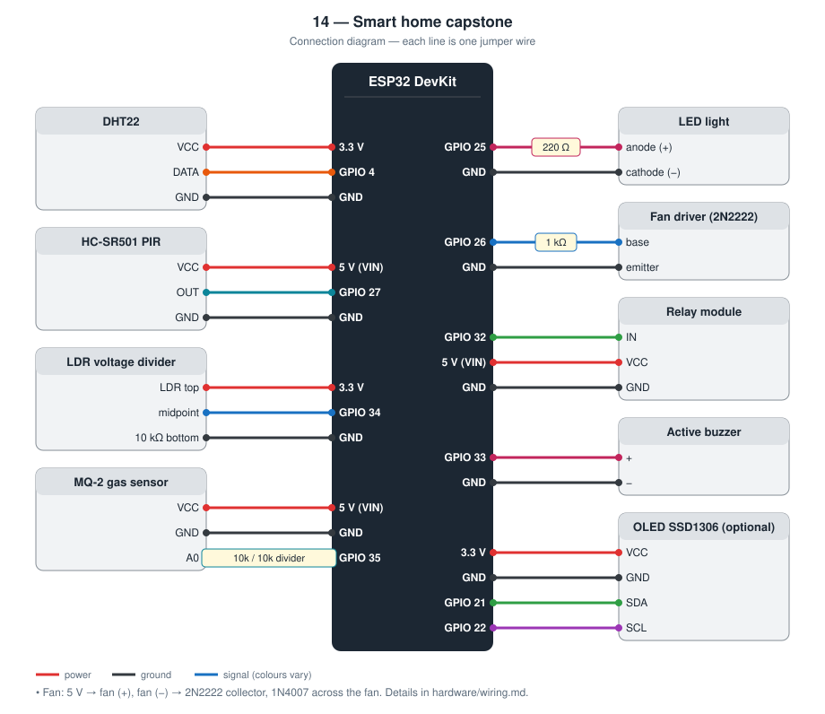
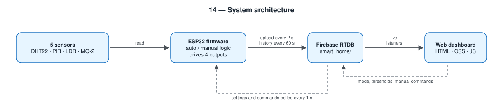

# 14 — Smart Home Capstone: IoT-Based Monitoring and Automation System

**Level 2 — IoT capstone.** This project combines what the thirteen smaller
projects in this portfolio taught me: sensing (01–05), alarms (02, 03, 07, 08),
automatic lighting (04, 05), web control (09, 12), and cloud data (13).

A student STEM project: an ESP32 prototype that monitors a model room, runs
simple automatic rules, and can be controlled from a web dashboard through
Firebase Realtime Database.

This is a **low-voltage classroom model**. It does not switch mains electricity
and it is not a commercial home-security product.

TODO: Add prototype photo (`images/prototype/prototype-front.jpg`)

TODO: Add circuit diagram (`images/circuit/circuit-diagram.jpg`)

TODO: Add dashboard screenshot (`images/dashboard/dashboard-sensors.png`)

---

## Contents

1. [At a Glance](#at-a-glance)
2. [Project Overview](#project-overview)
3. [Why I Built This Project](#why-i-built-this-project)
4. [Problem](#problem)
5. [My Goals](#my-goals)
6. [Objectives and Success Criteria](#objectives-and-success-criteria)
7. [What I Built](#what-i-built)
8. [How It Works](#how-it-works)
9. [Hardware](#hardware)
10. [Software](#software)
11. [Key Features](#key-features)
12. [Automatic Mode](#automatic-mode)
13. [Manual Mode](#manual-mode)
14. [System Architecture](#system-architecture)
15. [Code Walkthrough](#code-walkthrough)
16. [Engineering Notes](#engineering-notes)
17. [My Contribution](#my-contribution)
18. [Challenges I Faced](#challenges-i-faced)
19. [How I Solved Them](#how-i-solved-them)
20. [What I Learned](#what-i-learned)
21. [Testing](#testing)
22. [Results](#results)
23. [Limitations](#limitations)
24. [Future Improvements](#future-improvements)
25. [Academic Interests](#academic-interests)
26. [Troubleshooting](#troubleshooting)
27. [Connection to Further Study](#connection-to-further-study)
28. [References](#references)
29. [Project Structure](#project-structure)
30. [Setup](#setup)
31. [Author](#author)
32. [License](#license)

## At a Glance

|  |  |
| --- | --- |
| **Board** | ESP32 DevKit (30-pin) |
| **Inputs** | DHT22 (temperature, humidity), HC-SR501 (motion), LDR (light), MQ-2 (gas / smoke) |
| **Outputs** | LED light, DC fan, relay, buzzer, optional OLED |
| **Network** | Wi-Fi; Firebase Authentication and Realtime Database; web dashboard |
| **Key ideas** | Modular firmware, automatic rules with manual override, two-way cloud sync, working offline |
| **Firmware** | Eight modules in [`firmware/esp32/src`](firmware/esp32/src) and [`firmware/esp32/include`](firmware/esp32/include) |
| **Tests defined** | 17 (see [docs/testing.md](docs/testing.md)) |
| **Hardware status** | TODO: built on (date) / tested on (date) |

## Project Overview

The system reads five inputs (temperature, humidity, motion, light, gas/smoke)
and drives four outputs (LED lamp, DC fan, relay, buzzer). Sensor values and
device states are stored under `smart_home/` in Firebase. A static HTML
dashboard displays the live data, switches Auto/Manual mode, and — in Manual
mode — toggles the outputs.

More detail: [docs/project-overview.md](docs/project-overview.md)

## Why I Built This Project

I wanted one project that I could wire, program, and explain: electronics on
the breadboard, C++ on the microcontroller, and a small cloud path to a
browser. A “smart home” is a familiar story, so I could spend the effort on
making the loop actually close (sense → decide → act → show) instead of on
a new metaphor.

## Problem

School rooms and model houses are often demonstrated with a single sensor
and an LED. Real IoT work is messier: several sensors, conflicting commands,
a network that drops, and a UI that must not fight the firmware. I wanted
to practise that full path at a scale I can power from USB.

## My Goals

- Read DHT, PIR, LDR, and MQ-2 on an ESP32 without freezing the rest of the code
- Keep automatic rules and manual overrides on the same outputs without them
  overwriting each other incorrectly
- Move live data and commands through Firebase Realtime Database
- Build a dashboard a teacher can operate in a demo
- Document pins, credentials, and tests so the build is reproducible

## Objectives and Success Criteria

Each goal has a test in [docs/testing.md](docs/testing.md) that I can pass or fail.

| # | Objective | How I will know it is met |
| --- | --- | --- |
| 1 | Read five quantities reliably | All sensor tests pass; DHT values are never shown as NaN |
| 2 | Automatic rules act on the room | Fan follows temperature; light follows dark **and** motion; buzzer follows gas |
| 3 | Manual mode really overrides | In Manual, warming the DHT does not start the fan |
| 4 | Dashboard and device agree | A threshold changed on the page changes the device's behaviour within a few seconds |
| 5 | Keep working without the network | With the router off, automatic rules still drive the fan and light |
| 6 | Recover by itself | Uploads resume after the router returns, with no reset |
| 7 | Keep a history | A new record every minute; CSV export opens in a spreadsheet |
| 8 | No secrets in the repository | `git status` never lists `config.h` or `firebase-config.js` |

## What I Built

- Modular ESP32 firmware (sensors, devices, automation, cloud, optional OLED)
- Firebase schema, auth-based rules, and a seed tree
- A dashboard in HTML, CSS, and JavaScript (no extra JS framework)
- Hardware notes for a 5 V / 3.3 V prototype
- Portfolio documentation (architecture, testing sheet, learning journey)

I have not invented passing lab results. The test table in
[docs/testing.md](docs/testing.md) is marked **TODO** until I run it on the
desk.

## How It Works

1. The ESP32 samples sensors on a timer.
2. If `settings/mode` is `auto`, it applies threshold rules (fan, light+motion,
   gas buzzer).
3. If the mode is `manual`, it applies booleans written by the dashboard.
4. About every two seconds it uploads `sensors`, `devices`, and `system`
   (online flag + server timestamp).
5. About every minute it appends a history snapshot for later CSV export.
6. The dashboard listens to the same tree and writes `settings` (and
   `devices` in manual mode).

If Wi-Fi or Firebase is down, the firmware keeps reading sensors and can
still run automatic mode with the last settings in RAM. It retries the
network instead of rebooting in a loop.

## Hardware



Full list: [hardware/components.md](hardware/components.md)  
Wiring: [hardware/wiring.md](hardware/wiring.md)

| Role | Part |
| ---- | ---- |
| Controller | ESP32-WROOM 30-pin DevKit |
| Temperature / humidity | DHT22 (DHT11 optional) |
| Motion | HC-SR501 |
| Light | LDR + 10 kΩ divider |
| Gas / smoke | MQ-2 + 10 kΩ + 10 kΩ analog divider |
| Light output | LED + 220 Ω |
| Fan | 5 V DC fan via 2N2222 |
| Extra output | 5 V relay module (DC load only) |
| Alarm | Active buzzer |
| Optional UI | SSD1306 128×64 OLED (I2C) |

**GPIO:** DHT 4, PIR 27, LDR 34, MQ-2 35, LED 25, fan 26, relay 32, buzzer 33,
OLED SDA/SCL 21/22.

## Software

| Piece | Choice |
| ----- | ------ |
| Firmware | C++ / Arduino framework, PlatformIO (`firmware/esp32`) |
| Libraries | Adafruit DHT, Mobizt Firebase ESP client, Adafruit SSD1306 |
| Cloud | Firebase Authentication (email/password) + Realtime Database |
| Dashboard | HTML, CSS, JavaScript, Firebase compat SDK 10 |

I did not use a heavier front-end framework. The dashboard is a demo page,
not a product SPA.

## Key Features

- Live temperature, humidity, motion, light ADC, gas ADC
- Auto and Manual modes
- Thresholds stored in Firebase (`temperature_threshold`, `light_threshold`,
  `gas_threshold`, `motion_hold_ms`)
- Dashboard controls for light, fan, relay, buzzer in Manual mode
- Gas alert on the buzzer (Auto) and on the dashboard
- History log + CSV download
- Optional local OLED
- Credentials kept out of git (`config.example.h`, `firebase-config.example.js`)

## Automatic Mode

See [docs/automatic-control.md](docs/automatic-control.md).

- Temperature above threshold → fan ON
- Dark **and** recent motion → LED ON
- Gas above threshold → buzzer ON
- Relay is not driven by auto rules (spare DC output)

## Manual Mode

The dashboard sets `settings/mode` to `manual` and writes `devices/*`.
Automatic rules do not override those commands until the mode is `auto`
again.

## System Architecture



```
Sensors → ESP32 → Wi-Fi → Firebase RTDB → Dashboard
Dashboard → Firebase RTDB → ESP32 → LED / fan / relay / buzzer
```

[docs/system-architecture.md](docs/system-architecture.md)  
[docs/firebase-database.md](docs/firebase-database.md)

## Code Walkthrough

The firmware is split so that each file has one job:

| Module | Job | Knows about the network? |
| --- | --- | --- |
| `sensors` | Read DHT22, PIR, LDR, MQ-2; cache the slow DHT read | No |
| `devices` | Drive LED, fan, relay, buzzer; remember their states | No |
| `automation` | Decide outputs from sensor values and settings | No |
| `cloud` | Wi-Fi, Firebase sign-in, upload, download, history | Yes |
| `display_oled` | Optional local screen | No |
| `main` | Call the others in order, on timers | Only through `cloud` |

Only one module touches the network. That is what lets the house logic
run when the network is down, and it means a change of cloud provider
would affect one file.

### The automatic rules

Copied from [`firmware/esp32/src/automation.cpp`](firmware/esp32/src/automation.cpp):

```cpp
void automaticControl(const SensorData& sensors, const SystemSettings& settings) {
  const bool occupied =
      sensors.motion ||
      (lastMotionTimestamp() != 0 &&
       (millis() - lastMotionTimestamp()) < settings.motionHoldMs);

  const bool fanOn =
      sensors.dhtOk && sensors.temperature > settings.temperatureThreshold;

  const bool dark = sensors.light < settings.lightThreshold;
  const bool lightOn = dark && occupied;

  const bool gasAlert = sensors.gas > settings.gasThreshold;

  controlFan(fanOn);
  controlLight(lightOn);
  controlBuzzer(gasAlert);

  /*
   * Relay stays as-is in automatic mode. It is a general-purpose output
   * for a low-voltage extra load and is only driven from Manual mode.
   */
}
```

Three points in this short function:

- **Occupancy has memory.** A PIR output drops when a person stands still,
  so `occupied` stays true for `motionHoldMs` after the last movement.
- **A failed sensor cannot start the fan.** `fanOn` requires `dhtOk`, so a
  NaN temperature is never compared with the threshold.
- **The relay is deliberately left alone.** Only a person, in Manual mode,
  switches it.

### Order of work in `loop()`

1. Read all sensors.
2. Check Wi-Fi and Firebase without blocking.
3. Once per second, fetch settings (and commands, in Manual mode).
4. Apply either the automatic rules or the manual commands.
5. Refresh the OLED.
6. Every 2 s upload sensor values and device states; every 60 s append a
   history record.

Steps 1 and 4 never depend on steps 2, 3, and 6.

## Engineering Notes

### Design decisions

| Decision | Alternative I considered | Why I chose this |
| --- | --- | --- |
| Separate modules | One large `main.cpp` | Each part can be read, tested, and changed alone |
| One `settings/mode` value decides who controls the outputs | Let the dashboard and the rules both write outputs | Two writers on one output fight each other |
| Thresholds stored in the database | Constants in the firmware | Tuning during a demo needs no re-upload |
| Settings kept in RAM after download | Read from the cloud every time | Automatic mode continues with the last known settings when offline |
| E-mail / password sign-in with rules | Open database | A public database can be read and changed by anyone with the URL |
| History with `push` | Overwrite one node | Old samples are kept, each under its own key |
| OLED optional and non-fatal | Stop if the display is missing | A missing accessory must not stop the system |

### Calculations

- **MQ-2 divider.** 10 kΩ / 10 kΩ halves the sensor output: 5 V becomes
  2.5 V, below the 3.3 V pin limit.
- **Fan driver.** Base current = (3.3 V − 0.7 V) / 1 kΩ ≈ 2.6 mA. Assuming
  a gain of at least 50 when the 2N2222 is switched hard on, that supports
  a collector current of about 130 mA. A fan that draws more needs a
  smaller base resistor or a MOSFET. TODO: measure my fan's current.
- **Flyback diode.** The 1N4007 across the fan gives the motor's coil
  current a path when the transistor switches off, protecting the transistor.
- **LED.** (3.3 V − 2.0 V) / 220 Ω ≈ 5.9 mA.
- **Default thresholds.** 30 °C; light 1500 and gas 1800 on the 12-bit
  scale (0–4095). The light and gas values are placeholders until I record
  my own room's readings.
- **Traffic.** Upload every 2 s is 43 200 updates per day; history every
  60 s is 1 440 records per day; the settings poll runs once per second.
- **Motion hold.** 10 s by default, adjustable from the dashboard.

### Behaviour by mode

| | Auto mode | Manual mode |
| --- | --- | --- |
| Fan | On above the temperature threshold (if the DHT is valid) | Dashboard button |
| Light | On when dark **and** recently occupied | Dashboard button |
| Buzzer | On above the gas threshold | Dashboard button |
| Relay | Unchanged | Dashboard button |
| Dashboard buttons | Read-only | Active |
| Network lost | Rules continue with the last settings | Outputs hold the last command |

### Failure modes I designed for

| What can go wrong | What the system does |
| --- | --- |
| Wi-Fi unavailable at boot | Continues after 20 s; retries in the background |
| Firebase token not ready | Skips cloud work until it is; local logic runs |
| DHT read fails | Keeps the last value for display; does not start the fan from a bad read |
| OLED missing | Logs it and carries on |
| Dashboard misconfigured | Shows a banner that names the missing file or placeholder |
| ESP32 stops updating | Dashboard marks it offline when `last_update` is older than 20 s |
| Gas alarm in Manual mode | **Not handled**: the automatic buzzer rule is off in Manual. A safety function should not be overridable; I would change this before any real use |

## My Contribution

On this project I:

- **Designed** the GPIO map, Firebase tree, and Auto/Manual split
- **Wrote** the firmware in separate modules instead of one large `loop()`
- **Documented** breadboard wiring, including the MQ-2 divider and fan transistor
- **Integrated** Firebase Auth + RTDB on both the ESP32 and the dashboard
- **Built** the dashboard (layout, live listeners, threshold form, CSV export)
- **Prepared** a test sheet to fill during bring-up

Physical soldering/breadboard assembly, Serial debugging on the real board,
and ticking tests to PASS/FAIL happen when the kit is in front of me. I am
not listing those as finished results in this README until they are.

## Challenges I Faced

I keep a lab-style log in [docs/challenges.md](docs/challenges.md). It is a
template until I fill it with real faults (wrong DHT type, active-low relay,
Firebase token not ready, and so on). I would rather leave it empty than
invent a debugging story.

## How I Solved Them

Each challenge block has space for what I tried, what failed, and the fix.
The design already encodes a few lessons I did not want to re-learn on the
bench: ADC pins 34/35 are input-only, MQ-2 analog is divided, Wi-Fi connect
has a timeout, OLED failure is non-fatal.

## What I Learned

- Electronics: 3.3 V logic vs 5 V modules, dividers, a transistor as a switch
- Embedded systems: timers, cached DHT reads, reconnect without a watchdog reset storm
- IoT: a shared JSON tree as the contract between firmware and UI
- Process: pin headers, wiring notes, and dashboard paths must stay identical

[docs/learning-journey.md](docs/learning-journey.md)

## Testing

Procedure and empty results table: [docs/testing.md](docs/testing.md)

Until I run the suite, every status is **TODO**. That includes Wi-Fi,
Firebase, Auto/Manual, gas alert, and motion-hold tests.

## Results

**Not yet filled from hardware.** After bring-up I will record:

- Typical DHT readings in the room
- LDR ADC in light vs covered
- MQ-2 ADC after warm-up vs a safe stimulus
- Whether Auto fan/light/gas matched the rule table
- Whether Manual blocked those rules

I will not put example numbers here just to make the README look complete.

## Limitations

- LDR and MQ-2 are relative ADC values, not lux or ppm
- PIR only sees motion in a cone; an empty still person may time out
- Relay is a model output, not a household branch circuit
- Firebase free-plan history will grow if the board runs for days
- The dashboard user password lives in a local JS file; rules are classroom-grade
- No battery, no OTA, no mobile app

## Future Improvements

Listed as **future work** in [docs/future-development.md](docs/future-development.md):
mobile app, energy monitoring, scheduling, weather API, voice, machine
learning, occupancy prediction. None of those are in the current firmware.

The next realistic firmware step is fan hysteresis and a cap on history
length.

## Academic Interests

This project is the kind of work I want to continue in engineering or
computer science: measurement, embedded software, and networked systems,
kept at a scale I can test myself. Portfolio wording:
[docs/student-portfolio.md](docs/student-portfolio.md)

## Troubleshooting

Common faults for this parts list. My own are recorded in
[docs/challenges.md](docs/challenges.md).

| Symptom | Likely cause | What to check or change |
| --- | --- | --- |
| Temperature shows `—` | DHT read failing | GPIO 4, 3.3 V, pull-up, `DHT_TYPE` in `pins.h` |
| Relay is on at boot | Active-HIGH module | Set `RELAY_ACTIVE_LOW 0` in `pins.h` |
| Gas value stuck at 4095 | No divider on the MQ-2 output | Disconnect; build the 10 kΩ / 10 kΩ divider |
| Light logic is inverted | LDR and resistor swapped | Swap them (LDR to 3.3 V, 10 kΩ to GND) |
| Fan does not spin | Transistor wired wrongly, or fan powered from a GPIO | Check emitter to GND, collector to fan (−), fan (+) to 5 V |
| Serial shows the token never becomes ready | API key, URL, or user wrong | Re-copy the values; check that Email/Password sign-in is enabled |
| Dashboard says “Missing firebase-config.js” | File not created, or page opened as `file://` | Copy the example file; use `python3 -m http.server` |
| Dashboard buttons do nothing | Mode is Auto | Switch to Manual |
| “ESP32 offline or stale” | Board not uploading | Check Wi-Fi and the Serial log |
| Board resets when the fan or relay switches | 5 V pin overloaded | Separate 5 V supply for loads; common ground |

## Connection to Further Study

| Idea used in this project | Where it continues at university |
| --- | --- |
| Modular design and interfaces | Software engineering; systems engineering |
| Rule-based control with override | Control engineering; building automation |
| Two-way cloud synchronisation | Distributed systems; Internet of Things |
| Mixed 5 V / 3.3 V circuits and load drivers | Circuit analysis; power electronics |
| Authentication and database rules | Cybersecurity; database systems |
| Sensor choice and limits | Measurement and instrumentation |

## References

- Datasheets: DHT22 (AM2302), HC-SR501, MQ-2, GL5528 LDR, 2N2222, 1N4007, SSD1306
- Firebase Realtime Database documentation — https://firebase.google.com/docs/database
- Firebase Arduino Client Library for ESP8266 and ESP32 (mobizt)
- Arduino core for ESP32 documentation — https://docs.espressif.com/projects/arduino-esp32/
- PlatformIO documentation — https://docs.platformio.org/
- TODO: list the tutorials, videos, courses, and people that actually helped me with this project

## Project Structure

```
14-smart-home-capstone/
├── README.md
├── SECURITY.md
├── firmware/esp32/          PlatformIO firmware
├── dashboard/               HTML/CSS/JS UI
├── hardware/                parts + wiring
├── firebase/                rules + seed JSON
├── docs/                    architecture and portfolio notes
└── images/                  photo placeholders
```

## Setup

Do not commit secrets. Read [SECURITY.md](SECURITY.md) first.

### 1. Firmware

```bash
cp firmware/esp32/config.example.h firmware/esp32/include/config.h
```

Edit Wi-Fi and Firebase fields. Then, from `firmware/esp32/`:

```bash
pio run --target upload
pio device monitor
```

Library and Arduino IDE notes: [firmware/esp32/README.md](firmware/esp32/README.md)

### 2. Firebase

Follow [firebase/README.md](firebase/README.md): enable Email/Password, create
Realtime Database, paste [firebase/database.rules.json](firebase/database.rules.json).

### 3. Dashboard

```bash
cp dashboard/firebase-config.example.js dashboard/firebase-config.js
cd dashboard
python3 -m http.server 8080
```

Open http://localhost:8080

### 4. Hardware

Wire using [hardware/wiring.md](hardware/wiring.md). Power MQ-2 and the fan
from 5 V with common GND. Never connect 220 V to the relay.

## Author

**[Student Name]**  
High-school STEM student building this prototype as a study-abroad portfolio
project.

Replace this line with your name, school, year, and a contact email you are
willing to publish.

## License

[MIT](../LICENSE) — replace the copyright name in `LICENSE` when you publish.
