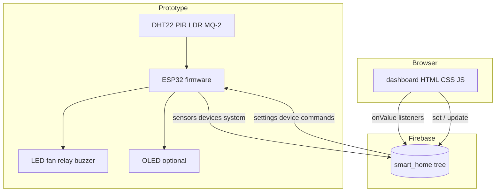

# System architecture

Two directions share one Firebase tree.

```
Sensors → ESP32 → Wi-Fi → Firebase Realtime Database → Dashboard
Dashboard → Firebase → ESP32 → LED / fan / relay / buzzer
```



## Firmware loop (simplified)

1. Read sensors (`sensors.cpp`).
2. Reconnect Wi-Fi / Firebase if needed (`cloud.cpp`).
3. Pull `settings` (and `devices` when mode is manual).
4. If mode is `auto`, run `automaticControl()`; if `manual`, run `manualControl()`.
5. Refresh OLED.
6. Every 2 s, upload sensors, device states, online flag, and timestamp.
7. Every 60 s, push a history record.

Rules live in `automation.cpp`, not in a giant `loop()`.

## Why Firebase RTDB

The assignment needs a live dashboard and two-way commands. Realtime Database
gives path-based JSON and browser listeners without writing a custom server.
The ESP32 uses email/password auth, not a database secret.

A home-grown HTTP server on the ESP32 would work on a local network only.
Firebase lets a reviewer open the dashboard on another laptop on the same
project (still a classroom setup, not a hardened public service).

## Data ownership

| Writer | Paths |
| ------ | ----- |
| ESP32 | `sensors/*`, `system/*`, `history/*`; `devices/*` in auto mode (so the UI matches hardware) |
| Dashboard | `settings/*`; `devices/*` in manual mode; `settings/mode` |

In auto mode the dashboard does not send device toggles (buttons disabled).
The ESP32 is the source of actuator state.

## Failure behaviour

| Fault | Device behaviour |
| ----- | ---------------- |
| Wi-Fi down | Sensors and auto rules keep using last settings in RAM |
| Firebase token not ready | Uploads skipped; retry on a timer; no reboot loop |
| DHT CRC fail | Last good temperature/humidity not overwritten as 0; `dhtOk` false |
| OLED missing | Firmware continues |
| ESP32 power loss | Dashboard shows stale after ~20 s because `last_update` stops moving |

## Trust boundary

Anyone with the Firebase web config **and** the user password can read and
write `smart_home`. Rules require `auth != null`. This is acceptable for a
supervised school demo, not for a real house.
