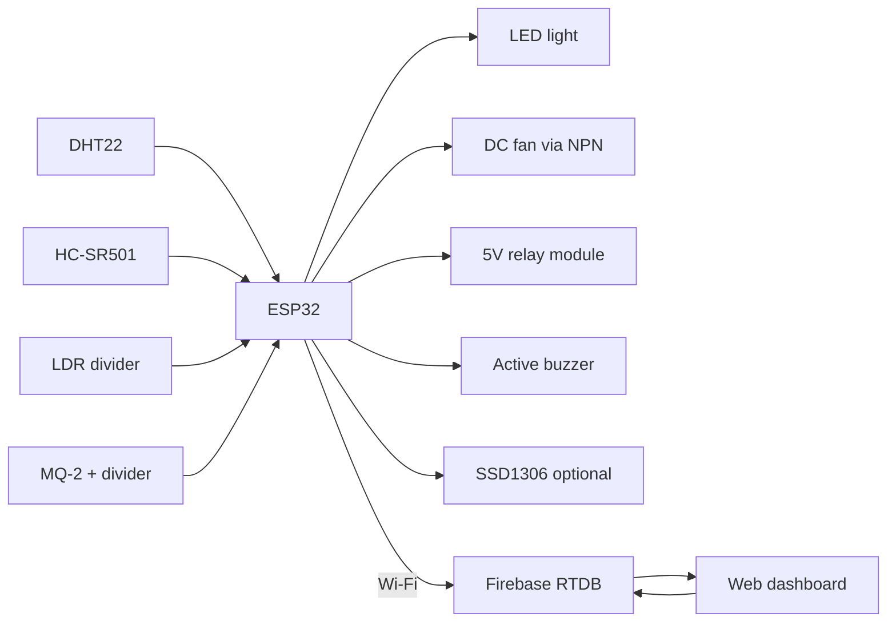

# Circuit diagram

TODO: Add circuit diagram

Add a photo or export of the real breadboard / Fritzing / KiCad drawing:

- `images/circuit/circuit-diagram.jpg` — photo of the wired prototype
- `images/circuit/schematic.png` — schematic export if you draw one

Do not paste a generated “fake photo” of hardware that was never built.

## Connection sketch (text)

This matches `wiring.md` and `firmware/esp32/include/pins.h`.

```
                    +5 V (USB adapter, common GND)
                    |
        +-----------+------------------+--------------+
        |           |                  |              |
      PIR VCC    MQ-2 VCC          Relay VCC       Fan +
        |           |                  |              |
      PIR OUT     MQ-2 A0            Relay IN       Fan −
        |           |                  |              |
      GPIO27     10k + 10k           GPIO32        2N2222
                    |                                 |
                  GPIO35                            GPIO26
                                                      |
                    3.3 V                            GND
                    |
              DHT VCC, OLED VCC, LDR
                    |
         DHT DATA -- GPIO4
         OLED SDA -- GPIO21
         OLED SCL -- GPIO22
         LDR mid  -- GPIO34
         LED      -- GPIO25 (+ 220 Ω)
         Buzzer   -- GPIO33
         GND      -- all module GND
```

## Block diagram


