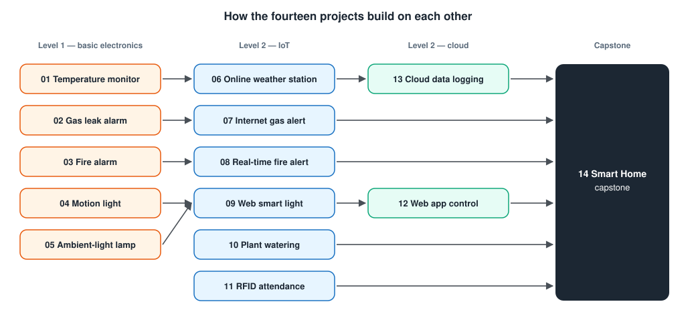

# Technical Report

A cross-project analysis of the fourteen builds in this portfolio: the
design principles they share, how the networked projects compare, what
happens to each one when something fails, and how I test them.

Numbers in this report are of three kinds, and I keep them apart:

- **Design values** are constants in my code (for example “hold time 15 s”).
- **Compiler measurements** are flash and RAM sizes reported by the build.
- **Bench measurements** are things only the real circuit can tell me
  (delays, sensor readings, run times). These are marked **TODO** until I
  have measured them.

---

## 1. Scope

| | Level 1 (01–05) | Level 2 (06–14) |
| - | --------------- | --------------- |
| Controller | Arduino Uno (ATmega328P, 8-bit, 16 MHz) | ESP32 (dual-core 32-bit, 240 MHz, Wi-Fi) |
| Logic level | 5 V | 3.3 V |
| ADC | 10-bit, 0–5 V | 12-bit, about 0–3.3 V, non-linear at the ends |
| Flash / RAM | 32 kB / 2 kB | 4 MB (1.3 MB app partition) / 320 kB |
| Connectivity | USB serial only | Wi-Fi: HTTP, HTTPS, MQTT, NTP |
| Focus | Sense and decide correctly | Communicate without depending on the network |

## 2. Seven design principles

These are the rules I ended up following in every project. Each one came
from a specific problem.

### 2.1 Never block the loop

`delay()` stops everything. From project 01 on, timing is done by comparing
`millis()` with a stored time, so the program can watch a sensor, blink an
LED, and answer a web request in the same loop. Unsigned subtraction
(`now - last >= interval`) stays correct when `millis()` overflows after
49.7 days.

*Where to see it:* [01](../01-temperature-humidity-monitor/firmware/src/main.cpp),
[04](../04-motion-activated-light/firmware/src/main.cpp), and every later project.

### 2.2 Decide on a cleaned signal, with two thresholds

A raw analog reading is noisy. I smooth it with an exponential moving
average and switch with hysteresis (one level to turn on, a different
level to turn off). Where the cause can also change quickly, I add a
minimum dwell time.

| Project | Smoothing (time constant) | Hysteresis | Extra |
| ------- | ------------------------- | ---------- | ----- |
| 02 Gas alarm | α = 0.1 at 100 ms (≈ 0.95 s) | on +150, off +100 counts | Baseline calibration |
| 05 Auto lamp | α = 0.1 at 50 ms (≈ 0.47 s) | set point ± 40 counts | 3 s dwell |
| 07 Internet gas alert | α = 0.1 at 100 ms (≈ 0.95 s) | on +400, off +250 counts (12-bit) | Baseline calibration |
| 10 Plant watering | α = 0.2 at 500 ms (≈ 2.2 s) | Pump / soak cycle instead | Daily run cap |

Time constant: τ = −Δt / ln(1 − α).

### 2.3 Make the states explicit

Whenever a device has modes (“warming up”, “alarm”, “silenced”), I write
them as an `enum` and a `switch`. The state diagram in each README is the
design; the code is a direct translation of it.

*Where to see it:* 02 (4 states), 03 (3), 04 (4), 07 (4), 10 (3).

### 2.4 Local function first, network second

From project 07 on, every `loop()` has the same order: read sensors and
drive the local outputs, *then* do network work. A buzzer, a pump, or a
light switch must not wait for Wi-Fi. Section 5 lists what each project
does with no network at all.

### 2.5 The network will fail, so plan the retry

No project waits forever for Wi-Fi. Each one connects with a 20 s timeout,
carries on, and retries in the background. What happens to *data* during an
outage depends on what the data is for:

| Kind of data | Strategy | Project |
| ------------ | -------- | ------- |
| Current state (alarm on / off) | Keep only the newest, send when possible | 07, 08 |
| Events that must all be recorded | Queue in order, remove after confirmation | 11, 13 |
| Commands | Store the *desired* state in the cloud; the device catches up | 12 |

### 2.6 Do not trust input

Values that arrive from a web page are clamped before use
(`constrain()` in 09 and 10). The cloud projects require a signed-in user
*and* database rules. The attendance script checks a shared secret and the
format of the card ID.

### 2.7 Say what is not known and what is not solved

Devices report missing data as missing (`Sensor error`, JSON `null`,
“pending”, “offline”) instead of showing an old value. Every README ends
with a *Limitations* section.

## 3. Electrical design notes

### 3.1 Working at two logic levels

| Signal | Source level | Controller | What I did |
| ------ | ------------ | ---------- | ---------- |
| MQ-2 analog out | up to 5 V | Uno (5 V) | Direct |
| MQ-2 analog out | up to 5 V | ESP32 (3.3 V) | 10 kΩ / 10 kΩ divider → 2.5 V max |
| HC-SR501 output | 3.3 V | Uno or ESP32 | Direct |
| Flame sensor analog | follows its supply | ESP32 | Power the module from 3.3 V |
| RC522 | 3.3 V only | ESP32 | 3.3 V supply, never 5 V |
| Relay input | 5 V module, active-LOW | ESP32 | Direct drive; off level written first at boot |

### 3.2 Voltage dividers

Vout = Vin × Rbottom / (Rtop + Rbottom)

- **Level shifting (07, 14):** 10 kΩ / 10 kΩ halves the MQ-2 output.
- **Resistance sensing (05, 13, 14):** the LDR is the top resistor and
  10 kΩ the bottom one, so more light gives a higher voltage. The divider
  is most sensitive when both resistances are equal, which is why 10 kΩ
  suits the LDR's value around dusk.

### 3.3 Driving loads

| Load | Current | How it is driven |
| ---- | ------- | ---------------- |
| LED | 6–14 mA | GPIO through 220 Ω |
| Active buzzer | check the part; above 20 mA use a transistor | GPIO |
| Relay coil | about 70 mA each | Relay module with its own driver |
| DC fan (capstone) | 100 mA or more | 2N2222 transistor with a 1N4007 flyback diode |
| Pump (10) | hundreds of mA, noisy | Relay or MOSFET, **separate 5 V supply**, common ground |

LED resistor: I = (Vsupply − Vforward) / R. For a red
LED: (5 − 2.0) / 220 = 13.6 mA on the Uno and (3.3 − 2.0) / 220 = 5.9 mA on
the ESP32.

### 3.4 ESP32 pin choices

| Rule | Reason | Applied in |
| ---- | ------ | ---------- |
| Analog inputs on ADC1 (GPIO 32–39) | ADC2 does not work while Wi-Fi is on | 07, 08, 10, 13, 14 |
| GPIO 34–39 for inputs only | These pins have no output driver | Sensors on 34 / 35 |
| Avoid GPIO 0, 2, 12, 15 for outputs | Boot-strapping pins | All ESP32 projects |
| SPI on 18 / 19 / 23, I2C on 21 / 22 | Default hardware buses | 11, 14 |

## 4. Communication methods compared

The Level 2 projects deliberately use different ways to move data, so that
I could compare them.

| | 06 / 09 / 10 | 07 | 08 | 11 | 12 / 13 / 14 |
| - | ------------ | -- | -- | -- | ------------ |
| Method | HTTP server on the ESP32 | HTTPS request to Telegram | MQTT through a broker | HTTPS request to Apps Script | Firebase Realtime Database |
| Who starts | Browser | Device | Device publishes, broker pushes | Device | Both sides, through the database |
| Works outside the home network | No | Yes | Yes | Yes | Yes |
| Needs Internet | No | Yes | Yes | Yes | Yes |
| Encryption | None | TLS (certificate not verified) | None on port 1883 | TLS (certificate not verified) | TLS |
| Authentication | None | Bot token | Optional broker account | Shared secret | Email / password + rules |
| Data kept | In RAM only | Chat history | Retained last value | Spreadsheet | Database |
| Best for | Local control and display | Alerts to one person | Live state for many listeners | Records people read | Remote control and history |

What I take from this table: there is no best protocol. A local web server
is the simplest and the most private but stops at the front door. A cloud
database does the most and depends the most on someone else's service.

## 5. Reliability: what happens when the network is gone

Design behaviour, read from the code. The last column is for my own test.

| Project | With no Wi-Fi the device still… | Lost while offline | Tested |
| ------- | ------------------------------- | ------------------ | ------ |
| 06 Weather station | Measures and keeps one hour of history | Page is unreachable | TODO |
| 07 Gas alert | Detects, sounds the buzzer, keeps the newest message | Older messages (by design) | TODO |
| 08 Fire alert | Detects and sounds the buzzer; re-publishes state on reconnect | Telemetry | TODO |
| 09 Smart light | Responds to the physical button and timer | Web control | TODO |
| 10 Plant watering | Runs the full automatic cycle with saved settings | Web page | TODO |
| 11 RFID attendance | Reads cards, queues 20 scans with their times | Scans beyond 20 (refused with a red LED) | TODO |
| 12 Device control | Holds the current relay states | All control (no local buttons) | TODO |
| 13 Data logging | Samples and queues 120 readings with their times | Readings beyond 120 (oldest dropped, counted) | TODO |
| 14 Smart home | Reads sensors and runs automatic rules with the last settings | Dashboard and manual commands | TODO |

Project 12 is the weakest row, and I say so in its README: a device whose
only control path is the cloud is not acceptable for anything important.
Physical buttons are its listed next step.

## 6. Firmware size

Reported by the PlatformIO build for each project (Arduino framework,
default settings).

| # | Project | Board | Flash (bytes) | Flash % | RAM (bytes) | RAM % |
| - | ------- | ----- | ------------- | ------- | ----------- | ----- |
| 01 | Temperature monitor | Uno | 7 972 | 24.7 | 615 | 30.0 |
| 02 | Gas alarm | Uno | 4 184 | 13.0 | 319 | 15.6 |
| 03 | Fire alarm | Uno | 2 976 | 9.2 | 285 | 13.9 |
| 04 | Motion light | Uno | 2 926 | 9.1 | 246 | 12.0 |
| 05 | Auto lamp | Uno | 3 580 | 11.1 | 247 | 12.1 |
| 06 | Weather station | ESP32 | 807 881 | 61.6 | 47 544 | 14.5 |
| 07 | Gas alert | ESP32 | 921 429 | 70.3 | 47 008 | 14.3 |
| 08 | Fire alert | ESP32 | 758 353 | 57.9 | 45 024 | 13.7 |
| 09 | Smart light | ESP32 | 811 885 | 61.9 | 47 192 | 14.4 |
| 10 | Plant watering | ESP32 | 816 949 | 62.3 | 47 304 | 14.4 |
| 11 | RFID attendance | ESP32 | 928 501 | 70.8 | 47 496 | 14.5 |
| 12 | Device control | ESP32 | 1 086 769 | 82.9 | 49 296 | 15.0 |
| 13 | Data logging | ESP32 | 1 089 481 | 83.1 | 50 144 | 15.3 |

Observations:

- On the Uno, the two libraries in project 01 (DHT and LCD) cost more than
  the whole of any other Level 1 program.
- On the ESP32 the smallest program is already over 750 kB, because the
  Wi-Fi stack is included. My own code is a small part of each image.
- Adding TLS (07, 11) costs roughly 110–120 kB compared with plain HTTP (06).
- The Firebase library (12, 13) brings the image to 83 % of the default
  partition. A larger project would need a different partition table.

## 7. Safety review

| Hazard | Where | Control |
| ------ | ----- | ------- |
| Mains electricity | Nowhere | No project uses it; relays switch low-voltage DC only |
| Over-voltage on an ESP32 pin | 07, 14 | Voltage divider; flame sensor powered from 3.3 V |
| Flooding | 10 | 30 s cap per run, 6 runs per day, pump off at boot |
| Electronics near water | 10 | Board placed above the container; separate pump supply |
| Open flame and gas during tests | 02, 03, 07, 08 | Brief tests, ventilated room, non-flammable surface, an adult present |
| Hot sensor | 02, 07, 14 | The MQ-2 heater dissipates about 0.75 W; not touched during use |
| False sense of security | 02, 03, 07, 08, 14 | Stated in every README: these are not certified alarms |
| Leaked credentials | 06–14 | Secrets in gitignored files; see [SECURITY.md](../SECURITY.md) |
| Personal data | 11 | Invented names only in the repository and screenshots |

## 8. Test method

### 8.1 Bring-up order (the same for every project)

1. Check supply voltages with a multimeter before connecting any signal pin.
2. Flash the firmware and read the Serial log.
3. Test each sensor alone and note its raw values.
4. Test each output alone.
5. Test the logic (thresholds, states).
6. Only then enable the network.
7. Run the project's checklist and record every result, including failures.

### 8.2 How I measure delays

For “how long from A to B” (alarm to phone, click to relay), I film both
in one shot with a phone at 30 or 60 frames per second and count frames
between the two events. I repeat each measurement at least five times and
report the minimum, median, and maximum, not one best number.

### 8.3 Results log

| Measurement | Project | Min | Median | Max | Runs | Date |
| ----------- | ------- | --- | ------ | --- | ---- | ---- |
| Buzzer → Telegram notification | 07 | TODO | TODO | TODO | TODO | TODO |
| Flame → monitor page turns red | 08 | TODO | TODO | TODO | TODO | TODO |
| Power loss → `offline` shown | 08 | TODO | TODO | TODO | TODO | TODO |
| Button press → page updates | 09 | TODO | TODO | TODO | TODO | TODO |
| Card tap → row in sheet | 11 | TODO | TODO | TODO | TODO | TODO |
| Web click → relay switches | 12 | TODO | TODO | TODO | TODO | TODO |
| Pump flow (mL per second) | 10 | TODO | TODO | TODO | TODO | TODO |
| Readings stored in 24 h (expected 1 440) | 13 | TODO | — | — | 1 | TODO |

### 8.4 Sensor calibration log

| Sensor | Condition | Raw value | Project | Date |
| ------ | --------- | --------- | ------- | ---- |
| MQ-2 (Uno) | Clean-air baseline after warm-up | TODO | 02 | TODO |
| MQ-2 (ESP32, through divider) | Clean-air baseline after warm-up | TODO | 07 | TODO |
| Flame sensor | No flame / flame at 30 cm | TODO / TODO | 03, 08 | TODO |
| LDR | Room light on / off / covered | TODO / TODO / TODO | 05, 13 | TODO |
| Soil sensor | In air / in water | TODO / TODO | 10 | TODO |

## 9. Known weaknesses and what I would do about them

| Weakness | Affects | What a better version needs |
| -------- | ------- | --------------------------- |
| TLS certificates are not verified | 07, 11 | Store the root certificate and check it |
| MQTT without encryption or accounts | 08 | Private broker with TLS and users |
| Queues live in RAM | 11, 13 | Write the queue to flash so it survives a reset |
| Cloud-only control | 12 | Local buttons that also write the desired state |
| No battery backup | all alarms | Battery and a low-power design |
| Relative sensor values, not units | 02, 05, 07, 10, 13 | Calibration against a reference instrument |
| One shared account per project | 12, 13, 14 | Per-user rules and roles |
| Everything on a breadboard | all | Soldered board or PCB, and an enclosure |

## 10. Glossary

| Term | Meaning in this portfolio |
| ---- | ------------------------- |
| ADC | Analog-to-digital converter: turns a voltage into a number |
| Baseline | A sensor's reading in normal conditions, measured at start-up |
| Debounce | Ignoring the rapid on / off noise of a mechanical button |
| Dwell time | Minimum time an output must stay in one state |
| Hysteresis | Using different thresholds for switching on and off |
| Last will | An MQTT message the broker sends if a device disappears |
| NTP | Network Time Protocol: how the ESP32 learns the real time |
| PWM | Pulse-width modulation: fast switching that acts like a variable voltage |
| Retained message | An MQTT message the broker stores and gives to new subscribers |
| Ring buffer | A fixed-size list where new items overwrite the oldest |
| State machine | A program organised as named states and the events that move between them |
| Store and forward | Keeping data locally until it can be delivered |
